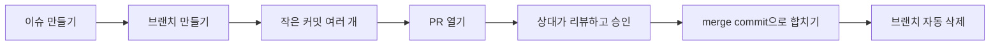

# 함께 작업하는 규칙

이 저장소는 2명이 함께 씁니다. 커밋 내용, 기간 전체에 걸친 커밋 분포, 이슈와 PR 기록이 개인 평가에 들어가므로 아래 순서를 지킵니다.

## 1. 작업 순서



1) 할 일은 먼저 이슈로 만들고, 라벨과 주차 마일스톤을 붙입니다.
2) 이슈 번호를 넣어 브랜치를 만듭니다.
3) 작업을 작게 나눠 자주 커밋합니다. 며칠 치를 한 번에 몰아서 커밋하지 않습니다.
4) PR 설명에 `Closes #이슈번호`를 적습니다. 합치면 이슈가 자동으로 닫힙니다.
5) 상대 팀원이 리뷰하고 승인한 뒤 합칩니다.

```bash
git switch main
git pull
git switch -c feat/12-term-card      # 이슈 12번 작업
# 작업하고 커밋
git push -u origin feat/12-term-card
# 깃허브에서 PR 열기
```

## 2. 브랜치

### 가. 구조

1) `main`은 언제 받아도 실행되는 상태로 둡니다. 직접 push하지 않고 PR로만 합칩니다.
2) 작업 브랜치는 1~3일 쓰고 합친 뒤 지웁니다. `develop`처럼 오래 가는 브랜치는 두지 않습니다.
3) 깃허브 기여 그래프는 `main`에 들어간 커밋만 셉니다. 오래 묵힌 브랜치의 커밋은 합치기 전까지 기여로 보이지 않습니다.

### 나. 이름

`종류/이슈번호-설명` 형식으로 짓습니다. 설명은 영어 소문자와 `-`로 씁니다.

| 종류 | 쓰는 때 | 예 |
|---|---|---|
| `feat` | 새 기능 | `feat/12-term-card` |
| `fix` | 버그 수정 | `fix/15-search-empty` |
| `docs` | 문서, README, 발표 자료 | `docs/1-ideation` |
| `test` | 테스트, 측정 | `test/20-speed-check` |
| `chore` | 설정, 패키지, 폴더 정리 | `chore/8-lint-setup` |

## 3. 커밋 메시지

`종류: 무엇을 했는지 (#이슈번호)` 형식으로 씁니다.

```
feat: 용어 카드에 예시 그림 넣기 (#12)
fix: 검색어가 비었을 때 오류 나는 문제 (#15)
```

1) 한 커밋에는 한 가지 일만 담습니다.
2) AI가 만든 코드가 틀려서 고친 커밋이면 본문에 무엇이 틀렸고 어떻게 알아챘는지 한두 줄 적습니다. 발표의 "AI가 틀렸을 때" 자료가 됩니다.

## 4. PR과 리뷰

1) PR은 작게 엽니다. 리뷰하는 사람이 10분 안에 읽을 수 있는 크기가 좋습니다.
2) 리뷰하는 사람은 브랜치를 직접 받아 실행해 보고, 궁금한 점은 줄마다 코멘트로 남깁니다.
3) 합치는 방법은 **Create a merge commit** 하나만 켜 두었습니다. squash로 합치면 커밋 여러 개가 하나로 뭉쳐서 각자의 커밋 기록이 줄어들기 때문입니다.
4) 합친 브랜치는 깃허브가 자동으로 지웁니다.

## 5. 라벨

| 라벨 | 뜻 |
|---|---|
| `feat` | 새 기능 |
| `fix` | 버그 수정 |
| `docs` | 문서 |
| `test` | 테스트와 측정 |
| `ai-mistake` | AI가 틀린 코드나 판단을 사람이 바로잡은 기록 |

`ai-mistake`는 다른 라벨과 함께 붙여도 됩니다. 발표 준비 때 이 라벨만 모아 보면 "AI가 틀렸을 때 바로잡은 과정"이 정리됩니다.

## 6. 일정

| 마일스톤 | 기간 | 목표 |
|---|---|---|
| 1주차: 주제 확정과 설계 | 11/19~11/25 | 주제 확정, 기능 목록, 역할 분담, 사전 시험 |
| 2주차: 핵심 기능 | 11/26~12/2 | 핵심 기능 하나가 처음부터 끝까지 동작 |
| 3주차: 확장과 테스트 | 12/3~12/9 | 기능 확장, 테스트 작성 |
| 4주차: 측정과 다듬기 | 12/10~12/16 | 효과 측정, 화면 다듬기, README 실행 방법 |
| 마감 주: 버그만 고침 | 12/17~12/20 | 새 기능 없이 버그만 고침 |

1) 기능 코드는 **12월 20일 23시 59분**까지만 커밋합니다. 마감 직전에 `v1.0` 태그를 붙입니다.
2) 12월 21일부터는 README와 발표 자료만 고칩니다. 이때도 `docs/` 브랜치와 PR로 합칩니다.
3) 발표는 12월 23일입니다.

## 7. 처음 한 번 확인할 것

커밋에 적히는 이메일이 깃허브 계정에 등록된 이메일과 같아야 커밋이 내 기여로 잡힙니다.

```bash
git config user.name     # 깃허브 아이디
git config user.email    # 깃허브에 등록한 이메일인지 확인
```

1) 다르다면 `git config user.email "깃허브에 등록한 이메일"`로 바꿉니다.
2) 이메일을 공개하고 싶지 않다면 깃허브 Settings > Emails에 나오는 `noreply` 주소를 씁니다.
