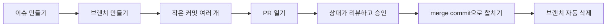

# 함께 작업하는 규칙

이 저장소는 2명이 함께 씁니다. 개인 평가는 커밋된 내용, 기간 전체에 걸친 작업 분포, 이슈와 PR 기록을 봅니다. 그래서 아래 순서를 지킵니다.

## 1. 작업 순서



1) 할 일은 먼저 이슈로 만듭니다. 라벨, 주차 마일스톤, 담당자를 붙이고, 본문에 목적과 완료 조건을 적습니다.
2) 이슈 번호를 넣어 브랜치를 만듭니다. 오타나 한 줄 수정은 이슈 없이 PR만 열어도 됩니다.
3) 작업한 날 커밋하고 push합니다. 며칠 치를 한 번에 몰아서 올리지 않습니다.
4) PR 설명에 이슈를 연결합니다. 이슈를 끝내는 PR에는 `Closes #이슈번호`를 적습니다. 큰 기능을 나눈 중간 PR에는 `Refs #이슈번호`를 적습니다. `Closes`는 main을 향한 PR이 합쳐질 때 이슈를 자동으로 닫습니다.
5) 상대 팀원이 리뷰하고 승인한 뒤 합칩니다.

```bash
git switch main
git pull
git switch -c feat/12-term-card      # 이슈 12번 작업
# 작업하고 커밋
git push -u origin feat/12-term-card
# 깃허브에서 PR 열기
```

## 2. 브랜치

### 가. 구조

1) 계속 두는 브랜치는 `main` 하나입니다. 언제 받아도 실행되는 상태로 둡니다. 직접 push하지 않고 PR로만 합칩니다.
2) 작업 브랜치는 1~3일 쓰고 합친 뒤 지웁니다. 오래 묵히면 충돌이 커지고, 마감 전에 못 합칠 위험이 생깁니다.
3) 깃허브 기여 그래프는 기본 브랜치(이 저장소는 `main`)에 들어간 커밋을 셉니다. 합치지 않은 브랜치의 커밋은 기여로 보이지 않습니다. 이슈 열기, PR 열기, PR 리뷰도 기여로 잡힙니다.

### 나. 이름

`종류/이슈번호-설명` 형식으로 짓습니다. 설명은 영어 소문자와 `-`로 씁니다.

| 종류 | 쓰는 때 | 예 |
|---|---|---|
| `feat` | 새 기능 | `feat/12-term-card` |
| `fix` | 버그 수정 | `fix/15-search-empty` |
| `docs` | 문서, README, 발표 자료 | `docs/1-ideation` |
| `test` | 테스트, 측정 | `test/20-speed-check` |
| `spike` | 주제나 기술을 짧게 시험해 보기 | `spike/9-term-prompt-test` |
| `chore` | 설정, 패키지, 폴더 정리 | `chore/7-pr-template` |

### 다. 사전 시험 (`spike/`)

1) 코드는 `experiments/<시험 이름>/` 폴더 안에만 둡니다.
2) 결과는 버린 시험이라도 `docs/ideation/06_pretest.md`에 적어 main에 합칩니다.
3) 코드는 세 가지를 지키면 함께 합칩니다. `experiments/` 밖의 파일을 건드리지 않을 것, 키나 비밀번호가 없을 것, 큰 파일이 없을 것. 지키기 어려우면 PR을 닫고 결과 문서에서 링크합니다.

## 3. 커밋

### 가. 메시지

`종류: 무엇을 했는지 (#이슈번호)` 형식으로 씁니다. 한 커밋에는 한 가지 일만 담습니다.

```
feat: 용어 카드에 예시 그림 넣기 (#12)
fix: 검색어가 비었을 때 오류 나는 문제 (#15)
```

### 나. 작성자와 AI 표시

1) 커밋 작성자는 깃허브 계정에 연결된 사람입니다. AI 도구가 자기 이름으로 커밋하게 두지 않습니다.
2) AI(Claude 등)와 함께 만든 커밋은 끝에 `Co-Authored-By:` 줄로 표시합니다.
3) AI가 만든 코드나 판단이 틀려서 고쳤다면, 커밋 본문에 무엇이 틀렸고 어떻게 알아챘는지 한두 줄 적고 관련 이슈에 `ai-mistake` 라벨을 붙입니다.
4) 커밋 날짜를 고쳐 쓰지 않습니다.

### 다. 올리면 안 되는 것

API 키와 비밀번호는 `.env` 파일에 두고 커밋하지 않습니다(`.gitignore`에 들어 있음). 필요한 값의 이름만 `.env.example`에 적어 올립니다.

## 4. PR과 리뷰

1) PR은 작게 엽니다. 리뷰하는 사람이 10분 안에 읽을 수 있는 크기가 좋습니다. PR 양식의 칸을 채웁니다.
2) 리뷰는 PR 종류에 맞게 봅니다.
   - 문서 PR: 사실이 맞는지, 링크가 살아 있는지, 공개해도 되는 내용인지
   - 기능 PR: 브랜치를 받아 직접 실행하고 결과를 확인
3) 승인 버튼만 누르지 않습니다. 확인한 내용이나 궁금한 점을 줄 코멘트로 남깁니다. 리뷰와 결정 댓글은 사람이 직접 씁니다.
4) 리뷰 요청을 받으면 24시간 안에 답합니다. 24시간 동안 답이 없을 때만 저장소 주인이 승인 없이 합칠 수 있고, 그때는 PR에 이유를 한 줄 남깁니다. AI 도구(Claude Code 등)는 PR을 합치지 않습니다.
5) 합치는 방법은 **Create a merge commit** 하나만 켜 두었습니다. 각 커밋의 작성자와 날짜, 리뷰 이력을 main에 그대로 남기기 위해서입니다. squash로 합치면 여러 날 한 작업이 합친 날의 커밋 하나로 바뀝니다. merge commit 자체는 Contributors 그래프에서 세지 않으므로, 합치기 버튼을 누른다고 기여가 늘지는 않습니다.
6) 합친 브랜치는 깃허브가 자동으로 지웁니다.

## 5. 라벨

| 라벨 | 뜻 |
|---|---|
| `feat` | 새 기능 |
| `fix` | 버그 수정 |
| `docs` | 문서 |
| `test` | 테스트와 측정 |
| `ai-mistake` | AI가 틀린 코드나 판단을 사람이 바로잡은 기록 |

`ai-mistake`는 다른 라벨과 함께 붙여도 됩니다. 발표 준비 때 이 라벨만 모아 보면 "AI가 틀렸을 때 바로잡은 과정"이 정리됩니다.

## 6. 일정

| 마일스톤 | 기간 | 목표 |
|---|---|---|
| 1주차: 주제 확정과 설계 | 11/19~11/25 | 주제 확정, 기능 목록, 역할 분담, 사전 시험 |
| 2주차: 핵심 기능 | 11/26~12/2 | 핵심 기능 하나가 처음부터 끝까지 동작 |
| 3주차: 확장과 테스트 | 12/3~12/9 | 기능 확장, 테스트 작성 |
| 4주차: 측정과 다듬기 | 12/10~12/16 | 효과 측정, 화면 다듬기, README 실행 방법 |
| 마감 주: 버그만 고침 | 12/17~12/20 | 새 기능 없이 버그만 고침 |

1) 공식 마감은 **12월 20일 23시 59분(한국 시각)까지 main에 합치기 완료**입니다. 23시 50분에 커밋해도 0시 10분에 합치면 12월 21일 기록이 남습니다.
2) 내부 마감

   | 무엇 | 언제까지 |
   |---|---|
   | 기능 PR 합치기 | 12/16(수) |
   | 12/17부터 | 새 기능 PR은 받지 않고 `fix`, `test`, `docs`만 |
   | 버그 수정 PR 합치기 | 12/20(일) 22:00 |
   | `v1.0` 태그 | 12/20(일) 23:00 |

3) 12월 21일부터는 공지대로 README와 깃허브에 올린 발표 자료만 고칩니다. 서비스가 읽어 쓰는 데이터 파일은 문서 형식이어도 고치지 않습니다.
4) 발표는 12월 23일입니다.

## 7. 처음 한 번 확인할 것

깃허브는 커밋 안에 적힌 이메일 주소로 커밋을 계정에 연결합니다. 로그인한 계정이나 이름이 아닙니다. 그 주소가 계정에 등록되어 있지 않으면 커밋이 내 기여로 잡히지 않습니다.

1) 깃허브 Settings > Emails에 있는 주소 하나를 git에 설정합니다. 이메일을 공개하고 싶지 않으면 같은 화면에 나오는 `noreply` 주소를 씁니다.

   ```bash
   git config --global user.email "Settings > Emails에 있는 주소"
   ```

2) 첫 커밋을 push한 뒤, 깃허브 커밋 목록에서 작성자 자리에 내 프로필 사진과 아이디가 보이는지 확인합니다. 사진 없이 이름만 보이면 연결되지 않은 것입니다. `git config`에 나오는 값만으로는 알 수 없습니다.
3) push가 `GH007` 오류로 거부되면 계정의 이메일 비공개 설정 때문입니다. 1)의 `noreply` 주소로 바꾼 뒤 `git commit --amend --reset-author --no-edit`로 마지막 커밋의 주소를 고치고 다시 push합니다.

## 8. 막혔을 때

1) main에 push가 거부되면 정상입니다. main은 보호되어 있으니 브랜치를 만들어 PR로 올립니다.
2) 충돌이 나서 혼자 풀기 어려우면 PR에 댓글로 알리고 같이 풉니다.
3) 규칙이 지키기 어려우면 이 문서를 고치는 PR을 엽니다.
