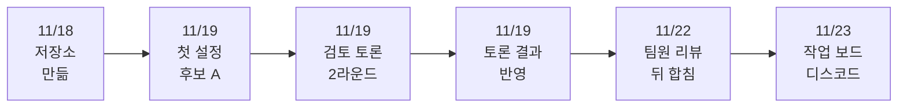

# 깃 설계

이 저장소의 깃 설정과 규칙을 무엇을 왜 그렇게 정했는지 적습니다. 지켜야 할 규칙 자체는 [CONTRIBUTING.md](../../CONTRIBUTING.md)에 있습니다.

## 1. 정한 순서

1. 11/18: lumos0107이 저장소를 만들었습니다.
2. 11/19: 라벨, 마일스톤, main 보호, 합치기 방식을 설정하고 PR #3, #4를 열었습니다. 같은 날 이 설정을 AI 검토자 4명에게 2라운드로 검토받았습니다(4장).
3. 11/19: 토론 결과를 CONTRIBUTING.md(PR #4)와 PR 양식, `.gitignore`(PR #8)에 반영했습니다.
4. 11/22: lgosoup이 #3, #4, #8을 리뷰했습니다. #8에는 키 파일 패턴을 더해 달라는 요청이 있어 반영한 뒤 합쳤습니다.
5. 11/23: 수업 안내에 따라 작업 보드와 디스코드를 더했습니다([02_discord.md](02_discord.md), [03_project_board.md](03_project_board.md)).

## 2. 기준

공지의 개인 평가는 깃허브에서 세 가지를 봅니다.

1. 커밋된 내용
2. 작업이 기간 전체에 고르게 나뉘었는지
3. 이슈와 PR 기록

그래서 "이 세 가지가 깃허브에 있는 그대로 남는가"를 기준으로 정했습니다. 2명이 다른 과목도 함께 듣기 때문에 관리할 것이 많으면 지켜지지 않는다는 점도 함께 봤습니다.

## 3. 정한 것과 이유

### 가. 브랜치: main 하나와 짧은 작업 브랜치

1) 후보 세 가지를 놓고 검토했습니다.
   - 후보 A(고름): GitHub Flow. 계속 두는 브랜치는 main 하나이고, 작업 브랜치는 1~3일 쓰고 합칩니다.
   - 후보 B: 원래 Git Flow(Vincent Driessen, 2010). main과 develop을 계속 두고, feature, release, hotfix 브랜치를 씁니다.
   - 후보 C: Claude가 낸 "줄인 Git Flow". develop을 기본 브랜치로 두고, 주마다 develop에서 main으로 PR을 열어 판 번호 태그를 붙입니다.
2) A를 고른 이유
   - 채점은 기본 브랜치의 커밋 내용과 날짜, 이슈와 PR 기록을 봅니다. 브랜치 모델로 더 얻는 점수가 없습니다.
   - C의 주간 develop → main PR은 merge commit만 늘립니다. merge commit은 Contributors 그래프에서 세지 않으므로 기여로 보이지 않고, 승인 대기와 실수만 늘어납니다.
3) C에서 가져온 것
   - `spike/` 브랜치 종류: 주제나 기술을 짧게 시험해 봅니다. 코드는 `experiments/` 안에만 둡니다.
   - 12/17부터 새 기능 PR을 받지 않는 규칙
   - 마지막 `v1.0` 태그
4) C를 낸 것은 Claude였고, 검토자 4명이 모두 A를 권해 C는 적용하지 않았습니다.

### 나. main 보호

1) main에는 직접 push할 수 없고 PR로만 합칩니다. 합치려면 승인 1명이 필요합니다. force push와 브랜치 삭제는 막았습니다.
2) 관리자도 이 규칙을 똑같이 지키게 강제하는 설정(`enforce_admins`)은 꺼 두었습니다.
   - 2명이라 한 사람이 답이 없으면 마감 전에 막힐 수 있어서입니다.
   - 대신 "리뷰 요청 뒤 24시간 동안 답이 없을 때만 저장소 주인이 승인 없이 합치고, PR에 이유를 한 줄 남긴다"는 규칙을 두었습니다.
   - 11/23까지 이 예외로 합친 PR은 없습니다. 합친 PR 5개(#3, #4, #8, #14, #17)는 모두 상대 팀원이 승인했습니다.
3) AI 도구는 PR을 합치지 않습니다. 합치기 버튼은 사람이 누릅니다.

### 다. 합치기: merge commit만 허용

1) squash와 rebase 합치기는 껐습니다.
2) 이유는 각 커밋의 작성자와 날짜, 리뷰 이력을 main에 그대로 남기기 위해서입니다. squash로 합치면 여러 날 한 작업이 합친 날의 커밋 하나로 바뀝니다.
3) 처음에는 이유를 "커밋 수를 남기려고"로 적었다가, 토론에서 merge commit은 그래프에서 세지 않는다는 지적을 받고 고쳤습니다.
4) 실제로 11/19~21에 쓴 커밋은 11/22에 합쳤지만, 커밋 날짜는 작업한 날로 남아 있습니다.

### 라. 합친 브랜치 자동 삭제

1) 작업 브랜치는 1~3일 쓰는 것이라 합치면 깃허브가 바로 지웁니다.
2) 브랜치가 지워져도 커밋은 main에, 리뷰와 합친 기록은 PR에 남습니다. 필요하면 PR 화면의 Restore branch로 되살릴 수 있습니다.

### 마. 마감 기준

1) 공식 마감은 "12/20 23:59(한국 시각)까지 main에 합치기 완료"로 정했습니다. 23:50에 커밋해도 0:10에 합치면 12/21 기록이 남기 때문입니다.
2) 그래서 내부 마감을 앞당겼습니다. 기능 PR은 12/16까지 합치고, 12/17부터는 버그 수정과 테스트, 문서만 받습니다. 시각까지 적은 표는 CONTRIBUTING.md 6장에 있습니다.

### 바. 라벨과 마일스톤

1) 라벨 5개를 더했습니다: `feat`, `fix`, `docs`, `test`, `ai-mistake`. 뜻이 겹치는 기본 라벨 `bug`, `documentation`, `enhancement`는 지웠습니다.
2) `ai-mistake`는 AI가 틀린 코드나 판단을 사람이 바로잡은 기록입니다. 채점 항목 "도전과 해결"에 AI가 틀렸을 때 바로잡은 과정이 들어 있어서, 발표 준비 때 이 라벨만 모아 보려고 만들었습니다.
3) 마일스톤은 주차별 5개입니다. 1주차(~11/25) 주제 확정과 설계, 2주차(~12/2) 핵심 기능, 3주차(~12/9) 확장과 테스트, 4주차(~12/16) 측정과 다듬기, 마감 주(~12/20) 버그만 고침입니다.

### 사. 커밋 작성자와 AI 표시

1) 커밋 작성자는 깃허브 계정에 연결된 사람입니다. AI(Claude 등)와 함께 만든 커밋은 끝에 `Co-Authored-By:` 줄로 표시합니다.
2) 리뷰와 결정 댓글은 사람이 직접 씁니다.
3) 커밋 메시지는 `종류: 무엇을 했는지 (#이슈번호)` 형식입니다.

### 아. PR 양식과 .gitignore

1) PR 양식의 칸은 관련 이슈, 무엇을 했나, 어떻게 확인했나, AI를 어떻게 썼나, 리뷰할 때 봐 줄 것입니다. "AI를 어떻게 썼나"에는 AI가 틀린 곳과 바로잡은 방법을 적습니다.
2) `.gitignore`에는 `.env`, 키 파일, 개인 설정, 운영체제가 만드는 파일, 빌드 결과를 넣었습니다. 키 파일 패턴(`credentials*.json`, `token*.json`, `*.pem`)은 11/22 lgosoup의 리뷰로 더했습니다.

## 4. 11/19 검토 토론

### 가. 진행 방식

1) 검토자는 4명입니다.
   - Claude 에이전트 3명: 수업 담당 교수, 현업 엔지니어, 깃에 익숙하지 않은 팀원 역할을 맡겼습니다. "팀원"은 역할 이름이고 실제 팀원이 아닙니다.
   - GPT(Codex CLI): 도구 없이 첨부 자료만 보고 답했습니다.
2) 자료는 공지 원문, CONTRIBUTING.md 초안, 주제 도출 문서, 저장소 상태, 브랜치 후보 A, B, C였습니다.
3) 1라운드에서 각자 따로 평가하고, 2라운드에서 다른 셋의 1라운드를 읽고 동의, 반박, 수정했습니다.
4) 원문은 [git_review/](git_review/)에 있습니다. 개인 정보는 가렸습니다.

### 나. 넷이 합의한 것

1) 후보 A를 유지하고 C에서 `spike/`, 기능 동결, `v1.0` 태그만 가져옵니다.
2) squash를 끈 이유를 "커밋 수"가 아니라 "작성자, 날짜, 리뷰 이력 보존"으로 적습니다.
3) 마감 기준을 "main에 합치기 완료"로 적습니다.
4) 마감 뒤 고칠 수 있는 것은 공지대로 README와 깃허브에 올린 발표 자료뿐입니다.
5) 11/17~19 작업을 11/19에 한꺼번에 올린 PR #3은 쪼개지 않고, 본문에 그 사실을 적고 리뷰 범위를 좁힙니다. 커밋 날짜는 고치지 않습니다.
6) 커밋 작성자는 사람이고 Claude는 `Co-Authored-By` 줄에만 둡니다.
7) 1주차에 PR 양식, `.gitignore`, 겹치는 기본 라벨 정리를 넣습니다. 자동 테스트(Actions)는 첫 테스트가 생길 때 넣습니다.
8) 깃 구성보다 주제 결정이 급합니다.

### 다. 의견이 갈린 것과 정리

1) 커밋 이메일 고치는 방법
   - 의견: 셋은 noreply 주소로 커밋을 다시 쓰자고 했고, 엔지니어 역할은 지금 주소를 계정에 추가하자고 했습니다.
   - 실제로 한 것: 계정에 등록된 주소로 PC 설정을 바꾸고, 아직 합치기 전이던 커밋 7개의 작성자 주소만 고쳐 다시 올렸습니다. 내용과 날짜는 그대로입니다([이슈 #6](https://github.com/lumos0107/AI_Final_Project/issues/6)).
2) 버린 사전 시험 코드
   - 의견: 합친다, 조건이 맞으면 합친다, 결과 문서만 합친다로 갈렸습니다.
   - 정리: 결과 문서는 반드시 합칩니다. 코드는 `experiments/` 안에 있고, 키나 큰 파일이 없으면 합칩니다.
3) 관리자 예외
   - 의견: 팀원이 들어오면 켠다, 켜지 않고 규칙으로 정한다로 갈렸습니다.
   - 정리: 꺼 둔 채 3장 나. 2)의 24시간 규칙을 둡니다.
4) 내부 마감 시각
   - 의견: 기능 PR을 12/16에 합친다, 12/20 18:00에 합친다로 갈렸습니다.
   - 정리: 넷 다 "12/17부터 새 기능 안 받음"에 동의했으므로 기능 PR은 12/16에 합칩니다. 버그 PR은 12/20 22:00, `v1.0`은 23:00입니다.
5) 이슈 양식
   - 의견: 팀원 역할만 양식 1개를 권했습니다.
   - 정리: 양식 없이 이슈 본문에 목적, 완료 조건, 담당자를 적습니다.

### 라. 뺀 것

1) 후보 B, 후보 C의 develop과 release 브랜치, 기본 브랜치 바꾸기, hotfix
2) 이슈 양식 4종, 영역 라벨과 커밋 범위 표시, CODEOWNERS, 주마다 Release, Projects 보드
3) 커밋 날짜 고쳐 쓰기, 날짜를 나눠 다시 올리기, 커밋 수 맞추기
4) 문서 PR까지 브랜치를 받아 실행해 보는 리뷰

Projects 보드는 이때 "마일스톤과 태그로 충분하다"는 이유로 뺐습니다. 11/23에 수업에서 작업 기록용 보드를 만들라는 안내가 있어 다시 넣었습니다([03_project_board.md](03_project_board.md)).

### 마. 토론에서 찾은 AI 실수

1) 처음 설정 때 Claude가 "PC의 git 이메일이 계정과 맞다"고 안내했지만 틀렸습니다. 계정에 등록되지 않은 주소라 커밋 7개가 누구의 기여로도 잡히지 않는 상태였습니다.
2) 교수 역할 검토자가 깃허브 커밋 API를 조회해 찾았고, 위 3장 다. 1)처럼 바로잡았습니다. 과정은 [이슈 #6](https://github.com/lumos0107/AI_Final_Project/issues/6)(`ai-mistake` 라벨)에 있습니다.
3) 이 일로 CONTRIBUTING.md 7장에 "`git config` 값이 아니라 깃허브 커밋 화면에서 작성자 연결을 확인한다"를 넣었습니다.
