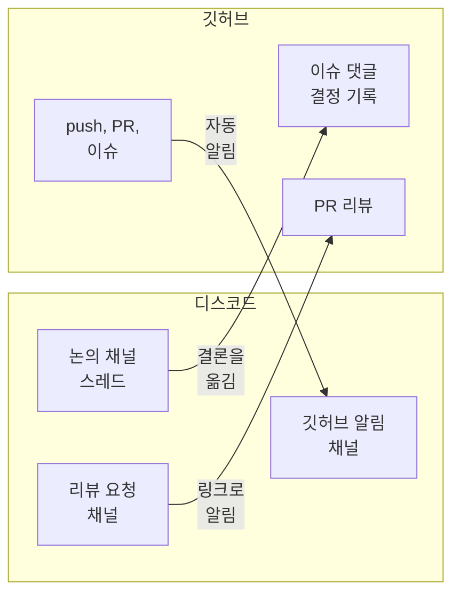

# 디스코드 설계

팀 소통 창구로 쓰는 디스코드 서버의 구성과 규칙, 깃허브 알림 연결을 적습니다.

## 1. 만든 이유

1. 11/23 수업에서 작업 기록용 보드와 소통 창구를 만들라는 안내가 있었습니다.
2. 소통 창구로 디스코드와 깃허브 Discussions(저장소 안 게시판)를 비교했고, 디스코드로 정했습니다. 주제별로 채널을 나눌 수 있고, 깃허브 알림을 한 채널에 모을 수 있습니다.
3. 다만 디스코드 대화는 깃허브 기록에 남지 않아 채점에 보이지 않습니다. 그래서 결정은 깃허브로 옮긴다는 규칙을 두었습니다(4장).

## 2. 디스코드와 깃허브가 맡는 일



1. 디스코드: 이야기, 질문, 알림
2. 깃허브: 결정, 리뷰, 작업 기록. 채점에 보이는 곳입니다.

## 3. 채널 구성

```
#협업-디스코드-사용설명      채널별 쓰는 법 (고정 글)
안내
  #공지-규칙                마감 일정, 링크, 규칙 (고정 글)
  #자료-링크                찾은 자료를 링크와 한 줄 설명으로
작업
  #깃허브-알림              커밋, PR, 이슈 자동 알림 (사람은 글 안 씀)
  #리뷰-요청                PR을 올리면 링크와 "봐 주세요"
  #개발-질문                오류, 환경 설정, 코드 질문
소통
  #일반                     일정 맞추기, 가벼운 대화
  #회의                     회의 기록
  #논의                     정할 일 하나에 스레드 하나
발표
  #발표-준비                발표 자료, 대본, 시연 영상
음성
  일반                      화면 공유하며 회의
```

1. 2명이 쓰는 서버라 채널을 10개 정도로 적게 잡았습니다.
2. #회의에는 회의가 끝나면 "정한 것, 누가, 언제까지"를 세 줄로 남깁니다.
3. #논의에서 결론이 나면 해당 이슈에 댓글로 옮기고 스레드를 닫습니다.
4. #깃허브-알림은 알림이 많아 채널 알림을 꺼 두고 필요할 때 봅니다.
5. 처음 안에는 AI 사용 기록을 모으는 #ai-기록 채널도 있었지만 필요 없다고 보고 만들지 않았습니다. AI를 어떻게 썼는지와 AI가 틀린 곳은 지금처럼 PR 본문과 `ai-mistake` 라벨에 남깁니다.

## 4. 규칙

1. 디스코드에서 정한 것은 해당 이슈에 댓글로 남깁니다.
2. 리뷰는 디스코드가 아니라 PR에 씁니다.
3. API 키, 비밀번호, 웹후크 주소는 디스코드에도 올리지 않습니다.

## 5. 깃허브 알림 연결

1. 저장소 웹후크를 #깃허브-알림 채널에 연결했습니다. 디스코드 웹후크 주소 끝에 `/github`를 붙이면 깃허브 알림 형식을 그대로 받습니다.
2. 받는 이벤트는 5가지입니다.
   - push
   - PR 열기, 합치기, 닫기
   - PR 리뷰
   - 이슈 열기, 닫기
   - 이슈 댓글
3. 11/23 연결한 뒤 깃허브의 확인 신호와 시험 알림이 정상으로 전달된 것을 확인했습니다.
4. 웹후크 주소는 아는 사람 누구나 그 채널에 글을 올릴 수 있어 비밀번호처럼 다룹니다. 문서에 적지 않고, 쓰지 않는 웹후크는 지웁니다.
5. 서버 초대 링크도 공개 저장소에는 적지 않습니다.

## 6. 만든 과정

1. 채널 구성안과 규칙, 사용법 글은 Claude(Claude Code)가 초안을 쓰고 lumos0107이 골랐습니다.
2. 서버와 채널은 lumos0107이 직접 만들었습니다.
3. 깃허브 웹후크 연결과 사용법 글 올리기는 Claude가 lumos0107의 요청으로 했습니다.
