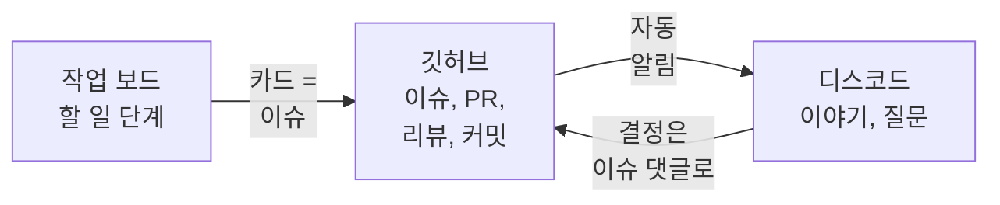
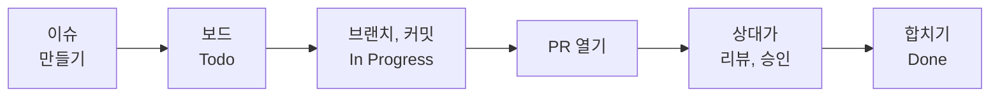

# 협업 도구

2명이 어떻게 함께 일하는지 정한 기록입니다. 지켜야 할 규칙은 [CONTRIBUTING.md](../../CONTRIBUTING.md)에 있고, 이 폴더에는 그 규칙과 도구를 왜 그렇게 정했는지 적습니다.

## 1. 세 도구가 맡는 일

1. 깃허브 저장소: 코드와 문서, 이슈, PR, 리뷰가 있는 곳입니다. 채점에 보이는 기록은 모두 여기에 남깁니다.
2. 작업 보드: 이슈가 지금 어느 단계인지 보여 줍니다. [AI_Final_Project 작업 보드](https://github.com/users/lumos0107/projects/1)
3. 디스코드: 이야기하고 묻고 알림을 받는 곳입니다. 정한 것은 이슈 댓글로 옮깁니다.

## 2. 일 하나가 흐르는 길

1. 이슈를 만들고 보드에 올립니다.
2. 브랜치를 만들어 커밋하고, 카드를 In Progress로 옮깁니다.
3. PR을 열고 디스코드 #리뷰-요청에 링크를 올립니다.
4. 상대 팀원이 PR에서 리뷰하고 승인합니다.
5. 합치면 이슈가 닫히고 카드는 자동으로 Done으로 갑니다.

## 3. 문서

| 문서 | 내용 |
|---|---|
| [01_git_setup.md](01_git_setup.md) | 깃 설계: 브랜치, main 보호, 합치기 방식, 라벨과 마일스톤을 정한 이유, 11/19 검토 토론 |
| [02_discord.md](02_discord.md) | 디스코드: 채널 구성, 규칙, 깃허브 알림 연결 |
| [03_project_board.md](03_project_board.md) | 작업 보드: 단계, 화면, 자동 규칙, 쓰는 법 |
| [git_review/](git_review/) | 11/19 깃 구성 검토 토론 원문 9개 |
