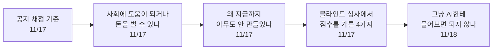

# 주제를 고르는 기준

처음부터 기준이 정해져 있지는 않았습니다. 후보를 내고 반응을 보면서 기준이 하나씩 늘었습니다. 이 문서는 기준이 생긴 순서대로 정리한 것입니다.

## 1. 공지에서 온 기준

| 채점 항목 | 내용 | 주제 고르기에 주는 영향 |
|---|---|---|
| 주제 해석과 독창성 | 무엇이 본 적 없는 것인지 팀이 한 문장으로 정의하고, 결과물이 그 정의와 맞아떨어지는지 봄 | 기능보다 한 문장 정의를 먼저 세워야 함 |
| 기술 도구 사용의 타당성 | AI 활용 과정, Skill이나 MCP 같은 AI 표준 기술을 썼는지 봄 | Skill이나 MCP가 들어갈 자리가 있는 주제가 유리함 |
| 도전과 해결 | 어려웠던 문제와 AI가 틀렸을 때 바로잡은 과정을 봄 | 처음부터 기록을 남겨야 함 |
| 완성도 | 실제로 동작하는지 봄 | 2명이 약 33일 안에 끝낼 수 있는 크기여야 함 |
| 발표 | README만 보고 실행할 수 있는지, 라이브 시연을 하는지 봄 | 시연 장면이 정의를 그대로 보여 줘야 함 |

## 2. 사회에 도움이 되거나 돈을 벌 수 있나

1차 후보에 대해 팀이 "참신하지 않다"고 판단했습니다. 그러면서 "사회에 도움이 되거나 돈을 벌 수 있나"라는 관점으로 다시 보자고 정했습니다. 2차부터는 후보마다 사회적 가치와 돈을 낼 사람을 함께 적었습니다.

## 3. 왜 지금까지 아무도 안 만들었나

심사는 수업 교수님이 기본이고 외부 심사위원이 올 수도 있습니다. 학생 투표는 없습니다. 심사위원을 설득하려면 "그게 그렇게 좋으면 왜 지금까지 아무도 안 만들었나"라는 질문에 한 줄로 답할 수 있어야 한다고 보았습니다. 답할 수 있는 방식은 세 가지로 나눴습니다.

| 지금까지 없었던 이유 | 예시 후보 |
|---|---|
| 문제가 최근에 처음 생겼다 | AI 눈에만 보이는 글씨 검사기 (AI가 대신 쇼핑하기 시작한 것이 2026년) |
| 기술이 이제야 가능해졌다 | 말로 만드는 내 앱, AI 주민 정책 실험실 |
| 이미 있던 두 가지를 아무도 묶지 않았다 | 결항 빈방 잇기, 노포 맛 잇기 |

"비슷한 것이 있는데 조금 다르다" 정도로만 설명할 수 있는 후보(헌옷 리폼, 다크패턴 점검, 친구 목표 주식)는 이 기준에서 약하다고 보았습니다.

## 4. 블라인드 심사에서 점수를 가른 4가지

AI 심사위원 3명의 평가([03_blind_review.md](03_blind_review.md))에서 높은 점수를 받은 후보와 낮은 점수를 받은 후보를 가른 이유를 모아 보니 네 가지였습니다. 5차부터는 이 네 가지를 먼저 통과하는 후보만 찾았습니다.

| 기준 | 내용 | 심사에서 나온 근거 |
|---|---|---|
| 지금이어야 하는 이유 | 왜 지금까지 없었는지 한 줄로 답할 수 있다 | 1위 후보는 "문제가 올해 처음 생겼다"로 답할 수 있었음 |
| MCP가 꼭 필요한 자리 | MCP나 Skill이 장식이 아니라 구조상 빠질 수 없는 자리에 있다 | 결항 빈방 잇기는 "AI를 빼도 돌아간다"는 이유로 기술 점수가 낮았음 |
| 진짜 데이터 | 팀이 지어낸 데이터가 아니라 실제 자료로 시연한다 | 집앞평가는 "진짜 문서로 시연해 의심받을 구석이 없다"는 평가를 받음 |
| 숫자로 증명 | 효과를 막기 전과 후, 맞힌 비율과 잘못 잡은 비율 같은 숫자로 보여 줄 수 있다 | "10회 대 10회는 우연과 구분이 안 된다", "100회 이상, 범위와 함께 내라"는 지적이 나옴 |

## 5. 그냥 AI한테 물어보면 되지 않나

5차 후보 중 "비전공자용 바이브 코딩 앱 보안 점검"에 대해 팀이 "이미 Claude나 GPT한테 물어보면 되지 않나"라고 지적했습니다. 확인해 보니 맞았습니다. Claude Code에는 보안 점검 명령이 이미 들어 있고, 깃허브는 공개 저장소에 API 키가 든 커밋을 기본으로 막습니다. 이 후보는 뺐습니다.

이 질문은 발표장에서도 거의 반드시 나올 질문이라, 이후로는 모든 후보에 이 질문을 대 보았습니다.

| 후보 | 그냥 AI한테 물어보면 | 판정 |
|---|---|---|
| AI 답변 격차 점검기 | 재는 대상이 AI 자신이고, 같은 질문을 말투만 바꿔 수백 번 묻고 점수를 내는 일은 대화로 할 수 없음 | 통과 |
| AI가 틀리는 제주 | "AI한테 물으면 틀린다"가 주제의 문제 자체임. 다만 웹 검색을 하는 AI는 잘 맞힐 수도 있어 시험이 필요함 | 조건부 |
| 팀플 기여 영수증 | AI 대화창은 누가 언제 무엇을 고쳤는지 직접 볼 수 없음. 다만 구글 문서에 버전 기록이 이미 있음 | 반쯤 |
| AI 눈에만 보이는 글씨 검사기 | 숨은 글씨에 넘어가는 쪽이 AI 자신이라 AI에게 물어서는 막을 수 없음 | 통과 |
| 집앞평가 | 평가서 PDF를 AI에 올리고 물으면 쪽 번호까지 답해 줌. 차별점인 지점 좌표와 거리 계산은 손으로 뽑아야 하는 부분임 | 약함 |

## 6. 비슷한 것이 있는지 확인하는 방법

- 후보마다 국내외 서비스, 앱, 논문, 학생 프로젝트를 웹 검색으로 찾았습니다.
- 검색으로 찾지 못한 것은 "검색한 범위에서 찾지 못했다"로만 적었습니다. 세상에 없다고 단정하지 않았습니다.
- 공개된 자료만 사례로 쳤습니다. 회사 내부 문서처럼 일반인이 볼 수 없는 자료는 사례에서 뺐습니다.
