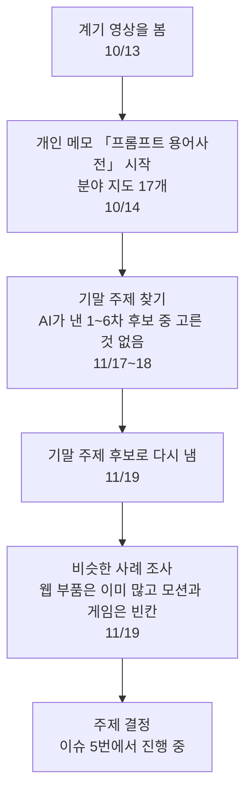

# 아이디어 1: 바이브 코딩 용어 정리집

비전공자나 다른 분야에 처음 도전하는 사람이 AI에게 일을 시킬 때 쓸 이름(화면 부품, 화면 동작, 카메라 기법, 게임 느낌 등)을 분야별로 모아, 보고 골라 쓸 수 있게 하는 정리집입니다. 낸 사람은 lumos0107입니다.

## 1. 나온 과정

### 가. 출발점: 직접 겪은 불편 (10월)

1) lumos0107이 바이브 코딩을 하다가, AI에게 원하는 것을 정확히 시키려면 그 분야 용어를 알아야 한다고 느꼈습니다. 예를 들면 프레임워크 이름, 게임 용어, 카메라 무빙입니다.
2) 계기가 된 영상은 [업계에 있는 사람들이 AI를 '잘 쓰는' 이유](https://www.youtube.com/watch?v=zWHoU2KRAiU)(2026.10.13, 40초 쇼츠)입니다. 요지는 세 가지입니다.
   - 처음 쓰는 사람은 "세련된 느낌으로", "부드러운 액션 넣어 줘"처럼 AI가 정확히 알아듣지 못하는 말로 부탁한다.
   - 업계 사람은 카메라 워크나 전환 효과 용어를 정확히 써서 원하는 결과를 빠르게 얻는다.
   - AI를 잘 쓰는 것은 프롬프트 요령보다 그 분야 지식에 달려 있다.
3) 10월 14일 개인 프로젝트 「프롬프트 용어사전」(가칭)으로 정리를 시작했습니다. "무엇을 만들 때 막히는지"를 기준으로 분야를 17개로 나눴습니다(2장).
4) 10월 메모에는 "AI한테 물어보면 되지 않나"에 대한 답도 적어 두었습니다. AI에게 "화면 위에 잠깐 떴다 사라지는 알림을 뭐라고 해?"라고 물으면 "토스트"라고 잘 답합니다. 그래서 용어 사전만 만들면 AI에게 묻는 것과 겹칩니다. 정리집만 할 수 있는 일은 두 가지로 보았습니다.
   - 직접 보고 "아, 이거!" 하고 고르기
   - 있는 줄 몰랐던 것을 둘러보다 발견하기. 이름을 모르면 검색도 못 하고 AI에게 물어보지도 못합니다.
5) 개인 프로젝트는 첫 분야를 고르는 단계에서 멈췄고, 코드는 만들지 않았습니다.

### 나. 기말 주제 후보로 다시 냄 (11/19)

1) 11월 17~18일에는 AI(Claude)가 여섯 차례 주제 후보를 냈지만 팀이 고른 후보는 없었습니다([earlier_rounds/](earlier_rounds/)).
2) 11월 19일 lumos0107이 직접 괜찮다고 생각한 아이디어 2개를 냈고, 이것이 그중 하나입니다. 낸 내용은 이렇습니다.
   - 바이브 코딩을 하는 사람은 비전공자가 많아서, 화면 부품 같은 용어를 쓰지 않고 두루뭉술하게 AI에게 일을 시킨다. 그러면 결과가 나빠지거나 오래 걸린다.
   - 게임이나 모션 그래픽도 용어를 모르면 "역동적으로" 정도밖에 말하지 못한다. 카메라 기법이나 물체가 움직이는 방식을 부르는 이름을 알면 의도를 더 정확하고 빠르게 전할 수 있다.
   - 현업자들은 이런 이름을 잘 알아서 AI를 더 잘 쓰는 것 같다.
   - 디자인과 기능 쪽 용어, 웹·앱 디자인 과정, 화면 부품 이름이 들어간다.
3) 모션 그래픽이 어떤 느낌인지 보여 주려고 쇼츠 2개를 함께 냈습니다.
   - [전문가처럼 만드는 모션 용어 5가지 알려줄게!](https://www.youtube.com/shorts/97OpNILqrnw)
   - [화려한 모션 그래픽 TOP 5, 이름만 알면 AI가 만들어 줍니다](https://www.youtube.com/shorts/NRILp2qsb_Q)

### 다. 사례 조사로 좁혀진 것 (11/19)

1) 웹·앱 화면 부품 이름은 이미 정리한 곳이 많았습니다(3장).
2) 모션과 게임 쪽은 Claude용 Skill은 있지만, 직접 보이는 예시와 한국어 자료는 찾지 못했습니다.
3) "이름을 알면 AI가 더 잘 만든다"를 직접 재 본 사례는 찾지 못했습니다.

## 2. 분야 지도

10월에 정리한 분야 지도 17개 중 일부입니다. "무엇을 만들 때 막히는지"를 기준으로 나눴습니다.

| 분야 | 막연하게 말할 때 | 알면 좋은 용어 |
|---|---|---|
| 화면 요소 | "알림 띄워 줘", "옆에서 메뉴 나오게" | 토스트, 모달, 드로어, 바텀 시트, 아코디언, 캐러셀 |
| 화면 동작 | "부드럽게", "살아 있는 느낌" | 이징, 트랜지션, 스태거, 패럴랙스, 스켈레톤 로딩 |
| 디자인과 배치 | "깔끔하게", "세련되게" | 여백, 그리드, 시각적 위계, 행간과 자간 |
| 게임 느낌 | "타격감 있게", "조작감 좋게" | 히트스톱, 화면 흔들림, 넉백, 코요테 타임, 입력 버퍼 |
| 카메라와 영상 연출 | "영화처럼", "멋있게 찍어 줘" | 로우 앵글, 돌리, 트래킹, 오빗, 돌리 줌 |
| 고치기와 되돌리기 | "안 돼요", "아까로 돌려 줘" | 에러 메시지, 재현 단계, 콘솔, 커밋, 롤백 |

## 3. 비슷한 사례

| 분야 | 이미 있는 것 | 비어 있는 곳 |
|---|---|---|
| 웹·앱 부품 | Name That UI(2026.7, 자기 말로 설명하면 부품 이름과 코딩 AI에게 줄 문장을 알려 주는 보이는 사전, Claude용 Skill도 있음), 위키독스 『그거 있잖아 그거! 바이브코딩 실전 용어 가이드』(무료), 크몽 『그림으로 찾는 UI 요소 사전』(유료, 61개), UI Guideline(유료, 부품 60개 이상) | 거의 없음 |
| 카메라 무빙 | Carat 블로그 용어 정리, Atlabs 「카메라 무빙 프롬프트 42가지」 등 글이 많음 | 거의 없음 |
| 화면 동작과 모션 | Emil Kowalski의 Claude Skill 「animation vocabulary」, 모션 디자인 용어집(AI용 아님) | 보이는 예시와 한국어 자료 |
| 게임 느낌 | Claude Skill 「game-feel」, 게임 느낌 체크리스트 30가지 | 보이는 예시와 한국어 자료 |

## 4. 효과에 대한 근거

| 자료 | 내용 |
|---|---|
| daisyUI 안내 | 부품 이름을 정확히 쓰면 프롬프트가 짧아지고, AI가 고치는 코드 양도 줄어든다고 함 |
| NAACL 2025 「Substance Beats Style」 | 초보 학생의 코딩 프롬프트를 실험해 보니, 전문 용어를 쓰느냐보다 프롬프트에 정보가 얼마나 담겼느냐가 성공을 갈랐음 |

두 번째 논문은 발표장에서 반론으로 나올 수 있습니다. 반대로 보면 "스태거" 한 단어에는 "여러 개가, 하나씩 차례로, 조금씩 늦게"라는 정보가 담겨 있습니다. 이름을 아는 것이 정보를 담는 지름길이라는 점을 보여 줄 수 있습니다. "이름을 알면 AI가 더 잘 만든다"는 주장을 직접 재 본 사례는 찾지 못했습니다.

## 5. 지금까지의 판단

1) 웹·앱 부품만 다루면 이미 있는 것과 거의 같습니다.
2) 남은 틈은 두 가지입니다.
   - 모션과 게임처럼 아직 보이는 예시가 없는 분야
   - "이름을 알면 정말 빨라지나"를 숫자로 재 보는 것
3) 정리집이 내용 중심이라 MCP나 Skill 같은 AI 기술 점수가 약해질 수 있습니다. 정리집을 Skill이나 MCP로 만들어 AI 대화 안에서 쓰게 하는 방법을 검토하고 있습니다.
4) 10월 메모에서 짚은 대로, 여러 분야를 한 번에 하면 커지고 코드보다 내용을 만드는 일이 큽니다. 한 분야를 깊게 하고 다른 분야는 같은 틀에 나중에 붙이는 쪽이 현실적입니다.

## 6. 출처

- [업계에 있는 사람들이 AI를 '잘 쓰는' 이유 (유튜브)](https://www.youtube.com/watch?v=zWHoU2KRAiU)
- [Name That UI 소개 (디자인 나침반)](https://designcompass.org/2026/08/25/namethatui-visual-dictionary/)
- [namethatui Skill (skills.sh)](https://www.skills.sh/jpcaparas/skills/namethatui)
- [그거 있잖아 그거! 바이브코딩 실전 용어 가이드 (위키독스)](https://wikidocs.net/book/19160)
- [그림으로 찾는 UI 요소 사전 (크몽)](https://kmong.com/gig/822056)
- [UI Guideline](https://www.everydev.ai/tools/ui-guideline)
- [daisyUI: 글로 UI 만들기 안내](https://daisyui.com/ai/generate-ui-from-text/)
- [Animation Vocabulary Skill (Emil Kowalski)](https://claudepluginhub.com/skills/emilkowalski-emil-design-skills/animation-vocabulary)
- [Motion Design Glossary (Design Shifu)](https://www.designshifu.com/blog/motion-design-glossary)
- [game-feel Skill](https://claudeskills.info/ko/skills/gamedev-skills/awesome-gamedev-agent-skills/game-feel/)
- [Game Juice 체크리스트 30가지](https://gamejuice.pages.dev/articles/game-juice-checklist-30-techniques)
- [카메라 무빙 용어 가이드 (Carat)](https://carat.im/blog/camera-moving-terms-guide)
- [Substance Beats Style (NAACL 2025)](https://preview.aclanthology.org/setup/2025.naacl-long.433)
