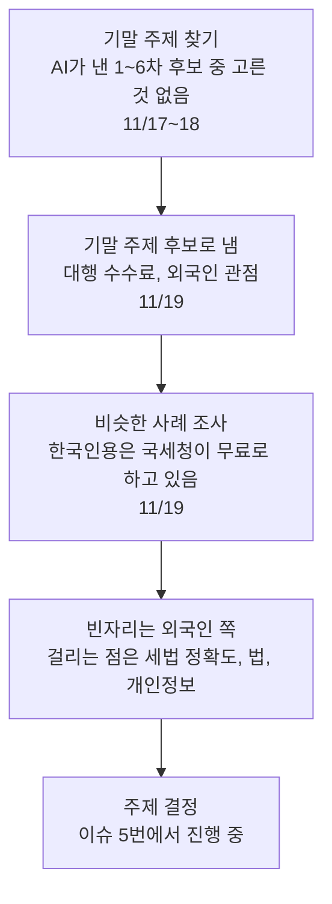

# 아이디어 2: 세금 도우미

홈택스가 어려워 대행 서비스에 수수료를 내고 맡기는 사람, 특히 외국인을 위한 세금 환급 도우미입니다. 낸 사람은 lumos0107입니다.

## 1. 나온 과정

### 가. 낸 내용 (11/19)

11월 17~18일 AI(Claude)가 낸 후보 중 팀이 고른 것이 없자, lumos0107이 직접 괜찮다고 생각한 아이디어 2개를 냈고, 이것이 그중 하나입니다. 낸 내용은 이렇습니다.

1) 지금은 홈택스에서 직접 하기가 어려워서 세무사에게 맡기거나, 환급은 삼쩜삼이나 토스 같은 대행 서비스에 수수료를 내고 맡긴다.
2) 그런데 만드는 일 자체는 그렇게 어려워 보이지 않아서 만들 수 있을 것 같다.
3) 한국인뿐 아니라 외국인에게는 이런 일이 더 어렵다. 이 관점도 괜찮아 보인다.

### 나. 사례 조사로 바뀐 것 (11/19)

1) 한국인 대상 "수수료 없는 환급"은 국세청이 2025년 3월 31일부터 원클릭 환급으로 이미 무료로 하고 있었습니다. 삼쩜삼 수수료는 환급액의 10~20%입니다.
2) 그래서 빈자리는 외국인 쪽으로 좁혀졌습니다. 국세청 다국어 안내서와 영어 상담 전화는 있지만, 외국인용 환급 도우미 앱은 찾지 못했습니다. 검색이 놓쳤을 수 있습니다.
3) "만드는 일이 그렇게 어려워 보이지 않는다"는 처음 짐작은 조사 뒤 바뀌었습니다. 어려운 부분은 코드보다 세법을 정확히 맞추는 일, 틀렸을 때의 책임, 홈택스 자료를 가져오는 방법이었습니다([03_ai_corrections.md](03_ai_corrections.md) 7번).
4) 2026년 6월 24일부터 시행된 개정 세무사법 때문에 "대신 신고해 주는" 기능은 위험합니다. 만든다면 안내만 하는 도구로 한정해야 합니다.

## 2. 비슷한 사례와 걸리는 점

| 내용 | 뜻 |
|---|---|
| 국세청 원클릭 환급이 2025년 3월 31일부터 무료로 운영 중. 삼쩜삼 수수료는 환급액의 10~20% | 한국인 대상 "수수료 없는 환급"은 국세청이 이미 함 |
| 외국인용으로 국세청 다국어 안내서(영어, 중국어, 베트남어)와 영어 상담 전화가 있음 | 외국인용 환급 도우미 앱은 찾지 못함. 검색이 놓쳤을 수 있음 |
| 2026년 6월 24일 개정 세무사법 시행: 자격 없이 세무대리처럼 보이게 광고하는 것을 금지 | "대신 신고해 주는" 기능은 법적으로 위험함. 안내만 하는 도구로 한정해야 함 |
| 삼쩜삼은 홈택스 자료 수집 문제로 개인정보보호법 위반 혐의로 검찰에 송치됨 | 개인 세금 자료를 다루는 방식이 문제가 될 수 있음 |

## 3. 지금까지의 판단

1) 어려운 부분은 코드보다 세법을 정확하게 맞추는 일, 틀렸을 때의 책임, 홈택스 자료를 가져오는 방법입니다.
2) 한국인 쪽은 국세청 무료 서비스가 이미 있습니다. 외국인 쪽에 빈자리가 있을 수 있지만, 법과 개인정보 위험이 큽니다.

## 4. 출처

- ['삼쩜삼'은 수수료 있어요...국세청 원클릭은 무료로 환급 (SBS Biz)](https://biz.sbs.co.kr/amp/article/20000225720)
- [외국인 근로자 연말정산 2026 (아시아경제)](https://cm.asiae.co.kr/en/article/2026010709522291133)
- [세무사회 "삼쩜삼, 아직 3건 남아있어" (세정신문)](https://www.taxtimes.co.kr/news/article.html?no=270088)
- [세무사회, 삼쩜삼 공정위 2차 신고 (택스워치)](https://www.taxwatch.co.kr/article/tax/2026/05/29/0003)
