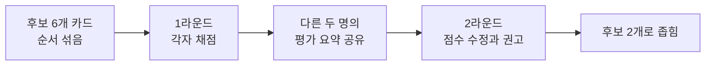

# AI 심사위원 블라인드 평가 (11/17)

4차까지 나온 후보 중 6개를 골라, 심사위원 역할을 맡긴 AI 에이전트 3명에게 평가받았습니다. 실제 심사는 수업 교수님이 기본이고 외부 심사위원이 올 수도 있어서, 그 두 시점과 기술 시점을 함께 넣었습니다.

## 1. 진행 방식

### 가. 심사위원 3명

| 역할 | 보는 관점 |
|---|---|
| 수업 담당 교수 | 공지와 채점 기준을 만든 사람의 시점 |
| 외부 투자 심사역 | 스타트업 창업 경험, "왜 지금인가", "누가 돈을 내나" |
| 외부 AI 엔지니어 | "LLM에 화면만 씌운 것 아닌가", "MCP가 장식 아닌가", "숫자로 시험할 수 있나" |

### 나. 공정하게 하려고 한 것

1) 후보 6개를 같은 형식, 같은 분량의 카드로 주고, 팀의 추천 표시는 뺐습니다.
2) 심사위원마다 카드 순서를 다르게 섞었습니다.
3) 파일, 메모리, 웹 검색을 쓰지 말고 카드만 보고 판단하게 했습니다. 세 명 모두 1라운드에 도구를 쓰지 않았다고 보고했습니다.

### 다. 라운드

1) 1라운드: 각자 공지 채점 기준 5개(각 5점, 25점 만점)로 채점하고, 발표장에서 나올 아픈 질문과 순위를 냈습니다.
2) 2라운드: 다른 두 명의 평가 요약을 보고 동의하거나 반박한 뒤 점수를 고쳤습니다. 1·2위 후보 중 어느 쪽을 권할지와, 약점을 피하는 한 문장 정의도 냈습니다.

## 2. 후보 6개

| 번호 | 이름 | 한 문장 (카드 원문) |
|---|---|---|
| P1 | AI 눈에만 보이는 글씨 검사기 | 사람에게는 안 보이고 AI에게만 보이는 '숨은 명령'을 찾아 보여 주고, AI 쇼핑 비서가 그 글을 읽기 전에 걸러 주는 검문소 |
| P2 | 결항 빈방 잇기 | 결항이 뜨는 순간, 들어오지 못한 손님 때문에 생긴 빈방과 떠나지 못한 여행객을 자동으로 짝지어 주는 서비스 |
| P3 | 말로 만드는 내 앱 | 앱 쓰는 법을 배우는 대신, 70대 동네 사장님이 말로 자기 가게에 딱 맞는 작은 앱을 직접 만드는 서비스 |
| P4 | AI 주민 1,000명 정책 실험실 | 제주의 실제 인구 통계로 만든 AI 주민 1,000명이 새 정책에 어떻게 반응하는지 미리 보여 주는 실험실 |
| P5 | 노포 맛 잇기 | 은퇴를 앞둔 노포 사장님을 AI가 인터뷰해 '승계 꾸러미'로 만들고, 이어받을 청년과 잇는 서비스 |
| P6 | 집앞평가 | 1,000쪽이 넘는 환경영향평가서를 "내 주소에서 가장 가까운 예측 지점의 수치와 근거 쪽 번호"로 다시 읽어 주고 주민 의견서까지 쓰게 하는 도구 |

## 3. 점수

| 후보 | 교수 1R, 2R | 투자 심사역 1R, 2R | AI 엔지니어 1R, 2R | 2라운드 합계 (75점) |
|---|---|---|---|---|
| P1 글씨 검사기 | 23, 23 | 23, 21 | 22, 22 | **66** |
| P6 집앞평가 | 21, 22 | 21, 22 | 21, 21 | **65** |
| P4 AI 주민 | 18, 18 | 19, 18 | 14, 14 | 50 |
| P2 결항 빈방 | 18, 17 | 17, 16 | 16, 15 | 48 |
| P3 말로 만드는 앱 | 17, 16 | 15, 15 | 17, 16 | 47 |
| P5 노포 맛 | 15, 15 | 16, 16 | 14, 14 | 45 |

- 최종 권고: 교수와 AI 엔지니어는 P1, 투자 심사역은 P6입니다. 투자 심사역은 2라운드에서 P6로 바꿨습니다.
- P1과 P6의 차이는 1점이라 사실상 동점입니다.

## 4. 합의, 조건부, 제외

### 가. 합의

1) 후보를 P1과 P6 둘로 좁힌다. 셋 모두 이 둘을 1·2위로 두었습니다.
2) 바로 정하지 말고 2~3일 사전 시험 뒤에 고른다. 2인 팀이니 한 명씩 하나를 맡아 동시에 한다.
3) P5는 제외한다. 섭외라는 기술 밖 변수가 있고, 매칭이 가짜 데이터이고, 기술의 핵심이 인터뷰 챗봇 하나뿐입니다.
4) P1과 P6 모두 처음 카드의 정의 문장은 고쳐야 한다.

### 나. 조건부

1) P4: 팀이 새로 만든 정책을 실제 사람에게 묻고 AI 주민의 답과 비교하는 검증 장치가 있으면 살아남습니다.
2) P3: 정의("딱 맞는 앱을 직접")와 범위("정해진 틀 안에서")가 서로 어긋나서, 정의를 "말로 고쳐서 우리 가게에 맞춘다"로 바꿔야 합니다.
3) P2: AI가 거의 필요 없어 기술 점수가 2점에 묶입니다.

## 5. 다시 쓴 한 문장 정의

### 가. P1이 받은 공통 지적

1) 누구를 위한 검문소인가: 소비자는 서버에서 읽는 AI 비서 앞에 검문소를 끼울 수 없습니다.
2) 함정 페이지도 팀이 만들고 검사기도 팀이 만들면 숫자를 믿기 어렵습니다.

### 나. P1 정의 (교수, AI 엔지니어 제안)

> 내가 쓰는 AI 비서가 쇼핑 페이지를 읽기 전에 반드시 거쳐 가는 MCP 검문소로, 사람 눈에는 안 보이고 AI만 읽는 숨은 명령을 걷어 내고 그 자리를 보여 주며, 효과는 우리가 만들지 않은 함정과 실제 한국 상세페이지에서 막은 비율과 잘못 막은 비율로 증명한다.

### 다. P6 정의 (세 명이 거의 같은 방향)

> 환경영향평가서에서 '우리 집 수치'를 지어내지 않고, 우리 집에서 가장 가까운 예측 지점의 예측값, 기준, 근거 쪽과 그 지점까지의 거리를 그대로 보여 주며, 거리가 멀면 "우리 마을에도 예측 지점을 두라"는 의견서까지 쓰게 하는 도구.

## 6. 발표장에서 나올 아픈 질문

### 가. P1

1) "함정도 너희가, 검사기도 너희가 만들었다. 너희가 모르는 사람이 만든 함정과 실제 정상 상세페이지에서는 몇 %를 잡고 몇 %를 잘못 잡았나?" (세 명 모두)
2) "에이전트에게 다른 웹 읽기 도구가 있으면 검문소를 우회하지 않나?" (AI 엔지니어)
3) 10회 대 10회는 우연과 구분이 안 되니 100회 이상, 성공률은 범위와 함께 내야 한다. (AI 엔지니어)

### 나. P6

1) "420m 떨어진 예측 지점의 수치는 우리 집 수치가 아니다. 주민의 오해를 어떻게 막나?" (투자 심사역)
2) "예측 지점 좌표는 보통 지도 그림에만 있다. 손으로 찍었다면 일반 PDF에서는 안 되는 것 아닌가?" (교수)
3) "화면에 나온 수치 중 몇 개를 원문과 대조했고 몇 개가 맞았나?" (AI 엔지니어)

## 7. 이 평가 뒤에 한 일

- 팀은 P1과 P6 사전 시험 대신 새 주제를 더 찾기로 했습니다.
- 이 평가에서 점수를 가른 이유를 모아 주제 고르는 기준 4가지를 만들었습니다([01_criteria.md](01_criteria.md)).

## 8. 한계

- 심사위원은 실제 사람이 아니라 역할을 맡긴 AI 에이전트입니다.
- 카드에 쓴 사실(논문, 서비스 유무, 통계)은 웹 검색 요약을 바탕으로 했고, 원문을 모두 확인하지는 않았습니다.
- 원문은 [blind_review/](blind_review/) 폴더에 있습니다. 원문에서 고친 곳은 저장 경로 두 군데뿐이고, 개인 PC 경로를 "(작업 폴더)"로 가렸습니다: [교수](blind_review/judge_professor.md), [투자 심사역](blind_review/judge_investor.md), [AI 엔지니어](blind_review/judge_ai_engineer.md).
