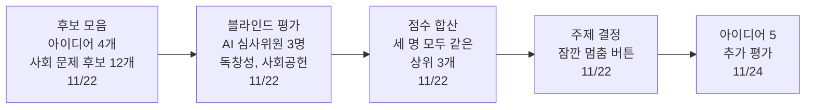

# 주제 결정 (11/22)

후보 16개를 독창성과 사회공헌으로 블라인드 평가해 주제를 정했고, 늦게 들어온 아이디어 5도 같은 방식으로 따로 평가했습니다. 결정 논의는 [이슈 #5](https://github.com/lumos0107/AI_Final_Project/issues/5)에서 했습니다.

## 1. 정한 주제: 잠깐 멈춤 버튼

| 항목 | 내용 |
|---|---|
| 한 문장 정의 | 통화 중 보이스피싱 탐지는 이미 있지만, 아는 사람이 얼굴을 맞대고 신분증·휴대폰·통장을 달라는 순간에 당사자가 직접 "잠깐"을 눌러 AI의 쉬운 경고와 믿는 사람의 "멈춰/괜찮아"를 받아 오는 서비스는 없다. |
| 대상 | 경계선 지능인·발달장애인과 그 가족 |
| 어떻게 푸는지 | 당사자가 "잠깐"을 누르고 상황을 말하면, 당사자 화면에는 "아직 주지 마세요"가, 미리 정한 믿는 사람의 폰에는 상황 요약과 위험 신호가 간다. 믿는 사람이 "멈춰/괜찮아"로 답하면 당사자 화면에 크게 뜬다. |
| 처음 나온 곳 | [사회 문제 대상별 아이디어](social_targets/README.md)의 [경계선 지능인·발달장애인](social_targets/3_borderline_developmental.md) 편 |

## 2. 고른 과정

### 가. 후보

| 묶음 | 후보 | 자세히 |
|---|---|---|
| 아이디어 | 1. 용어 정리집, 2. 세금 도우미, 3. 기억하는 개인 AI 비서, 4. 맥락 기반 간접 발화 생성 AI | [01](01_idea_glossary.md), [02](02_idea_tax.md), [06](06_idea_memory_assistant.md), [07](07_idea_indirect_speech.md) |
| 사회 문제 후보 | 대상 6개에서 남은 12개 | [social_targets/README.md](social_targets/README.md) 3장 |
| 늦게 들어온 아이디어 | 5. 요청에서 자라는 기능 분류표 (5장에서 따로 평가). 첫 안은 개인화 AI 비서 | [08](08_idea_personal_assistant.md), [09](09_idea_request_function_map.md) |

### 나. 기준

1) 16개는 독창성과 사회공헌 두 기준으로 좁혔고, 이슈 #5의 기준 6가지는 고른 후보에 대 보았습니다(6장 나.).
2) 독창성: 공지가 "무엇이 본 적 없는 것인지 팀이 한 문장으로 정의"하고, 결과물이 그 정의와 맞는지를 평가합니다([기준이 생긴 순서](earlier_rounds/01_criteria.md) 1장).
3) 사회공헌: 1차 후보 뒤 "사회에 도움이 되거나 돈을 벌 수 있나"를 기준으로 세웠습니다([기준이 생긴 순서](earlier_rounds/01_criteria.md) 2장). 사회 문제 후보 12개도 이 방향으로 찾은 것입니다([사회 문제 대상별 아이디어](social_targets/README.md)).
4) 두 기준이 모두 높은 후보가 있으면 그 후보로 정하고, 없으면 다시 논의하기로 했습니다.

## 3. 평가 방식

### 가. 심사위원 3명

| 역할 | 보는 관점 |
|---|---|
| 수업 담당 교수 | 공지의 "본 적 없는 것"을 한 문장으로 말할 수 있는가 |
| 사회복지·공공정책 심사위원 | 대상의 어려움, 대상 규모, 기존 공공 서비스의 빈자리 |
| 외부 AI 엔지니어 | "LLM에 화면만 씌운 것 아닌가", "그냥 ChatGPT에 물어보면 되지 않나" |

### 나. 공정하게 하려고 한 것

1) 후보 16개를 같은 형식의 카드(대상, 무엇을 하나, 이미 있는 것)로 만들고, 낸 사람과 기존 점수는 뺐습니다([카드](decision_review/cards.md)). 카드 이름은 아이디어 1~4를 각각 "용어 번역기", "외국인 세금 환급 안내", "기억하는 AI 비서", "맥락 기반 돌려 말하기"로 적었습니다.
2) 심사위원마다 카드 순서를 다르게 섞었습니다.
3) 카드 파일 하나만 보게 했고, "이미 있는 것"이 의심스러울 때만 웹 검색을 5번까지 쓰게 했습니다. 교수는 검색하지 않았고, 다른 두 명은 2번씩 검색했습니다.

### 다. 점수 기준

| 기준 | 매기는 법 (1~5점) |
|---|---|
| 독창성 | 5 = 비슷한 것을 찾기 어렵고 한 문장으로 날카롭게 말할 수 있음, 3 = 비슷한 것이 있지만 분명한 차이가 하나 있음, 1 = 거의 같은 것이 이미 있음. 범용 AI 채팅에 한두 문장 지시로 같은 결과가 나오면 낮춤 |
| 사회공헌 | 대상의 어려움 크기, 대상 규모, 실제 피해·비용을 직접 줄이는 정도를 봄. 오답 피해, 악용, 개인정보 위험이 크면 감점 |

## 4. 점수

괄호 안은 교수, 사회복지·공공정책 심사위원, AI 엔지니어 순서입니다.

| 순위 | 후보 | 독창성 (15) | 사회공헌 (15) | 합계 (30) |
|---|---|---|---|---|
| 1 | **잠깐 멈춤 버튼** | **15** (5, 5, 5) | 13 (5, 4, 4) | **28** |
| 2 | 선상 안전 말판 | 11 (4, 4, 3) | **15** (5, 5, 5) | 26 |
| 3 | 만약에 계산기 | 12 (4, 4, 4) | 12 (4, 4, 4) | 24 |
| 4 | 이것도 돌봄이에요 | 9 (3, 3, 3) | 12 (4, 4, 4) | 21 |
| 4 | 나를 소개하는 한 장 | 12 (4, 4, 4) | 9 (3, 3, 3) | 21 |
| 6 | 방 상태 타임라인 | 9 (3, 3, 3) | 9 (3, 3, 3) | 18 |
| 6 | 우리 학교 달력 풀이 | 9 (3, 3, 3) | 9 (3, 3, 3) | 18 |
| 8 | 통신문 골라 주기 | 7 (2, 2, 3) | 10 (3, 3, 4) | 17 |
| 8 | 조용한 안부 | 7 (3, 2, 2) | 10 (4, 3, 3) | 17 |
| 8 | 일한 시간 증거 지갑 | 5 (2, 1, 2) | 12 (4, 4, 4) | 17 |
| 11 | 아이디어 2: 세금 도우미 (카드: 외국인 세금 환급 안내) | 6 (2, 2, 2) | 9 (3, 3, 3) | 15 |
| 11 | 돌봄 나눔 주간표 | 6 (2, 2, 2) | 9 (3, 3, 3) | 15 |
| 13 | 아이디어 4: 맥락 기반 간접 발화 생성 AI (카드: 맥락 기반 돌려 말하기) | 9 (3, 3, 3) | 3 (1, 1, 1) | 12 |
| 14 | 계약 전날 점검 도구 | 3 (1, 1, 1) | 8 (3, 2, 3) | 11 |
| 15 | 아이디어 1: 용어 정리집 (카드: 용어 번역기) | 7 (3, 2, 2) | 3 (1, 1, 1) | 10 |
| 16 | 아이디어 3: 기억하는 개인 AI 비서 (카드: 기억하는 AI 비서) | 4 (1, 1, 2) | 3 (1, 1, 1) | 7 |

- 세 명 모두 잠깐 멈춤 버튼, 선상 안전 말판, 만약에 계산기를 "둘 다 높은 후보" 상위 3개로 뽑았습니다.
- 잠깐 멈춤 버튼은 세 명 모두 독창성 5점을 준 유일한 후보입니다.
- 사회공헌만 보면 선상 안전 말판이 가장 높습니다. 독창성은 교수와 사회복지·공공정책 심사위원이 4점, AI 엔지니어가 오프라인 번역 앱이 이미 있다는 이유로 3점을 주었습니다.

## 5. 아이디어 5 추가 평가 (11/24)

아이디어 5는 16개 평가 뒤에 들어와서, 같은 심사위원 3명이 같은 기준으로 아이디어 5 카드만 따로 채점했습니다. 앞선 16개의 점수는 그대로 두고 그 점수를 기준점으로 삼았습니다. 아이디어 5는 평가를 받으며 네 번 다듬었고, 차례마다 같은 방식으로 다시 채점했습니다.

괄호 안은 교수, 사회복지·공공정책 심사위원, AI 엔지니어 순서입니다.

| 차례 | 카드 | 핵심 | 독창성 (15) | 사회공헌 (15) | 합계 (30) |
|---|---|---|---|---|---|
| 1 | 17 | 기억과 실행을 함께 하는 개인화 AI 비서 | 3 (1, 1, 1) | 3 (1, 1, 1) | 6 |
| 2 | 18 | 앱 기능을 쪼개 말로 작은 앱을 조립 | 6 (2, 2, 2) | 5 (2, 2, 1) | 11 |
| 3 | 19 | 요청에서 출발해 기능으로 나누는 중간 단계 | 7 (3, 2, 2) | 5 (2, 2, 1) | 12 |
| 4 | 20 | 요청에서 자라는 기능 분류표 | 8 (3, 2, 3) | 6 (3, 2, 1) | 14 |

1) 마지막 안(합계 14)은 17개 가운데 13위 근처입니다. 1위는 그대로 잠깐 멈춤 버튼입니다.
2) 독창성: "실제 요청에서 자라는 분류표"가 애플 App Intents, schema.org와 다르다는 점은 교수와 AI 엔지니어가 인정했습니다. "빈 칸을 직접 만들어 채우기"는 Alita, MCP-Zero 같은 연구가 이미 있다고 세 명 모두 짚었습니다.
3) 사회공헌: 대상이 넓고 줄이는 것이 피해보다 불편이라 낮았습니다. 세 명 모두 대상을 좁히고 실제 손해를 재야 오른다고 보았습니다.
4) 원문: [카드 17~20](decision_review/cards_idea5.md), 각 심사위원 원문의 "추가 평가" 부분

## 6. 고른 이유

### 가. 심사위원 의견

1) 독창성: 세 명 모두 비슷한 것으로 통화 중 보이스피싱 감지와 도움 요청 버튼만 들었습니다. AI 엔지니어는 당사자가 버튼을 누르고 보호자가 답하는 앱을 검색했지만, 검색한 범위에서 찾지 못했습니다.
2) "그냥 AI에게 물으면": AI 엔지니어는 "대화창으로는 대신할 수 없다"고 보았습니다.
3) 사회공헌: 사회복지·공공정책 심사위원은 "명의 도용으로 수억 원대 피해 사례가 있고, 등록 장애인이 아니면 제도 지원이 빈다"고 보았고, AI 엔지니어는 "법적 보호도 비어 있다"고 보았습니다.
4) 교수는 "판단을 AI에 맡기지 않고 믿는 사람에게 넘기는 구조라 오답 피해가 적다"고 보았습니다.

### 나. 이슈 #5 기준 6가지로 본 잠깐 멈춤 버튼

처음 평가는 [경계선 지능인·발달장애인](social_targets/3_borderline_developmental.md) 편 4장의 평가입니다.

| 기준 | 판단 |
|---|---|
| 1. 한 문장 정의: 무엇이 본 적 없는 것인가 | 1장의 정의. 세 심사위원 모두 독창성 5점 |
| 2. 그냥 AI한테 물어보면 되지 않나 | 처음 평가에서는 "주의". "형이 신분증 달래, 줘도 돼?"는 AI 채팅에도 물을 수 있지만, 미리 정한 믿는 사람에게 묻고 그 답을 받아 오는 고리는 AI 채팅으로 안 됨. 이 고리가 시연의 중심이어야 통과 |
| 3. 사회에 도움이 되거나 돈을 벌 수 있나 | 명의도용·경제적 착취 피해를 넘겨주기 전에 막음. 사회공헌 13/15 |
| 4. Skill이나 MCP가 꼭 필요한가 | "위험 신호 판정" Skill(규칙표, 출력 형식, 사례 시험)은 자연스러우나, 앱 실행만 보면 시스템 프롬프트 파일로도 되므로 꼭 필요까지는 아님. 앱 안의 MCP는 억지이고, 개발 과정의 화면 자동 시험(Playwright MCP)에는 자연스러움 |
| 5. 실제 데이터를 쓰고, 효과를 숫자로 보여 줄 수 있나 | 기사 사례를 바꾼 위험 40개와 겉모습이 비슷한 정상 40개로 놓친 수, 잘못 경고한 수, 지어낸 근거 수를 잼. 실제로 피해를 막는지는 4주 안에 잴 수 없음 |
| 6. 2명이 12/16까지 핵심 기능을 만들 수 있나 | 이번 평가에서는 보지 않음. 처음 평가에서는 "주의" |

## 7. 짚은 위험

1) 미리 정한 믿는 사람이 오히려 가해자일 수 있습니다. 믿는 사람을 누구로 정할지 안전장치를 설명해야 합니다(사회복지·공공정책 심사위원, AI 엔지니어).
2) AI가 하는 일이 상황 요약과 위험 신호 표시에 그쳐, AI 과목 프로젝트로서 AI의 몫을 더 분명히 해야 합니다(AI 엔지니어).
3) 위험한 순간에 당사자가 실제로 버튼을 누를지는 4주 안에 확인할 수 없습니다. 발표에서는 "막을 수 있다"는 효과가 아니라, 누르면 무엇이 달라지는지와 사례 시험 숫자까지만 보여 줍니다(처음 평가).
4) 믿는 사람이 10분 안에 답하지 않으면 두 번째 사람에게 넘기고, 그동안 당사자 화면은 "아직 주지 마세요"를 유지하는 방법이 제안됐습니다(처음 평가).

## 8. 다음 할 일

1) 기능 목록과 역할 분담을 정합니다(1주차 목표).
2) 위험 신호 규칙표 초안과 사례 시험 세트를 만들고, 같은 사례를 일반 AI 채팅에 넣은 결과와 비교합니다.
3) 7장의 위험 1), 2)에 대한 설계를 정합니다.

## 9. 한계

- 심사위원은 실제 사람이 아니라 역할을 맡긴 AI 에이전트입니다.
- 카드의 "이미 있는 것"은 앞선 문서의 웹 검색 요약을 옮긴 것이고, 원문을 모두 다시 확인하지는 않았습니다.
- 아이디어 5는 같은 심사위원이 따로 채점해, 16개를 한꺼번에 본 것과 조건이 조금 다릅니다.
- 이번 평가는 독창성과 사회공헌 두 가지만 보았습니다. 완성 가능성은 처음 평가의 판단("주의")을 따랐습니다.
- 원문은 [decision_review/](decision_review/) 폴더에 있고 고친 곳은 없습니다: [교수](decision_review/judge_professor.md), [사회복지·공공정책](decision_review/judge_social_policy.md), [AI 엔지니어](decision_review/judge_ai_engineer.md).

## 10. 출처

1. [경계선 지능인·발달장애인](social_targets/3_borderline_developmental.md) (사회 문제 대상별 아이디어, 문제 근거와 출처 목록)
2. ['장애인 등록증 있어요?'…범죄 사각지대 놓인 사람들](https://www.nocutnews.co.kr/news/6494321) (노컷뉴스, 2026-04-01)
3. [장애수당 800만원 가로챈 것도 모자라…사채 대출도 가져갔다](https://www.heraldk.com/article/2026040100200042401) (헤럴드경제, 2026-04-01)
4. [보이스피싱·고수익 알바…경계선지능청년, 금융 사기 피하는 법 배운다](https://futurechosun.com/archives/115653) (더나은미래, 2025-03-04)
5. [에이닷 '가족 케어' 발표](https://news.sktelecom.com/224228) (SK텔레콤 뉴스룸, 2026-04-27)
