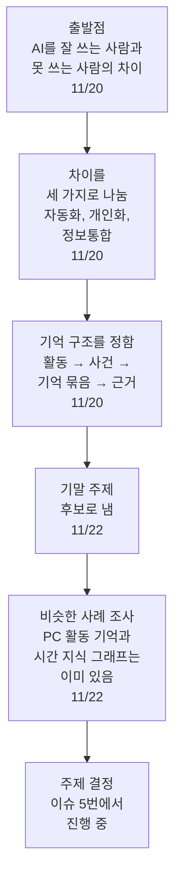

# 아이디어 3: 기억하는 개인 AI 비서

메일, 일정, 파일 같은 디지털 활동을 기억해 두었다가 "어제 본 그 파일", "지난번 교수님께 보낸 메일처럼 써 줘" 같은 막연한 말도 알아듣고 작업까지 해 주는 AI 비서입니다. 낸 사람은 lgosoup입니다.

## 1. 나온 과정

### 가. 출발점: AI를 쓰는 사람 사이의 차이 (11/20)

1) AI는 빠르게 퍼지고 있지만, 쓰는 수준은 사람마다 크게 다릅니다. 어떤 사람은 AI로 일을 자동으로 처리하고, 대부분은 질문하고 답을 받는 데서 그칩니다.
2) 차이가 나는 이유는 AI를 잘 쓰려면 프롬프트를 잘 쓰고 맥락을 정해 주는 기술이 필요하기 때문이라고 보았습니다.
3) 잘 쓰는 사람이 할 수 있고 못 쓰는 사람이 못 하는 것을 세 가지로 나눴습니다.

   | 능력 | 뜻 | 예 |
   |---|---|---|
   | 자동화 | 한 번 시키면 AI가 끝까지 해 줌 | "길동이한테 회의 자료 보내 달라고 메일 써 줘" |
   | 개인화 | 내 정보를 바탕으로 나에게 맞게 처리해 줌 | 이미 잡아 둔 약속을 보고 새 일정을 넣어 줌 |
   | 정보통합 | 여러 곳에 흩어진 정보를 모아 줌 | 버스 앱 여러 개의 시간과 노선을 한 번에 알려 줌 |

4) 세 능력의 공통 바탕은 "AI가 나를 기억하는 것"이라고 보았습니다. 사람이 이름이나 내용을 정확히 기억하지 못해도, AI가 과거 활동을 기억하고 있으면 요청을 알아듣고 이어서 일할 수 있습니다.

### 나. 기억 구조를 정함 (11/20)

1) 활동을 그대로 다 저장하지 않고 네 단계로 나눠 저장하기로 했습니다(2장).
2) 요청이 들어오면 이렇게 처리합니다.
   - "어제", "지난번" 같은 말을 날짜 범위로 바꿉니다.
   - 그 범위의 기억 묶음을 먼저 찾고, 필요한 사건과 근거를 붙여 AI에게 넘깁니다.
   - AI가 작업(메일 초안 쓰기 등)을 하고, 그 결과도 다시 기억으로 저장합니다. 쓸수록 나에게 맞춰집니다.
3) 메일 주소처럼 틀리면 안 되는 값은 AI가 지어내지 않고 기억에서 꺼내 씁니다. 메일은 보내지 않고 초안까지만 만듭니다.
4) 사용자가 "어제 병원…"처럼 일부만 입력해도 최근 기억을 바탕으로 프롬프트를 이어서 제안하는 기능도 함께 생각했습니다.

### 다. 사례 조사로 좁혀진 것 (11/22)

1) PC 활동을 기억해 찾아 주는 것은 Microsoft Recall이 이미 하고 있었습니다(3장).
2) 시간 정보를 담은 지식 그래프로 AI 기억을 만드는 것도 Graphiti가 오픈소스로 하고 있었습니다.
3) 남은 틈은 "기억을 찾는 데서 끝나지 않고 작업까지 이어 주는 것"과 "막연한 요청을 기억으로 구체화하는 것"으로 좁혀졌습니다.

## 2. 기억 구조

| 단계 | 뜻 | 예 |
|---|---|---|
| 활동 기록 | 컴퓨터가 감지한 원본 활동 | 10:00 넷플릭스 실행, 10:02 영화 제목 입력, 10:04 재생 시작 |
| 사건 | 그중 의미 있는 행동 | 영화 A 검색, 영화 A 재생(10:04~11:50) |
| 기억 묶음 | 사람이 떠올리는 단위로 사건을 묶은 것 | "10시에 영화 A를 봄", "교수님께 문의 메일 보내고 과제 파일 고침" |
| 근거 | 기억의 근거가 되는 원본의 위치 | 메일, 일정, 파일, 검색 기록 |

1) 사건은 시간, 주제, 상대, 파일이 비슷하면 하나의 기억 묶음으로 묶습니다.
2) AI가 사건을 잘못 정리할 수 있어서(예: "프로젝트 과제"를 "숙제"로), 확신이 낮으면 사용자에게 한 번 묻고 저장합니다.
3) 찾을 때는 기억 묶음만 돌려주지 않고 사건과 근거를 함께 보여 줍니다. 왜 이 결과가 나왔는지 사용자가 확인할 수 있게 하기 위해서입니다.

## 3. 비슷한 사례

| 분야 | 이미 있는 것 | 비어 있는 곳 |
|---|---|---|
| PC 활동 기억 | Microsoft Recall(Copilot+ PC): 화면을 주기적으로 찍어 기기 안에 저장하고 자연어나 타임라인으로 찾게 함. Click to Do로 화면 위 내용에 바로 작업도 함 | 화면 사진 기반이라 "누구에게, 무슨 일로"처럼 묶인 기억은 아님. 메일 쓰기 같은 작업으로 이어지지 않음 |
| AI용 시간 지식 그래프 | Zep과 그 엔진인 Graphiti(오픈소스): 사실마다 유효 기간을 두고, 일어난 때와 기록된 때를 따로 저장함. MCP 서버도 있음 | 대화 기억이 중심. 메일, 일정, 파일 같은 PC 활동을 모으는 부분은 없음 |
| 개인 기억 연구 | ContextGraph(AAAI-26, 스마트폰 생활 기록을 시간 지식 그래프로), PersonalAI(개인화 AI용 그래프 저장·검색 비교), Opal(개인 기억을 보호 영역 안에 둠) | 연구용이라 일반 사용자가 쓰는 도구는 아님 |

## 4. 지금까지의 판단

1) "그냥 AI한테 물어보면 되지 않나"에는 답할 수 있습니다. AI 채팅은 내 메일, 파일, 일정을 모르고 내가 언제 무엇을 했는지 기억하지 못합니다. AI 채팅의 메모리 기능도 대화 내용만 기억합니다.
2) 다만 시간 지식 그래프 자체는 Graphiti가 이미 하고 있어서 새로운 점이 되기 어렵습니다. 가져다 쓰는 것도 방법입니다.
3) Recall과의 차이는 "찾기에서 작업까지"와 "막연한 요청을 기억으로 구체화하기"에서 보여 줘야 합니다.
4) 걸리는 점이 있습니다.
   - 활동을 모으는 기능은 개인정보 문제가 큽니다. 시연은 지어낸 활동 기록으로 해야 합니다.
   - 세 능력과 앱 여러 개를 2명이 12/16까지 다 하기는 어렵습니다. 앱 하나(Gmail)와 기억 찾기 하나로 좁히는 쪽이 현실적입니다.
   - 아이디어 1과 출발점이 비슷합니다. 둘 다 "AI를 잘 못 쓰는 사람"에서 시작했고, 아이디어 1은 용어를 알려 주는 쪽, 이 아이디어는 AI가 맥락을 대신 채워 주는 쪽입니다.

## 5. 출처

- [Retrace your steps with Recall (Microsoft 지원)](https://support.microsoft.com/en-us/kb/5039749)
- [Click to Do in Recall (Microsoft 지원)](https://support.microsoft.com/windows/967304a8-32d1-4812-a904-fad59b5e6abf)
- [Recall Overview (Microsoft Learn)](https://learn.microsoft.com/en-us/windows/ai/apis/recall)
- [Graphiti (GitHub)](https://github.com/getzep/graphiti)
- [Zep: A Temporal Knowledge Graph Architecture for Agent Memory (arXiv 2501.13956)](https://arxiv.org/abs/2501.13956)
- [ContextGraph (AAAI-26)](https://ojs.aaai.org/index.php/AAAI/article/view/38600/42562)
- [PersonalAI (arXiv 2506.17001)](https://arxiv.org/abs/2506.17001v2)
- [Opal (arXiv 2604.02522)](https://arxiv.org/html/2604.02522v1)
