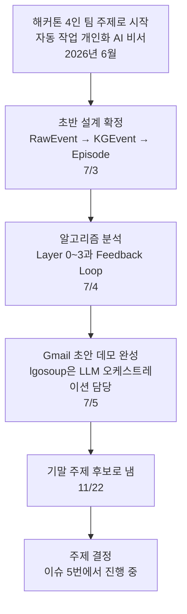

# 아이디어 3: 기억하는 개인 AI 비서

사용자의 디지털 활동(메일, 일정, 파일, 검색)을 시간 지식 그래프로 기억해 두고, "어제 본 그 파일", "지난번 교수님께 보낸 메일처럼"처럼 막연하게 말해도 알아듣고 작업까지 해 주는 AI 비서입니다. 낸 사람은 lgosoup입니다.

## 1. 나온 과정

### 가. 출발점: 해커톤 팀 프로젝트 (2026년 6~7월)

1) 해커톤에서 4명이 함께 정한 주제입니다. 팀이 쓴 문제의식은 이렇습니다.
   - AI를 잘 쓰는 사람과 못 쓰는 사람의 격차가 크다. 대다수는 AI를 질의응답 도구로만 쓴다.
   - AI를 잘 쓰려면 프롬프트 작성이나 맥락 설정 같은 기술 지식이 필요하기 때문이다.
   - 이런 사람을 "AI 취약계층"으로 정의하고, 이들이 AI 전문가에 비해 못 하는 것을 자동화, 개인화, 정보통합 세 가지로 나눴다.
2) 세 능력을 보여 줄 예시로 Gmail(자동화), 캘린더(개인화), 버스 노선 안내(정보통합)를 골랐습니다.
3) 역할은 넷으로 나눴습니다. 1번 LLM 오케스트레이션, 2번 앱 연동(Gmail, 캘린더, 버스 노선), 3번 지식 그래프, 4번 화면입니다. lgosoup은 1번을 맡았습니다.

### 나. 설계와 데모 (7/3~7/5)

1) 기억 구조는 네 단계로 정했습니다.

   | 단계 | 뜻 | 예 |
   |---|---|---|
   | Raw Event | 컴퓨터가 감지한 원본 활동 | 10:00 Netflix 실행, 10:02 영화 제목 입력 |
   | KGEvent | 그중 의미 있는 행동 | 영화 A 검색, 영화 A 재생(10:04~11:50) |
   | Episode | 사람이 떠올리는 기억 단위 | "10시에 영화 A를 봄" |
   | Evidence | 기억의 근거가 되는 원본 | 메일, 일정, 파일, 검색 결과의 위치 |

2) 요청이 들어오면 시간 표현("어제", "지난번")을 날짜 범위로 바꾸고, 그 범위의 Episode를 먼저 찾은 뒤 필요한 KGEvent와 Evidence를 붙여 LLM에 넘기는 흐름(T-GraphRAG)을 설계했습니다.
3) 데모는 Gmail 초안 만들기 하나만 끝까지 동작하게 만들었습니다.
   - 입력: "길동이한테 해커톤 회의 자료 보내달라고 메일 초안 써줘"
   - 1차 LLM이 받는 사람 이름 "길동"을 뽑고, 코드가 사람 그래프에서 이메일 주소를 찾고, 2차 LLM이 제목과 본문을 씁니다.
   - 이메일 주소는 LLM이 지어내지 못하게 코드에서 그래프 값으로 덮어씁니다. 메일은 보내지 않고 초안만 만듭니다.
4) 데모가 끝난 뒤 코드를 직접 점검해 보니, 설계와 실제 구현 사이에 차이가 컸습니다.
   - 완료: 의도 파악, 시간 표현 변환, 작업 계획, 초안 생성, 실행 결과 다시 저장
   - 껍데기만 있음: 활동 수집(2번 역할), 기억 저장과 검색(3번 역할). 기억 검색은 늘 빈 결과를 돌려줍니다.
   - 없음: 저장할지 거르는 단계(Write Gate), 반복 패턴에서 취향을 추정하는 기능, 되돌리기

### 다. 기말 주제 후보로 냄 (11/22)

1) 해커톤에서 끝까지 만들지 못한 부분, 특히 "기억 저장과 검색"이 이 아이디어의 핵심입니다. 기말에서는 이 부분을 실제로 동작하게 만드는 것을 생각했습니다.
2) 해커톤 때 정한 세 능력과 앱 세 개를 2명이 다 하기는 어렵습니다. 범위를 좁혀야 합니다(4장).

## 2. 비슷한 사례

| 분야 | 이미 있는 것 | 비어 있는 곳 |
|---|---|---|
| PC 활동 기억 | Microsoft Recall(Copilot+ PC): 화면을 주기적으로 찍어 기기 안에 저장하고, 자연어나 타임라인으로 찾게 함. Click to Do로 화면 위 내용에 바로 작업도 함 | 스크린샷 기반이라 "누구에게, 무슨 일로"처럼 구조로 묶인 기억은 아님. Copilot+ PC에서만 됨 |
| 에이전트용 시간 지식 그래프 | Zep과 그 엔진인 Graphiti(오픈소스): 사실마다 유효 기간을 두고, 일어난 때와 기록된 때를 따로 저장함. Kuzu도 지원하고 MCP 서버도 있음 | 대화 기억이 중심. 메일, 일정, 파일 같은 PC 활동을 모으는 부분은 직접 만들어야 함 |
| 개인 기억 연구 | ContextGraph(AAAI-26, 스마트폰 생활 기록을 시간 지식 그래프로), PersonalAI(개인화 에이전트용 그래프 저장·검색 비교), Opal(개인 기억을 보호 영역 안에 둠) | 연구용. 일반 사용자가 쓰는 도구는 아님 |

## 3. 지금까지의 판단

1) 해커톤 데모 코드와 설계 문서가 이미 있습니다. 처음부터 시작하는 다른 아이디어보다 출발점이 앞서 있습니다.
2) 해커톤 때 "핵심 차별점"으로 본 시간 지식 그래프는 Graphiti가 오픈소스로 이미 하고 있습니다. 그래프 자체를 새로 만드는 것은 차별점이 되기 어렵고, Graphiti를 가져다 쓰는 것도 방법입니다.
3) Recall이 "PC 활동을 기억해 찾기"를 이미 합니다. 남은 틈은 두 가지로 보입니다.
   - 찾는 데서 끝나지 않고 작업까지 이어 주기(메일 초안 쓰기 등)
   - 사용자가 막연하게 말해도 기억을 근거로 요청을 구체화해 주기
4) 걸리는 점이 있습니다.
   - 해커톤 결과물을 기말에 그대로 쓰면 "이번에 새로 만든 것"이 무엇인지 설명해야 합니다. 과목 규칙도 확인해야 합니다.
   - 활동을 모으는 기능은 개인정보 문제가 큽니다. 시연은 가짜 데이터로 해야 합니다.
   - 해커톤 범위(앱 3개, 세 능력)는 2명이 12/16까지 하기에 큽니다. 앱 하나(Gmail)와 기억 검색 하나로 좁히는 쪽이 현실적입니다.

## 4. 출처

- [Retrace your steps with Recall (Microsoft 지원)](https://support.microsoft.com/en-us/kb/5039749)
- [Click to Do in Recall (Microsoft 지원)](https://support.microsoft.com/windows/967304a8-32d1-4812-a904-fad59b5e6abf)
- [Recall Overview (Microsoft Learn)](https://learn.microsoft.com/en-us/windows/ai/apis/recall)
- [Graphiti (GitHub)](https://github.com/getzep/graphiti)
- [Zep: A Temporal Knowledge Graph Architecture for Agent Memory (arXiv 2501.13956)](https://arxiv.org/abs/2501.13956)
- [ContextGraph (AAAI-26)](https://ojs.aaai.org/index.php/AAAI/article/view/38600/42562)
- [PersonalAI (arXiv 2506.17001)](https://arxiv.org/abs/2506.17001v2)
- [Opal (arXiv 2604.02522)](https://arxiv.org/html/2604.02522v1)
