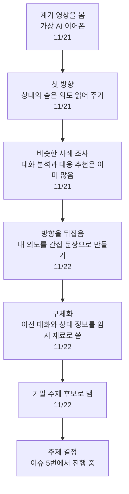

# 아이디어 4: 맥락 기반 간접 발화 생성 AI

하고 싶은 말을 직접 하지 않으면서도, 상대와 나눈 이전 대화와 상대에 대해 아는 것을 이용해 상대가 속뜻을 알아차릴 수 있는 문장을 만들어 주는 AI입니다. 낸 사람은 lgosoup입니다.

## 1. 나온 과정

### 가. 출발점: 가상 AI 이어폰 (11/21)

1) 코미디 채널 킥서비스의 영상에 나온 가상 제품 「버즈 9 오피스」에서 시작했습니다. 상사의 잔소리를 막아 주고, AI가 상황을 보고 시선 처리나 사과할 타이밍을 귀에 알려 주는 직장인용 이어폰이라는 설정입니다.
2) 눈에 띈 것은 이어폰이라는 모양보다 "AI가 상황에 대처해 준다"는 부분이었습니다. 말을 받아 적거나 감정을 알아채는 데서 그치지 않고, 상대가 실제로 무엇을 뜻하는지 추론해 대응을 알려 주는 기능입니다.

### 나. 첫 방향: 상대의 숨은 의도 읽기 (11/21)

1) 처음 구조는 "상대의 말 → 맥락과 말투 분석 → 숨은 의도 추론 → 대응 안내"였습니다. 문장 그대로의 뜻과 그 말을 한 의도가 다를 수 있다는 점을 문제로 잡았습니다.
2) 대화 코칭 앱, 실시간 음성 안내 도구, 멀티모달 의도 인식 연구(MIntRec2.0 등), 사회적 신호를 알려 주는 웨어러블 연구를 살펴봤습니다.
3) 대화를 실시간으로 분석해 대응을 추천하는 것은 이미 여러 형태로 있어서 방향을 다시 생각했습니다.

### 다. 방향을 뒤집음: 의도를 읽지 않고 만들기 (11/22)

1) 상대가 숨긴 의도를 AI가 읽어 주는 대신, 내가 전하려는 의도를 AI가 간접적인 문장으로 만들어 주면 어떨까 생각했습니다.
2) 쉽게 설명하려고 "교토화법 변환기"라는 말을 썼습니다. 실제 교토 방언이나 특정 지역 사람의 말투를 뜻하지 않습니다. 겉으로 한 말과 실제 뜻이 다르고, 상대가 속뜻을 알아채게 하는 간접 표현을 가리키는 비유입니다.
3) 다만 직설적인 문장을 정중하게, 또는 빈정거리게 바꾸는 도구는 이미 있습니다(3장). 그래서 "말투 바꾸기"에서 한 단계 더 나아가야 했습니다.

### 라. 구체화: 지금 문장이 아니라 쌓인 대화를 씀 (11/22)

1) 핵심 조건은 이전에 오간 대화, 상대가 알고 있는 것, 둘의 관계까지 함께 보는 것입니다. AI는 상대가 이미 무엇을 아는지에 따라 암시에 쓸 단서를 골라야 합니다.
2) 같은 속마음이라도 상대와 나눈 대화, 함께 겪은 일, 지금 상황에 따라 다른 문장이 나옵니다(2장).
3) 대화 기록을 요약하는 데 쓰지 않고, 암시할 단서를 찾는 데 씁니다.

## 2. 예시와 구조

### 가. 예시: 지난 약속으로 책임을 짚기

- 이전 대화: A가 B에게 "보고서 최종 검토는 내가 책임질게"라고 말함
- 지금 상황: A는 검토하지 않은 채 B에게 "왜 아직 보고서가 완성되지 않았어?"라고 물음
- B의 실제 뜻: "검토하기로 한 건 당신인데 왜 나에게 책임을 돌리나?"

| 바꾸는 방식 | 나오는 문장 |
|---|---|
| 직접, 정중하게 | "검토를 맡으시기로 했던 부분이 아직 완료되지 않은 것 같습니다." |
| 단순한 비꼼 | "참 책임감 있게 진행되고 있네요." |
| 맥락 기반 간접 발화 | "지난번에 말씀하신 검토 일정에 맞춰 기다리고 있었습니다." |

세 번째 문장은 기다린 이유만 말합니다. 하지만 A는 자기가 한 약속을 떠올리고 숨은 지적을 알아챌 수 있습니다.

### 나. 구성 요소

| 구성 요소 | 왜 필요한가 |
|---|---|
| 화자의 실제 의도 파악 | 간접적으로라도 전해야 할 핵심 뜻을 정하기 위해 |
| 이전 대화와 사건 분석 | 지금 상황과 이어지는 과거 발언, 약속, 사건을 찾기 위해 |
| 상대의 지식과 관계 추정 | 상대가 어떤 정보와 생각을 갖고 있을지 짐작하기 위해 |
| 간접 표현과 대화 함축 | 뜻을 문장 겉에 드러내지 않고 표현하기 위해 |
| 예상 해석과 반응 평가 | 상대가 뜻을 알아챌 가능성과 뜻이 드러나는 정도를 함께 보기 위해 |

1) 상대가 무엇을 아는지는 확실히 알 수 없고, 대화와 주어진 정보로 짐작하는 것입니다.
2) "상대에게 뜻이 전해지는 것"과 "그 뜻이 문장에 드러나지 않는 것"은 서로 부딪힙니다. 두 조건을 함께 맞추는 것이 이 아이디어의 핵심입니다.
3) 각 요소는 처음 나온 기술이 아닙니다. 대화 분석은 요약이 아니라 암시 재료 찾기에, 상대 정보는 개인화가 아니라 상대가 알아들을 암시 고르기에, 예상 반응 평가는 전달과 노출 사이의 균형 판단에 씁니다. "숨긴 뜻을 맥락으로 전한다"는 목적 하나로 묶은 점이 새롭다고 보았습니다.

## 3. 비슷한 사례

| 분야 | 이미 있는 것 | 비어 있는 곳 |
|---|---|---|
| 말투 바꾸기 | goblin.tools Formalizer(정중하게, 전문적으로 등 말투를 골라 바꿔 줌), 여러 AI 말투 변환 도구 | 지금 문장만 바꿈. 이전 대화나 상대가 아는 것은 보지 않음 |
| 대화 코칭, 답장 추천 | Cyranote, DateChatAI(연애 대화 답장 추천), Konvo AI(대화 연습과 채점) | 다음에 할 말을 추천하지만, 함께 겪은 일을 암시 재료로 고르지는 않음 |
| 대화 함축 연구 | 대화 함축 708문항 데이터셋(Lombardi·Lenci), COMMON-TOM(대화 참여자가 공유한 믿음으로 마음 이론 평가, ACL 2024 Findings), SwordsmanImp(중국어 여러 턴 대화 함축) | 대부분 AI가 함축을 "알아듣는지" 평가함. 공유한 대화로 함축을 "만드는" 연구는 검색한 범위에서 찾지 못함 |

## 4. 지금까지의 판단

1) 말투 바꾸기와 답장 추천은 이미 많습니다. 남은 틈은 "상대와 공유한 대화를 근거로 암시를 고른다"는 부분입니다.
2) "그냥 AI한테 물어보면 되지 않나"가 가장 큰 약점입니다. 이전 대화를 붙여 넣고 "이 맥락으로 돌려 말해 줘"라고 하면 AI 채팅도 비슷한 문장을 만들 수 있습니다. 차이를 보이려면 두 가지가 필요합니다.
   - 대화를 매번 붙여 넣지 않아도 상대별로 쌓인 대화와 지식을 기억하고 있음
   - 만든 문장마다 "상대가 알아챌 가능성"과 "뜻이 드러난 정도"를 따로 평가해 보여 줌
3) 같은 입력을 AI 채팅에 넣은 결과와 이 도구의 결과를 비교하는 사전 시험이 먼저 필요합니다.
4) 걸리는 점이 있습니다.
   - "알아챘는가"와 "드러나지 않았는가"를 숫자로 재려면 사람 평가가 필요합니다. 평가 방법을 먼저 정해야 합니다.
   - 쓰기에 따라 돌려 까기나 조종 도구로 보일 수 있습니다. 쓰는 장면을 직장 갈등 줄이기, 부드럽게 거절하기처럼 도움이 되는 쪽으로 잡아야 합니다.
   - 실제 대화 기록은 개인정보라 쓰기 어렵습니다. 시연용 대화는 직접 만들어야 합니다.

## 5. 출처

- [goblin.tools Formalizer 소개 (stork.ai)](https://www.stork.ai/en/goblin-tools-formalizer)
- [Top 10 AI Tone Rewriters (ClickUp)](https://clickup.com/blog/ai-tone-rewriters/)
- [Cyranote (App Store)](https://apps.apple.com/us/app/cyranote/id6482291145)
- [DateChatAI (App Store)](https://apps.apple.com/us/app/datechatai-double-your-dates/id6469422923)
- [Konvo AI (App Store)](https://apps.apple.com/app/id6772602328)
- [Evaluating Conversational Implicatures in LLMs: Pragmatics or Theory of Mind? (Lombardi)](https://agneselombardi.github.io/event/event6)
- [대화 기록과 마음 이론 평가 (Lombardi·Lenci, arXiv 2510.13395)](https://arxiv.org/html/2510.13395v1)
- [Views Are My Own, but Also Yours: Benchmarking Theory of Mind Using Common Ground (ACL 2024 Findings)](https://aclanthology.org/2024.findings-acl.880)
- [SwordsmanImp (CCL 2024)](https://aclanthology.org/2024.ccl-1.98.pdf)
