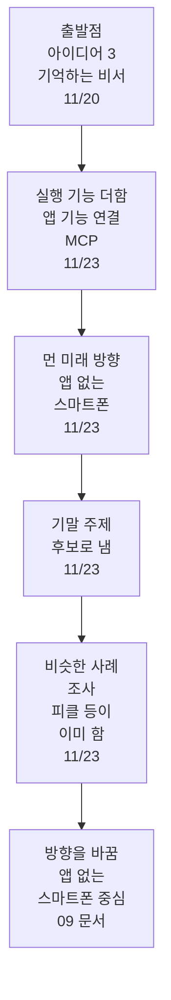

# 아이디어 5: 누구나 쓰는 개인화 AI 비서

복잡한 사용법을 배우지 않아도 평소처럼 말하면 의도를 알아듣고, 지난 활동을 기억해 두었다가, 필요한 앱 기능을 연결해 일까지 끝내 주는 AI 비서입니다. 낸 사람은 lgosoup입니다. 아이디어 5의 첫 안이고, 사례 조사 뒤 방향을 바꾼 안은 [09_idea_request_function_map.md](09_idea_request_function_map.md)에 있습니다.

## 1. 나온 과정

### 가. 출발점: LLM 취약계층 (11/20)

1) LLM(대규모 언어 모델)은 빠르게 발전하고 있지만, 모든 사람이 쉽게 쓰지는 못합니다. 어떤 사람에게는 무엇을 어떻게 요청해야 하는지부터 어렵습니다.
2) 이 어려움은 고령층만의 일이 아닙니다. 20대에도 AI를 끝까지 활용하지 못하는 사람이 있습니다. 그래서 대상을 LLM을 쓰기 어려워하는 모든 사람으로 잡았습니다.
3) 핵심은 사람에게 새 기술을 먼저 배우라고 하지 않는 것입니다. 개발 지식이나 프롬프트 작성법을 몰라도 원하는 일을 평소 말로 요청할 수 있어야 합니다.
4) 이 출발점은 [아이디어 3](06_idea_memory_assistant.md)과 같고, 그때 정한 기억 구조를 그대로 씁니다(2장).

### 나. 실행 기능을 더함 (11/23)

1) AI가 사용자를 잘 이해해도 말로 설명만 하면 할 수 있는 일에 한계가 있습니다. 원하는 결과를 얻으려면 메일, 일정, 파일처럼 실제로 쓰는 앱의 기능을 실행할 수 있어야 합니다.
2) 연결 방법으로 MCP(Model Context Protocol)를 생각했습니다. AI가 바깥 도구나 서비스의 기능을 쓸 수 있게 이어 주는 표준 방식입니다.
3) 앱을 대신 눌러 주는 데서 그치지 않고, 사용자가 원하는 일에 따라 AI가 필요한 기능을 골라 조합하는 데까지 보았습니다.

### 다. 먼 미래 방향: 앱 없는 스마트폰 (11/23)

1) 지금은 사용자가 하려는 일에 맞는 앱을 찾아 실행합니다. 그런데 앱은 결국 여러 기능을 모아 둔 것입니다.
2) 기능이 따로 제공된다면, 사용자가 앱을 고르는 대신 AI가 필요한 기능을 모아 그 사람의 목적에 맞게 처리하는 방식도 생각할 수 있습니다(3장).

### 라. 사례 조사 (11/23)

1) 사용자 기억을 쌓아 일까지 대신 하는 것은 피클이 이미 하고 있었고, Gemini와 Siri AI도 앱 기능을 대신 실행합니다(5장).
2) 그래서 이 안은 여기서 멈추고, 요청을 알아듣는 부분은 이런 앞단 서비스에 맡긴 뒤 앱 없는 스마트폰 쪽으로 방향을 바꿨습니다([09](09_idea_request_function_map.md)).

## 2. 두 가지 기능

| 기능 | 하는 일 | 쓰는 기술 |
|---|---|---|
| ① 기억하고 이해하기 (제2의 두뇌) | 사용자의 활동, 관계, 지난 맥락을 기억해 같은 정보를 매번 다시 설명하지 않게 함 | 지식 그래프 |
| ② 실제로 수행하기 | 의도를 파악한 뒤 필요한 앱 기능을 연결하고 실행해 일을 끝냄 | 앱 기능 연결과 MCP |

1) 지식 그래프는 사람, 파일, 활동, 시간처럼 서로 관련된 정보를 관계로 이어 둔 기억 구조입니다.
2) 일반 사용자가 지식 그래프를 직접 만들고 관리하기는 어렵습니다. 그래서 사용자가 따로 정리하지 않아도 AI가 활동을 기억으로 바꾸게 합니다. 기억 구조는 [아이디어 3](06_idea_memory_assistant.md) 2장의 "활동 기록 → 사건 → 기억 묶음 → 근거"를 그대로 씁니다.
3) 두 기능을 합친 흐름은 "의도 이해 → 기억 활용 → 기능 연결과 실행 → 결과 기록"입니다. 결과는 다시 다음 일에 쓸 기억이 됩니다.

## 3. 앱 없는 스마트폰

1) 앱을 없애고 기능만 이어 둔다고 원하는 일이 저절로 되지는 않습니다. 사람이 앱을 쓸 때는 어떤 기능을 누를지뿐 아니라 누구에게, 무엇을, 어떤 상황에서 할지도 함께 판단하기 때문입니다.
2) 예를 들어 "지난주에 찍은 사진을 엄마한테 보내 줘"를 처리하려면 사진 보내기 기능만으로는 부족합니다. "지난주"가 언제인지, 어떤 사진인지, "엄마"가 누구인지 알아야 합니다.
3) 그래서 기능을 잇는 능력과 함께 사용자의 의도와 지난 맥락을 이해하는 기억 구조가 필요하다고 보았습니다. 이 안에서 지식 그래프는 맥락을 파악하고, MCP와 앱 기능 연결은 실제 일을 맡습니다.
4) 앱 없는 스마트폰은 지금 완성된 기술이나 이번에 만들 결과물이 아니라, LLM이 운영체제 수준에서 기능을 잇고 조율하는 먼 방향입니다. 방향을 바꾼 뒤에는 이 방향을 중심에 두었습니다([09](09_idea_request_function_map.md) 4장).

## 4. 개발자가 MCP를 쓸 때와 다른 점

| 비교 | 개발자가 MCP를 쓸 때 | 일반 사용자가 앱을 쓸 때 |
|---|---|---|
| 요청하는 방식 | 필요한 도구와 실행 방법을 직접 정하거나 설정함 | "엄마한테 그 사진 보내 줘"처럼 원하는 결과를 말함. 무엇을 할지는 AI가 파악해야 함 |
| 맥락을 준비하는 방식 | 파일 위치, 대상, 조건을 직접 확인해서 넘김 | "그 사진", "지난번", "엄마" 같은 말을 씀. 필요한 정보는 AI가 기억과 상황에서 찾아야 함 |
| 일을 끝내는 방식 | 여러 기능을 어떤 순서로 실행할지 직접 설계함 | 어떤 기능이 필요한지 몰라도 결과를 원함. 기능을 고르고 이어서 실행하는 것은 AI가 해야 함 |

그래서 일반 사용자를 위한 비서는 도구를 많이 연결하는 것만으로는 부족하고, 말을 이해하고, 기억에서 맥락을 찾고, 알맞은 기능을 조합해 실행하는 구조가 함께 있어야 한다고 보았습니다.

## 5. 비슷한 사례

| 분야 | 이미 있는 것 | 비어 있는 곳 |
|---|---|---|
| 기억을 쌓아 대신 실행하는 비서 | 피클(사용자마다 기억을 쌓는 에이전트가 연결한 캘린더·메일·외부 서비스로 일정 확인, 식당 예약, 매장 전화 등을 대신 함, 2026년 11월 국내 앱스토어 무료 앱 상위권) | 기억(①)과 실행(②)을 둘 다 하고 있어 이 안과 가장 가까움 |
| 휴대폰 비서가 앱을 대신 씀 | 구글 Gemini(일부 안드로이드 앱에서 여러 단계 작업을 대신 하고, 앱이 AppFunctions로 기능을 내놓음), 애플 Siri AI(개인 맥락, 화면 인식, 앱 기능 연결, 2026.6 발표), ChatGPT·Claude의 앱 연결 기능 | 큰 회사들이 같은 방향으로 가고 있음. 지원하는 앱은 아직 일부 |
| 앱 대신 AI 비서가 일하는 기기 | 도이치텔레콤 AI Phone(Perplexity 비서가 앱을 일일이 열지 않고 일을 처리하게 함, 2025), Rabbit r1(앱 쓰는 법을 배운 모델로 사용자 대신 앱을 다루는 기기, 2024) | 기기를 새로 사야 함 |
| 개인 활동 기억 | [아이디어 3](06_idea_memory_assistant.md) 3장의 Microsoft Recall, Graphiti 등 | 기억을 찾는 데서 끝나고 실행까지 잇지는 않음 |

## 6. 지금까지의 판단

1) "그냥 AI한테 물어보면 되지 않나"에 "AI 채팅은 앱을 못 쓴다"로는 답할 수 없습니다. ChatGPT, Claude 같은 AI 채팅도 메일, 일정 같은 앱에 연결하는 기능이 있고, Gemini와 Siri AI는 앱 기능을 대신 실행합니다.
2) 처음에 본 남은 틈은 두 가지였습니다.
   - 막연한 말을 그 사람의 기억(지식 그래프)으로 풀어 실행하는 것
   - 대상을 개발자나 얼리어답터가 아니라 LLM을 쓰기 어려워하는 사람으로 잡는 것
3) 두 틈 모두 피클이 이미 하고 있어 차별점이 되기 어렵습니다. 앱 대신 AI가 일하는 방향 자체도 구글, 애플, 도이치텔레콤 같은 큰 회사가 이미 가고 있습니다.
4) 아이디어 3과 다른 점도 흐립니다.
   - 아이디어 3도 "찾기에서 작업까지"를 남은 틈으로 잡았고 메일 초안까지 다뤘습니다. 좁힌 범위도 "앱 하나와 기억 찾기 하나"로 같습니다.
   - 실제로 다른 것은 여러 앱 기능을 AI가 골라서 잇는 것(MCP)과 앱 없는 스마트폰 방향입니다.
5) 걸리는 점이 있습니다.
   - 활동을 모으는 기능은 개인정보 문제가 큽니다. 피클은 사용자가 말하지 않은 가족 관계를 메일, 넷플릭스 프로필, 연락처를 조합해 알아내거나 시키지 않은 식당 전화를 스스로 건 일로 기사가 났습니다. 시연은 지어낸 활동 기록으로 해야 합니다.
   - 범위가 큽니다. 2명이 12/16까지 하려면 기능 하나와 기억 찾기 하나로 좁혀야 합니다.
6) 그래서 기억과 요청 이해는 앞단 서비스에 맡기고, 아이디어 3과 달랐던 "여러 앱 기능을 잇는 것"과 "앱 없는 스마트폰" 쪽으로 방향을 바꿨습니다([09](09_idea_request_function_map.md)).

## 7. 출처

- [What is the Model Context Protocol (MCP)? (Model Context Protocol)](https://modelcontextprotocol.io/introduction)
- [캘린더 속 송년회 일정 훑고 식당 빈자리 예약까지⋯AI 비서 '피클' 써보니 (아이뉴스24)](https://www.inews24.com/view/2025971)
- [Privacy Control Concerns Become Reality Amid Craze for 'Pickle,' the AI That Acts on Its Own (아시아경제)](https://view.asiae.co.kr/en/article/2026110909414917294)
- [Pickle: The personal AI agent network for Asia (Y Combinator)](https://www.ycombinator.com/companies/pickle-2)
- [Ask Gemini to handle your multi-step tasks in select Android apps (Pixel Phone Help)](https://support.google.com/pixelphone/answer/16940971)
- [Google details 'AppFunctions' that let Gemini use Android apps (9to5Google)](https://9to5google.com/2026/02/25/android-appfunctions-gemini/)
- [Apple introduces Siri AI, a profoundly more capable and personal assistant (Apple)](https://www.apple.com/newsroom/2026/06/apple-introduces-siri-ai-a-profoundly-more-capable-and-personal-assistant/)
- ["Our" AI-phone brings "AI for everyone" (Deutsche Telekom)](https://www.telekom.com/en/newsroom/latest-updates/media-information/2025/8/_our_-ai-phone-brings-ai-for-everyone)
- [AI phone and tablet: Telekom and Perplexity sell hardware (heise online)](https://heise.de/-10522526)
- [introducing r1, a pocket companion that moves AI from words to action (rabbit)](https://www.rabbit.tech/newsroom/introducing-r1)
