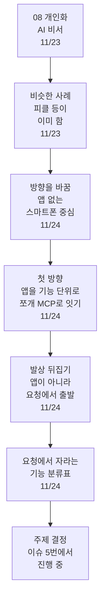
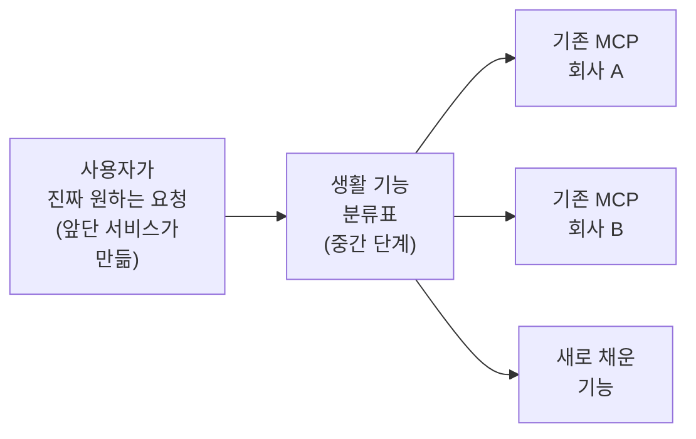

# 아이디어 5: 요청에서 자라는 기능 분류표

사람들이 실제로 한 요청을 모아 거꾸로 "생활 기능 분류표"를 뽑고, 그 칸을 여러 회사의 MCP로 채우되 기존 MCP로 채워지지 않는 칸은 직접 만들어 채워서, 지금 AI 비서가 끝내지 못하는 요청을 끝까지 실현하게 하는 층입니다. 낸 사람은 lgosoup입니다. 아이디어 5의 첫 안인 [개인화 AI 비서](08_idea_personal_assistant.md)에서 방향을 바꿔 이어 간 안입니다.

## 1. 나온 과정

### 가. 08에서 방향을 바꾼 이유 (11/23~11/24)

1) [08](08_idea_personal_assistant.md)의 개인화 AI 비서는 기억과 실행을 함께 하는 비서였습니다. 그런데 사용자 기억을 쌓아 일까지 대신 하는 것은 피클이 이미 하고 있었고, Gemini와 Siri AI도 앱 기능을 대신 실행합니다([08](08_idea_personal_assistant.md) 5장, 6장).
2) 그래서 요청을 알아듣는 부분(의도, 맥락, 기억)은 이런 앞단 서비스에 맡기기로 했습니다. 앞단은 의도와 맥락을 담은 요청을 만들어 넘겨 줍니다.
3) 이 안은 그 뒤에서 요청을 실제로 실현하는 쪽, 즉 08에서 먼 방향으로만 두었던 앱 없는 스마트폰을 중심에 둡니다(4장).
4) 대상은 그대로 LLM 취약계층입니다. 이들은 원하는 일을 말로 요청할 수는 있습니다. 어려운 것은 AI 비서가 중간에 "그건 할 수 없어요"로 멈출 때 다른 방법을 찾지 못한다는 점입니다.

### 나. 첫 방향: 앱을 기능 단위로 쪼개 MCP로 잇기 (11/24)

1) 앱은 결국 기능 묶음입니다. 처음에는 앱을 기능 단위로 쪼개 MCP(Model Context Protocol)로 잇는 방향을 보았습니다. MCP는 AI가 바깥 도구나 서비스의 기능을 쓸 수 있게 이어 주는 표준 방식입니다.
2) 그러나 앱 기능을 모아 내놓는 것은 Zapier MCP, MCP 게이트웨이, 구글 AppFunctions가 이미 하고 있었습니다(6장).

### 다. 발상을 뒤집음: 앱이 아니라 요청에서 출발 (11/24)

1) 그래서 순서를 뒤집었습니다. 서비스가 가진 기능에서 출발하지 않고, 사용자가 진짜 원하는 요청에서 출발해 그 요청을 실현하는 데 필요한 기능으로 나눕니다(3장).
2) 앞단이 만든 요청을 더 낮은 수준의 기능 단위로 옮기는 셈입니다(3장 다.).

### 라. 요청에서 자라는 기능 분류표 (11/24)

1) 나눈 기능을 "생활 기능 분류표"로 정리하고, 그 분류표를 실제 요청에서 거꾸로 뽑아 계속 늘려 가는 것으로 정했습니다.
2) 분류표 칸마다 기존 MCP로 되는지를 표시하고, 안 되는 칸은 직접 채웁니다(2장).

## 2. 무엇을 하나

1) 요청은 앞단(피클 같은 비서, 상용 서비스)이 의도와 맥락을 담아 만든 것을 그대로 받습니다.
2) 그 요청을 생활 기능 분류표의 칸들로 나눕니다. 예: 연락하기 > 사진 보내기, 사진 > 사람별로 고르기, 일정 > 추가하기
3) 칸마다 여러 회사의 기존 MCP·API 기능을 통째로 또는 일부만 잇고, "기존 MCP로 됨 / 일부만 됨 / 안 됨"을 표시합니다.
4) 안 되는 칸은 기존 기능을 조합하거나 새 기능을 만들어 채웁니다. 한 번 채운 칸은 분류표에 남아 다음 요청에도 쓰입니다.
5) 사용자에게는 이번 요청이 어떤 칸들로 이뤄졌고, 그중 어느 칸을 새로 채워서 가능해졌는지를 쉬운 말로 보여 줍니다. 되돌릴 수 없는 일(전송, 결제)은 확인을 받은 뒤 실행합니다.
6) 예를 들어 "지난주 사진 중 엄마 나온 것만 골라 큰 글씨 설명과 함께 보내 줘"에서 "사람별로 사진 고르기", "큰 글씨 설명 붙이기"가 기존 MCP에 없으면 그 칸을 채워서 요청을 끝까지 실현합니다.

## 3. 발상의 차이

### 가. 출발점이 반대

| 비교 | 기존 (Zapier MCP, MCP 게이트웨이, AppFunctions) | 이 아이디어 |
|---|---|---|
| 출발점 | 서비스: 이미 있는 앱과 API | 사용자가 진짜 원하는 요청 |
| 방향 | 아래에서 위로: 서비스가 가진 기능을 쪼개 내놓음 | 위에서 아래로: 요청을 실현하는 데 필요한 기능으로 나눔 |
| 기능이 없으면 | 쓸 수 없음 | 만들거나 덧붙여 채움 |
| 목표 | 기존 기능을 AI가 쓸 수 있게 하기 | 요청을 끝까지 실현하기 |
| 범용성 | 연결된 서비스 범위 안 | 분류표가 기준이라 서비스가 바뀌어도 그대로 |

### 나. 분류표가 다른 점

애플 App Intents 스키마 도메인과 schema.org Action도 기능을 분류합니다. 그러나 이 분류는 회사나 표준 단체가 미리 정한 분야 틀이고, 앱이 그 틀에 맞춰 들어갑니다. 이 아이디어의 분류표는 실제 요청에서 거꾸로 뽑고, 새 요청이 기존 칸으로 설명되지 않으면 칸이 새로 생깁니다.

### 다. 언어로 비유하면

| 단계 | 프로그래밍에서 | 이 아이디어에서 | 맡는 쪽 |
|---|---|---|---|
| 초고수준 | 사람이 쓴 코드 | 의도와 맥락이 담긴 자연어 요청 | 앞단 서비스 |
| 중간 단계 | 중간 언어 | 생활 기능 분류표로 옮긴 요청 | 이 아이디어 |
| 저수준 | 기계어 | 실제 MCP·API 호출 | 기존 서비스와 새로 채운 기능 |

## 4. 앱 없는 스마트폰

### 가. 그리는 모습

1) 폰에는 LLM 하나를 두고, 기능은 MCP처럼 하나의 방식으로 기능 단위로 이어 둡니다.
2) 사용자는 앱을 찾아 고르는 대신 하고 싶은 일을 말하고, 그 요청에 맞는 기능 조합이 그때그때 만들어집니다. 앱이 기능 묶음이라면, 요청마다 만들어지는 이 기능 조합이 그 사람만의 앱입니다.
3) 이 모습은 지금 완성된 기술이나 이번에 만들 결과물이 아니라 먼 방향입니다. 생활 기능 분류표는 이 방향의 바탕이 됩니다.

### 나. 비슷한 시도

| 시도 | 하는 일 | 이 방향과 비교 |
|---|---|---|
| 구글 AppFunctions | 안드로이드 앱이 기능을 기능 단위로 내놓고 Gemini가 씀 | 기능 단위로 내놓기는 하지만, 앱이 정한 단위이고 안드로이드 안에서만 |
| iOS 27 단축어 | 말로 설명하면 여러 앱 동작을 엮은 자동화를 만들어 줌 | 애플 기기 안에서만, 앱이 내놓은 동작만 엮음 |
| 구글 Create My Widget | 말로 설명하면 Gemini가 데이터를 엮은 위젯을 만듦 | 위젯만 |
| Nothing Playground, Essential Apps | 프롬프트로 위젯 미니 앱을 만들어 올림 | 위젯만, 새 앱 게시는 잠시 멈춤 |
| MCP Apps | 앱 회사가 만든 화면을 ChatGPT, Claude 대화 안에 띄움 | 앱 회사가 만든 것을 보여 줄 뿐, 요청에 맞춰 기능을 조합하지는 않음 |

## 5. 12/16까지 만들 범위

1) 연락·사진·일정 영역의 실제 요청 100개를 모아 생활 기능 분류표를 뽑습니다.
2) 분류표 칸에 기존 MCP를 잇고, 칸마다 "됨 / 일부만 됨 / 안 됨"을 표시합니다.
3) 안 되는 칸 가운데 2~3개를 직접 채웁니다.
4) 같은 요청 100개를 (가) 일반 AI 비서에 MCP를 연결한 경우와 (나) 이 아이디어로 처리한 경우로 나눠 끝까지 실현된 요청 수를 비교하고, 새로 채운 칸 덕분에 처음 실현된 요청 수를 따로 셉니다.

## 6. 비슷한 사례

| 분야 | 이미 있는 것 | 비어 있는 곳 |
|---|---|---|
| 요청을 받아 대신 실행하는 비서 | 피클, 구글 Gemini, 애플 Siri AI, ChatGPT·Claude의 앱 연결 기능(자세히는 [08](08_idea_personal_assistant.md) 5장) | 연결된 서비스가 내놓은 기능 안에서만 일함 |
| 여러 서비스 기능을 한 MCP로 모으기 | Zapier MCP(9,000개 넘는 앱의 동작 가운데 원하는 것만 골라 내놓고, 칸 값을 고정해 일부만 쓸 수 있음), MCP 게이트웨이(Kong 등, 여러 MCP 서버의 도구를 모아 일부만 내놓음) | 개발자나 관리자가 앱 기준으로 고름. 서비스에 없는 기능은 쓸 수 없음 |
| 기능 분류 | 애플 App Intents 스키마 도메인(분야별 동작 틀), schema.org Action(웹용 동작 분류), JSPLIT(MCP 도구를 분류해 AI가 도구를 잘 고르게 함) | 미리 정한 틀이거나 이미 있는 도구를 분류함. 실제 요청에서 자라지 않음 |
| 요청 분류 | TUNA(실제 대화 1,193개에서 요청 분류 57가지를 뽑음) | 칸마다 도구로 되는지와는 잇지 않음 |
| 없는 도구를 스스로 만드는 에이전트 | Alita·Alita-G(부족한 도구를 MCP로 만들어 쓰고 다시 쓰는 "MCP Box"로 쌓음), Tool-Genesis(도구 만들기 벤치마크). MCP-Zero는 만들지 않고 기존 도구 가운데 필요한 것을 찾아 쓰는 연구이고, "찾고 없으면 Alita 방식으로 만든다"는 결합은 논문 7.3절이 앞으로의 방향으로 제안함 | 에이전트가 과제를 풀려고 만들고 쌓음. 사람이 읽는 생활 기능 분류표로 남지는 않음 |
| MCP를 더 낮은 언어로 옮기기 | Cloudflare Code Mode(MCP 도구를 TypeScript API로 바꿔 LLM이 코드를 짜게 함) | 토큰을 아끼려는 개발자용 |

## 7. 지금까지의 판단

1) "그냥 AI한테 물어보면 되지 않나"에 "AI 채팅은 앱을 못 쓴다"로는 답할 수 없습니다([08](08_idea_personal_assistant.md) 6장 1)).
2) 요청을 알아듣고 대신 실행하는 것은 피클과 큰 회사들이 이미 하고 있습니다. 그래서 이 아이디어는 그 부분을 앞단에 맡기고, 앞단이 만든 요청을 끝까지 실현하는 쪽만 맡습니다.
3) 남은 틈은 두 가지로 보입니다.
   - 실제 요청에서 거꾸로 뽑아 계속 자라는 생활 기능 분류표
   - 그 칸마다 지금 MCP로 되는지 안 되는지를 보여 주는 지도. 기능 분류 연구와 요청 분류 연구는 있지만, 둘을 이어 "생활 요청 가운데 무엇이 되고 무엇이 안 되는지"를 보여 주는 것은 검색한 범위에서 찾지 못했습니다.
4) 빈 칸을 직접 만들어 채우는 것은 Alita, Alita-G 같은 연구가 이미 하고 있습니다. MCP-Zero는 기존 도구 가운데 필요한 것을 찾아 쓰는 쪽입니다. 이 아이디어에서 다른 점은 채운 칸이 에이전트 혼자 쓰는 도구가 아니라 사람이 읽을 수 있는 분류표 칸으로 남아 다음 요청에 다시 쓰인다는 것입니다.
5) 아이디어 3과 다른 점은 이렇습니다.
   - 아이디어 3: 사용자의 기억을 찾아 앱 하나(Gmail)의 작업까지 이어 주는 비서
   - 아이디어 5: 기억과 요청 이해는 앞단에 맡기고, 요청을 실현하는 데 필요한 기능을 분류표로 나누어 여러 회사의 MCP로 채우고 빈 칸을 메우는 층
6) 걸리는 점이 있습니다.
   - 요청을 기능 단위로 나눠 MCP로 잇는 쪽에도 비슷한 것이 이미 많습니다. 기능 모으기(Zapier MCP, MCP 게이트웨이), 기능 단위로 내놓기(AppFunctions), 없는 기능 만들어 채우기(Alita), 더 낮은 언어로 옮기기(Cloudflare Code Mode)가 있습니다(4장 나., 6장). 남은 차이가 3)의 분류표와 지도뿐이라, 이것으로 충분한지 정해야 합니다.
   - 사회공헌이 약합니다. 대상(LLM 취약계층)이 넓고, 사진 보내기나 일정 넣기 같은 예시는 피해보다 불편을 줄입니다. 대상을 좁히고 요청이 실현되지 않아 생기는 실제 손해를 재야 합니다.
   - 사진, 연락처를 다루므로 개인정보 위험이 있습니다. 피클은 사용자가 말하지 않은 가족 관계를 메일, 넷플릭스 프로필, 연락처를 조합해 알아내거나 시키지 않은 식당 전화를 스스로 건 일로 기사가 났습니다. 시연은 지어낸 데이터로 하고, 되돌릴 수 없는 실행은 확인을 받아야 합니다.
   - 새로 채운 기능이 잘못 동작할 수 있습니다. 채운 칸은 사례 시험을 거쳐야 분류표에 남깁니다.

## 8. 출처

- [What is the Model Context Protocol (MCP)? (Model Context Protocol)](https://modelcontextprotocol.io/introduction)
- [Privacy Control Concerns Become Reality Amid Craze for 'Pickle,' the AI That Acts on Its Own (아시아경제)](https://view.asiae.co.kr/en/article/2026110909414917294)
- [Google details 'AppFunctions' that let Gemini use Android apps (9to5Google)](https://9to5google.com/2026/02/25/android-appfunctions-gemini/)
- [Apple Brings Natural Language Creation to Shortcuts App (MacRumors)](https://www.macrumors.com/2026/06/08/apple-brings-natural-language-to-shortcuts/)
- [Gemini Intelligence brings gen UI, Gboard 'Rambler' to Android (9to5Google)](https://9to5google.com/2026/05/12/gemini-intelligence-announcement/)
- [Nothing launches AI tool for building mini apps using prompts (TechCrunch)](https://techcrunch.com/2025/09/30/nothing-launches-ai-tool-for-building-mini-apps-using-prompts/)
- [Hands-on: Nothing 'Essential Apps' let you vibe code widgets (9to5Google)](https://9to5google.com/2026/02/10/nothing-essential-apps-hands-on/)
- [MCP Apps - Bringing UI Capabilities To MCP Clients (Model Context Protocol Blog)](https://blog.modelcontextprotocol.io/posts/2026-01-26-mcp-apps/)
- [How Zapier MCP tools work (Zapier)](https://docs.zapier.com/mcp/overview/how-tools-work)
- [How to: Aggregate MCP tools from multiple AI MCP Server entities (Kong)](https://developer.konghq.com/ai-gateway/aggregate-mcp-tools/)
- [App schema domains (Apple Developer)](https://developer.apple.com/documentation/appintents/app-schema-domains)
- [Potential Actions (schema.org)](https://schema.org/docs/actions.html)
- [JSPLIT: A Taxonomy-based Solution for Prompt Bloating in Model Context Protocol (arXiv 2510.14537)](https://arxiv.org/abs/2510.14537)
- [Taxonomy of User Needs and Actions (arXiv 2510.06124)](https://arxiv.org/abs/2510.06124)
- [Alita (arXiv 2505.20286)](https://arxiv.org/abs/2505.20286)
- [Alita-G (arXiv 2510.23601)](https://arxiv.org/abs/2510.23601)
- [MCP-Zero: Active Tool Discovery for Autonomous LLM Agents (arXiv 2506.01056)](https://arxiv.org/abs/2506.01056)
- [Tool-Genesis (arXiv 2603.05578)](https://arxiv.org/abs/2603.05578)
- [Code Mode: the better way to use MCP (Cloudflare)](https://blog.cloudflare.com/code-mode/)
