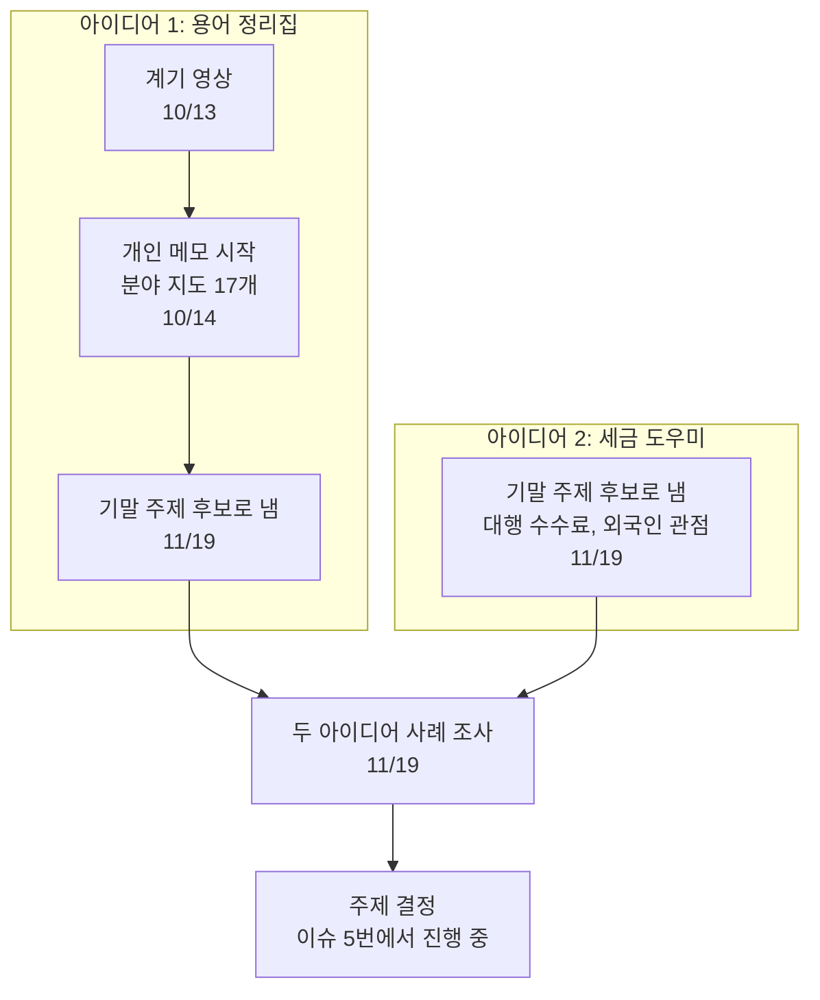

# 주제 도출 과정

팀이 좋다고 본 아이디어 2개와, 각각 어떻게 나왔는지 정리한 문서입니다. 주제는 아직 정하지 않았고 [이슈 #5](https://github.com/lumos0107/AI_Final_Project/issues/5)에서 정합니다.

## 1. 두 아이디어

| 구분 | 아이디어 1: 바이브 코딩 용어 정리집 | 아이디어 2: 세금 도우미 |
|---|---|---|
| 한 줄 | 비전공자가 AI에게 일을 시킬 때 필요한 분야별 이름을 보고 골라 쓰게 하는 정리집 | 홈택스가 어려워 대행에 수수료를 내는 사람, 특히 외국인을 위한 세금 환급 도우미 |
| 낸 사람 | lumos0107 | lumos0107 |
| 처음 생각한 때 | 2026년 10월 개인 메모. 기말 후보로 낸 것은 11/19 | 11/19 |
| 출발점 | 바이브 코딩을 하며 직접 겪은 불편. 용어를 몰라 AI에게 두루뭉술하게 시키게 됨 | 홈택스가 어려워 세무사나 대행 서비스에 수수료를 내는데, 만드는 일은 어려워 보이지 않았음 |
| 사례 조사 뒤 남은 빈자리 | 모션, 게임처럼 보이는 예시가 없는 분야. "이름을 알면 빨라지나"를 잰 사례는 못 찾음 | 외국인용 환급 도우미 앱은 못 찾음 |
| 걸리는 점 | 웹 부품 쪽은 이미 많음. 내용 중심이라 Skill과 MCP 점수가 약할 수 있음 | 국세청 무료 원클릭 환급이 이미 있음. 세무사법과 개인정보 위험 |
| 자세히 | [01_idea_glossary.md](01_idea_glossary.md) | [02_idea_tax.md](02_idea_tax.md) |

## 2. 나온 과정

1) 아이디어 1은 기말 프로젝트 전인 10월부터 있던 생각입니다. lumos0107이 바이브 코딩을 하며 겪은 불편에서 시작해 개인 메모로 정리해 두었고, 코드는 만들지 않았습니다. 11월 19일 이 생각을 기말 주제 후보로 냈습니다.
2) 아이디어 2는 11월 19일 lumos0107이 낸 생각입니다. 홈택스가 어려워 세무사나 대행 서비스에 수수료를 내고 맡기는 데서 출발했고, 외국인에게는 더 어렵다는 관점을 더했습니다.
3) 같은 날 두 아이디어마다 비슷한 서비스와 연구가 있는지 웹 검색으로 찾았습니다. 조사 뒤 아이디어 1의 빈자리는 모션과 게임 쪽으로, 아이디어 2의 빈자리는 외국인 쪽으로 좁혀졌습니다.

## 3. 고르는 기준으로 본 두 아이디어

기준은 AI 후보 탐색 중에 생겼고([earlier_rounds/01_criteria.md](earlier_rounds/01_criteria.md)), 이슈 #5에 적은 6가지와 같습니다. 아직 따져 보지 않은 칸은 채우지 않고 그대로 표시했습니다.

| 기준 | 아이디어 1: 용어 정리집 | 아이디어 2: 세금 도우미 |
|---|---|---|
| 1. 한 문장 정의: 무엇이 본 적 없는 것인가 | 아직 정하지 않음 | 아직 정하지 않음 |
| 2. 그냥 AI한테 물어보면 되지 않나 | 이름을 모르면 물어볼 수도 없음. 보고 고르기와 몰랐던 것 발견하기는 대화로 하기 어려움(10월 메모) | 아직 따져 보지 않음 |
| 3. 사회에 도움이 되거나 돈을 벌 수 있나 | 비전공자가 AI에게 의도를 더 정확하고 빠르게 전하게 함 | 한국인은 국세청 무료 서비스가 이미 있음. 외국인은 안내가 부족함 |
| 4. Skill이나 MCP가 꼭 필요한가 | 정리집을 Skill이나 MCP로 만들어 AI 대화 안에서 쓰게 하는 방법을 검토 중 | 아직 따져 보지 않음 |
| 5. 실제 데이터를 쓰고, 효과를 숫자로 보여 줄 수 있나 | "이름을 알면 정말 빨라지나"를 재 볼 수 있음. 잰 사례는 못 찾음 | 아직 따져 보지 않음 |
| 6. 2명이 12/16까지 핵심 기능을 만들 수 있나 | 여러 분야를 한 번에 하면 커짐. 코드보다 내용 만드는 일이 큼(10월 메모) | 코드보다 세법을 정확히 맞추는 일과 책임 문제가 큼 |

## 4. 문서 목록

| 문서 | 내용 |
|---|---|
| [01_idea_glossary.md](01_idea_glossary.md) | 아이디어 1이 나온 과정, 분야 지도, 비슷한 사례 |
| [02_idea_tax.md](02_idea_tax.md) | 아이디어 2가 나온 과정, 비슷한 사례와 걸리는 점 |
| [03_ai_corrections.md](03_ai_corrections.md) | 주제를 찾는 동안 AI의 판단을 사람이 바로잡은 기록 |
| [social_targets/](social_targets/) | 사회 문제 쪽으로 넓힌 후보. 대상 6개, 대상별 문제, 해결 방법 30개, 평가로 남은 12개와 떨어진 이유 |
| [earlier_rounds/](earlier_rounds/) | 두 아이디어가 나오기 전, AI가 후보를 낸 1~6차 기록 |
| [earlier_rounds/01_criteria.md](earlier_rounds/01_criteria.md) | 고르는 기준이 생긴 순서 |
| [earlier_rounds/02_rounds.md](earlier_rounds/02_rounds.md) | 1~6차 후보와 버린 이유 |
| [earlier_rounds/03_blind_review.md](earlier_rounds/03_blind_review.md) | AI 심사위원 3명의 블라인드 평가와 원문([blind_review/](earlier_rounds/blind_review/)) |

## 5. 채점 기준과의 관계

| 공지 채점 기준 | 이 폴더에서 보여 주는 것 |
|---|---|
| 주제 해석과 독창성 | 두 아이디어가 나온 과정과 비슷한 사례 조사 (01, 02) |
| 기술 도구 사용의 타당성 (AI 활용 과정) | AI로 후보를 내고, 웹 검색으로 확인하고, AI 심사위원으로 평가한 과정 (earlier_rounds) |
| 도전과 해결 (AI가 틀렸을 때 바로잡은 과정) | AI가 낸 안의 약점을 사람이 짚어 고친 기록 (03) |
