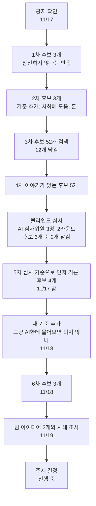

# 주제 도출 과정

기말 프로젝트 주제 "전례 없는(Unprecedented)"에 맞는 주제를 찾은 과정을 기록한 문서입니다.

- 기간: 2026년 11월 17일부터 (진행 중)
- 방법: Claude(AI)와 대화하며 후보를 내고, 후보마다 웹 검색으로 비슷한 서비스나 연구가 있는지 확인했습니다. 후보가 좁혀진 뒤에는 심사위원 역할을 맡긴 AI 에이전트 3명에게 블라인드 평가를 받았습니다.
- 판단: 후보를 버리거나 남기는 결정은 팀이 했습니다. AI가 낸 안을 사람이 바로잡은 기록은 [05_ai_corrections.md](05_ai_corrections.md)에 따로 모았습니다.

## 1. 전체 흐름

## 2. 차수별 요약

| 차수 | 날짜 | 나온 후보 | 대표 후보 | 팀 반응 | 이후 바뀐 것 |
|---|---|---|---|---|---|
| 1차 | 11/17 | 3개 | AI 실수 일지 | "참신하지 않다" | 기준에 "사회에 도움이 되거나 돈을 벌 수 있나"를 넣음 |
| 2차 | 11/17 | 3개 | 동네 가게를 AI 비서에게 열어 주는 창구 | "좀 더 뽑아 달라" | 분야를 나눠 대량으로 찾기로 함 |
| 3차 | 11/17 | 52개 검색, 12개 남김 | AI 눈에만 보이는 글씨 검사기 | "더 참신한 것" | 점검 도구가 많다는 점을 알아챔 |
| 4차 | 11/17 | 5개 | 말로 만드는 내 앱 | "심사위원 설득이 중요하다" | 심사위원 시점의 블라인드 평가를 하기로 함 |
| 블라인드 심사 | 11/17 | 6개 평가 | 글씨 검사기 66점, 집앞평가 65점 | "새로운 주제를 찾아 달라" | 점수를 가른 기준 4가지를 뽑음 |
| 5차 | 11/17~18 | 4개 | AI 답변 격차 점검기 | "주제는 좋은데 뭔가 부족하다" | "그냥 AI한테 물어보면 되지 않나"를 기준에 넣음 |
| 6차 | 11/18 | 3개 | 사진 위치 가림막 | 팀 아이디어를 직접 냄 | 팀 아이디어 검토로 넘어감 |
| 팀 아이디어 | 11/19 | 2개 | 바이브 코딩 용어 정리집 | 사례 조사 요청 | 비슷한 사례를 분야별로 정리함 |

## 3. 지금 상태 (11/19)

- 주제는 아직 정하지 않았습니다.
- 팀이 직접 낸 두 아이디어(바이브 코딩 용어 정리집, 세금 도우미)를 사례와 함께 검토하고 있습니다. 자세한 내용은 [04_team_ideas.md](04_team_ideas.md)에 있습니다.

## 4. 문서 목록

| 문서 | 내용 |
|---|---|
| [01_criteria.md](01_criteria.md) | 주제를 고르는 기준이 생긴 순서 |
| [02_rounds.md](02_rounds.md) | 1차부터 6차까지 나온 후보와 버린 이유 |
| [03_blind_review.md](03_blind_review.md) | AI 심사위원 3명의 블라인드 평가 방법과 결과 |
| [04_team_ideas.md](04_team_ideas.md) | 팀이 낸 아이디어 2개와 비슷한 사례 |
| [05_ai_corrections.md](05_ai_corrections.md) | AI의 판단을 사람이 바로잡은 기록 |
| [blind_review/](blind_review/) | 심사위원 3명의 1·2라운드 답 원문 |

## 5. 채점 기준과의 관계

| 공지 채점 기준 | 이 폴더에서 보여 주는 것 |
|---|---|
| 주제 해석과 독창성 | 후보마다 비슷한 것이 있는지 찾아본 기록 (02, 04) |
| 기술 도구 사용의 타당성 (AI 활용 과정) | AI로 후보를 내고, 웹 검색으로 확인하고, AI 심사위원으로 평가한 과정 (02, 03) |
| 도전과 해결 (AI가 틀렸을 때 바로잡은 과정) | AI가 낸 안의 약점을 사람이 짚어 고친 기록 (05) |
