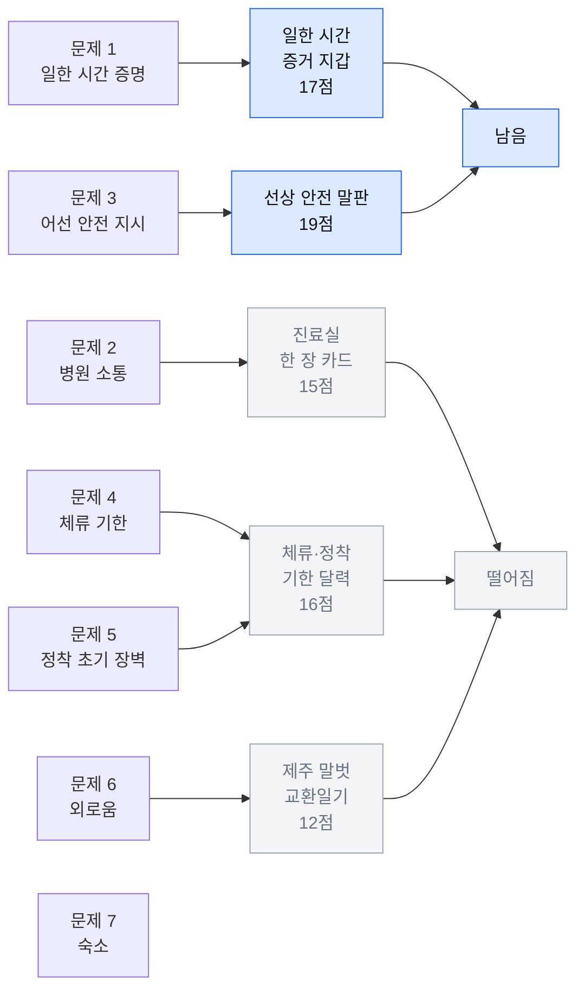

# 1. 외국인 유학생·이주노동자

[사회 문제 대상별 아이디어](README.md)의 대상별 문서다. 조사와 평가 방법은 README에 있다.

## 1. 대상

한국에 3개월 넘게 사는 외국인 가운데 유학(D-2) 체류자격 등으로 온 유학생과, 비전문취업(E-9)·선원취업(E-10)·계절근로(E-8) 등으로 온 이주노동자를 본다. 제주에 사는 사람을 먼저 염두에 두고 전국 자료도 함께 썼다.

- 제주에 3개월 넘게 사는 외국인은 2025년 30,447명이다[1]. 유형별로는 외국인 근로자가 40.5%로 가장 많고 유학생은 5.0%다. 이 비율은 민간 통계 페이지가 행정안전부 자료를 옮긴 표에서 가져왔고, 정부 원자료는 확인하지 못했다[2].
- 제주 비전문취업(E-9) 노동자 3,778명(2026년 5월 말) 가운데 어업이 1,491명(39.5%)으로 가장 많고, 농·축산업이 1,205명(31.9%)으로 뒤를 잇는다[3].

외국인 세금 환급 안내는 팀의 다른 후보라 이 목록에서 뺐다. 링크는 [세금 도우미](../02_idea_tax.md).

### 가. 처음 짐작과 조사 뒤 달라진 점

1) 처음에는 한국어로 된 행정, 계약, 병원 이용이 어렵다고 짐작했다. 셋 다 근거가 있었고, 외국인이 꼽은 한국생활 어려움 가운데 언어 문제가 가장 많았다(문제 1, 2, 4).
2) 조사해 보니 계약서를 읽는 것보다 일한 시간을 증명하는 것이 더 큰 벽이었다. 제주는 비전문취업(E-9) 가운데 어업이 가장 많아 어선 위 안전 소통을 따로 봐야 했다(문제 1, 3).
3) 외국인등록증이 나오기 전의 본인인증·계좌 문제와 출입국 사칭 사기, 외로움, 숙소도 새로 넣었다(문제 5, 6, 7).

## 2. 이 대상이 가진 문제

| 번호 | 문제 | 근거 |
|---|---|---|
| 1 | 일한 시간과 임금을 증명하고, 문제가 생기면 도움받기 | 2025년 8월 외국인 노동인권 침해 집중 신고 1,247건 가운데 임금체불이 965건(77%)[4]. 매일 손으로 적은 출퇴근 기록이 연필로 쓰고 지운 흔적이 있다는 이유로 증거로 인정되지 않은 사례[5] |
| 2 | 병원에서 증상을 말하고 설명을 알아듣기 | 최근 병원에 가지 못한 외국인(6.0%) 가운데 38.7%가 "한국어를 잘하지 못해서"를 이유로 꼽음[6]. 서울시 의료통역은 진료 3일 전 신청, 평일 낮, 연 4회까지라 갑자기 아플 때 쓰기 어려움[7] |
| 3 | 일터, 특히 어선 위에서 안전 지시를 알아듣기 | 2022년~2026년 1분기 산업재해로 숨진 이주노동자 463명 가운데 78.2%가 50인 미만 사업장[8]. 2025년 안전조업교육 이수자 가운데 외국인 선원은 7.2%이고, 법적 의무 대상이 아님[9] |
| 4 | 체류 허가와 기한을 놓치지 않기 | 유학생 시간제 취업 허가 신청이 2023년 28,272건에서 2025년 81,859건으로 늘었고, 지침상 14일인 처리가 약 한 달 걸린다는 증언[10]. 사업장 변경 신청 뒤 3개월 안에 새 일자리를 찾지 못하면 출국해야 함[11] |
| 5 | 정착 초기의 본인인증·금융 장벽과 사기 피하기 | 외국인등록증을 받기까지 두 달 걸려 예약과 집 계약이 늦어진 사례, e심으로는 본인인증이 안 됨[12]. 외국인 사기 피해자가 2023년 5,307명에서 2025년 19,907명으로 늘어남(관광객 대상 포함)[13] |
| 6 | 외로움과 관계 | 외국인이 꼽은 한국생활 어려움은 언어 문제 29.8%, 외로움 13.0% 순[6] |
| 7 | 안전하고 알맞은 숙소 | 경기도 계절근로자 숙소의 22.8%가 임시 가건물이고, 공공형 계절근로자의 22.0%가 숙소비 추가 청구를 겪음[14]. 산업단지 외국인 근로자 가운데 주택이 아닌 곳에 사는 사람의 42.5%가 고시원, 27.5%가 조립식 패널·컨테이너[15] |

문제 2와 6의 수치는 2025년 조사 결과를 찾지 못해 2024년 이민자체류실태 및 고용조사 결과를 썼다.

## 3. 해결 방법과 결과

선은 아이디어가 주로 겨냥한 문제만 이었다. 문제 7(숙소)을 주로 겨냥한 아이디어는 없다.

### 가. 일한 시간 증거 지갑

- 겨냥한 문제: 1 (숙소비 공제 기록으로 7 일부)
- 어떻게 푸는지: 수산물 가공 공장 노동자가 출퇴근 때 버튼을 누르고 모국어로 "오늘 7시 출근, 점심 30분"처럼 한마디 남기면 서버 시각이 붙은 기록이 쌓인다. 월말에 급여명세서 사진을 올리면 계약 기준 계산액과 실제 지급액의 차이 표, 상담용 한국어 1쪽 요약서(PDF)가 나온다.
- 이미 있는 것(다시 확인한 결과): 비슷한 것 있음(처음 판정보다 더 가까움). 돈내나: 교차 증거, 체불액 자동 계산, 로펌 연계[16]. WorkMate: 외국인용 다국어 출퇴근 기록과 예상 급여[17]

### 나. 진료실 한 장 카드

- 겨냥한 문제: 2
- 어떻게 푸는지: 의원에 가기 전 베트남어로 "어젯밤부터 배 오른쪽이 아프고 열이 난다"고 말하면 앱이 언제부터, 통증 정도, 먹는 약을 되묻고 의료진이 읽을 한국어 카드 한 장을 만든다. 진료 뒤 약봉투 사진을 찍으면 복용법을 모국어로 정리한다.
- 이미 있는 것(다시 확인한 결과): 있음. SIMTOMI: AI로 정리한 증상 요약을 한국어·베트남어 등 8개 언어로 의료진에게 보여 줌[18]. 서울대 MediBridge: 진료 전 AI와 대화해 의료진용 메모를 만듦[19]

### 다. 선상 안전 말판

- 겨냥한 문제: 3 (아픈 것을 알리는 문장으로 2 일부)
- 어떻게 푸는지: 출항 전 선원들이 모국어 안전 퀴즈 5문항을 풀고, 조업 중 선장이 한국어 버튼 "줄 위험, 뒤로 물러나"를 누르면 인터넷 없이 인도네시아어·베트남어 음성과 그림이 나온다. 번역과 음성은 육지에서 AI가 미리 만들어 두고, 선원은 "손을 다쳤어요" 버튼으로 선장에게 한국어 음성을 보낸다.
- 이미 있는 것(다시 확인한 결과): 비슷한 것 있음(처음엔 못 찾음). Fishery Speak: 어선 선원용 안전 용어집·번역, 인도네시아어는 있고 한국어·베트남어는 없음[20]. 한국해양교통안전공단 어선원 위험성 평가 챗봇: 인도네시아어·베트남어 번역은 계획 단계[21]. 한국어 지시를 인터넷 없이 여러 언어 음성으로 내보내는 형태는 못 찾음

### 라. 체류·정착 기한 달력

- 겨냥한 문제: 4, 5
- 어떻게 푸는지: 막 입국한 유학생이 입국일과 체류자격을 넣으면 외국인등록 → 휴대폰 → 계좌 순서의 첫 달 할 일과 마감일이 근거 문서 링크와 함께 달력 파일(.ics)로 나온다. 사업장을 바꾸려는 노동자에게는 구직 기한 3개월 카운트다운과 출입국 사칭 사기 주의가 나온다.
- 이미 있는 것(다시 확인한 결과): 있음(처음엔 개인 달력형 못 찾음). VIVISA: 9개 언어로 비자 만료 알림과 연장·변경 서류 안내[22]. VizaBridge: 만료 자동 알림[23]. Cloud K-TAG: 유학생 마감 알림[24]

### 마. 제주 말벗 교환일기

- 겨냥한 문제: 6 (지역 정보 교환으로 5 일부)
- 어떻게 푸는지: 서귀포 양식장의 인도네시아인 노동자와 제주대 학생 한 쌍이 각자 자기 말로 짧은 사진 일기를 쓰면 AI가 상대 말로 옮기고 답장 거리를 제안한다. 교대·조업으로 시간이 맞지 않아도 하루 한 번 따로 쓰면 된다.
- 이미 있는 것(다시 확인한 결과): 비슷한 것 있음. Slowly: 느린 편지 교환[25]. EveryPal: 번역 내장 펜팔[26]. LangJournal: 일기 교환과 AI 첨삭[27]. 이주노동자와 제주 주민을 운영자 승인으로 짝 짓는 형태는 못 찾음

"못 찾음"은 검색에서 잡히지 않았다는 뜻이다. 국내 어선 통역기 보급 사업(3회 검색 0건)과 지원센터 안에서 하는 짝 맺기 사업은 웹에 잘 올라오지 않아 검색이 놓쳤을 수 있다.

## 4. 평가

### 가. 점수표

| 아이디어 | 주제·독창성 | 기술 도구 | 도전과 해결 | 완성도 | 발표 | 합계(25) | AI 채팅으로 해결 | 사회 도움 | 법·윤리 | 2명·4주 |
|---|---|---|---|---|---|---|---|---|---|---|
| 선상 안전 말판 | 4 | 3 | 4 | 3 | 5 | **19** | 통과 | 통과 | 주의 | 주의 |
| 일한 시간 증거 지갑 | 2 | 4 | 4 | 3 | 4 | **17** | 통과 | 통과 | 주의 | 주의 |
| 체류·정착 기한 달력 | 2 | 4 | 3 | 4 | 3 | **16** | 탈락 | 통과 | 주의 | 통과 |
| 진료실 한 장 카드 | 1 | 3 | 3 | 4 | 4 | **15** | 탈락 | 통과 | 주의 | 주의 |
| 제주 말벗 교환일기 | 2 | 2 | 2 | 3 | 3 | **12** | 통과 | 통과 | 주의 | 주의 |

"AI 채팅으로 해결" 칸이 탈락이면 점수와 관계없이 남기지 않았다.

### 나. 남은 2개

#### 1) 선상 안전 말판 (19점)

- "본 적 없는" 정의 초안: AI는 육지에서 번역·음성을 만들고 사람이 검수하며, 바다 위에서는 AI도 인터넷도 없이 한국어 안전 지시 하나가 선원마다 다른 모국어 음성으로 바로 나오는 어선용 소통판. 발표용으로 줄이면 "AI를 바다에 데려가지 않는 AI 서비스"다.
- 시연 장면
  - 육지 단계(30초): 노트북에서 새 한국어 문장을 넣고 번역 → 역번역 → 음성 생성 → 검수 표 → 문장 팩 내려받기까지 보여 주어 AI가 하는 일을 드러낸다.
  - 입력: 선장 역할 팀원이 비행기 모드를 켠 폰에서 한국어 버튼 "줄 위험, 뒤로 물러나"를 누른다.
  - 출력: 짧은 신호음 뒤 인도네시아어와 베트남어 음성이 차례로 나오고, 화면에 그림과 세 언어 글자가 뜬다. 이어서 선원 역할이 "손을 다쳤어요"를 누르면 한국어 음성이 나온다.
- Skill·MCP가 들어갈 자리
  - Skill(필요함): "문장 팩 만들기" Skill. 번역 → 다른 모델로 역번역 → 원문과 비교 → 위험 단어 사전 대조(부정어, 방향어, 어선 장비 이름) → 음성 합성(TTS) → 검수 표 출력을 Claude Code가 매번 같은 순서로 따르게 한다. 안전 문장은 한 문장도 빠짐없이 같은 검사를 거쳐야 해서 절차를 고정하는 Skill이 실제로 쓸모 있다.
  - MCP(억지에 가까움): 모델 컨텍스트 프로토콜(MCP)은 AI 비서가 바깥 도구를 부르는 표준인데, 바다 위에는 인터넷이 없어 실행 중에 AI 비서가 MCP로 부를 일이 없다. 한국해양교통안전공단 자료를 읽어 퀴즈 초안을 만드는 MCP 서버를 개발 도구로 둘 수는 있지만, 파일을 직접 읽는 것과 차이가 작아 억지로 끼우는 것이다.
- AI가 틀릴 수 있는 곳과 시험 방법
  - 짧은 명령문 번역에서 부정·방향이 뒤집힘("당기지 마" ↔ "당겨"), 어선 용어(양망기, 로프, 갑판) 오역: 문장 50개를 번역하고 다른 모델로 역번역해 "역번역 일치 n/50", "원어민 판정 정확 n/50, 고친 문장 n개"로 적는다. 부정·방향 문장 10개는 따로 세어 오류 0개를 통과 기준으로 둔다.
  - 음성 합성 발음(베트남어 성조, 인도네시아어 낱말): 원어민이 글자를 보지 않고 음성만 듣고 받아 적게 해 "알아들은 문장 n/50"을 잰다.
  - 퀴즈 문항에 자료에 없는 내용을 지어냄: 문항마다 근거 문단을 붙이게 하고 근거와 맞지 않는 문항 수를 센다(예: 20문항 중 n개 수정).
  - 인터넷 없을 때 재생 실패: 브라우저 자동화 도구(Playwright)로 오프라인 상태를 만들어 버튼 50개를 모두 누르고 "재생 성공 n/50", "버튼부터 소리까지 평균 지연(밀리초)"을 기록한다.
- 가장 큰 위험: 4주 안에 인도네시아어·베트남어 원어민 검수자를 구하지 못하면 "검수된 안전 지시"라는 핵심이 무너지고, 검수 없는 기계 번역 안전 지시는 오히려 해가 될 수 있다. 첫 주에 제주대 유학생과 이주노동자 지원센터 통역을 섭외하고, 못 구하면 구할 수 있는 언어로 바꾼다.
- 고치면 나아질 점: 선원 폰 사이 전송은 빼고 선장 폰 하나를 스피커로 쓰게 줄이고, 육지 쪽 문장 팩 화면에 역번역 불일치를 자동으로 표시해 AI가 일하는 부분을 눈에 보이게 한다.

#### 2) 일한 시간 증거 지갑 (17점)

- "본 적 없는" 정의 초안: 한국어가 익숙하지 않은 노동자가 모국어로 말해 남긴 하루하루의 근무 기록을 서버 시각과 수정 이력이 붙은 채로 쌓았다가, 노동청·상담센터에 그대로 낼 수 있는 한국어 1쪽 요약서로 바꿔 주는 도구.
- 시연 장면
  - 입력: 미리 쌓아 둔 한 달 기록(베트남어 음성 메모, 예: "오늘 7시 출근, 점심 30분, 저녁 8시까지 포장")과 가짜 급여명세서 사진 한 장. 사업장은 수산물 가공 공장(제조업, 5인 이상)으로 정한다.
  - 출력: 날짜별 근무시간표, 계약 기준 계산액과 실제 지급액의 차이 표(차이 나는 날짜와 적용한 규칙 표시), 한국어 1쪽 요약서(PDF), 같은 내용의 베트남어 설명.
- Skill·MCP가 들어갈 자리
  - MCP(필요함): "임금 규칙 계산 MCP 서버". 최저임금, 가산율, 근로기준법 63조 적용 제외 업종, 5인 미만 여부를 도구로 내놓는다. 앱 안의 대형 언어 모델(LLM)이 숫자를 직접 만들지 않고 이 도구를 부르게 하면 "AI가 금액을 정하지 않는다"는 설계가 코드로 보장된다. 같은 서버를 다른 AI 비서에도 붙일 수 있어 표준 기술을 쓰는 이유가 분명하다.
  - Skill(보조): 명세서에서 뽑은 값을 정답 표와 대조하는 검사 절차를 Skill로 묶어 개발 중 반복해서 돌린다.
- AI가 틀릴 수 있는 곳과 시험 방법
  - 명세서·계약서 사진에서 값을 잘못 뽑음(시급, 공제 항목, 숙소비): 서식 3~4종으로 가짜 명세서 20장과 정답 표를 만들어 칸 단위 정확도를 잰다(예: 240칸 중 n칸 일치).
  - 업종·규모 예외를 무시한 계산: 업종(제조업/양식업) × 사업장 규모(5인 이상/미만) × 근무 형태(연장/야간/휴일)로 경계 사례 20개를 만든다. LLM에게 직접 계산시킨 결과와 규칙 코드 결과를 나란히 놓고 "LLM 단독 n/20, 규칙 코드 20/20"처럼 보여 준다. 이 비교가 AI가 틀렸을 때 바로잡은 과정의 발표 거리가 된다.
  - 음성 메모에서 시각·휴게시간을 잘못 알아들음: 녹음 30개로 출근·퇴근 시각과 휴게시간 추출 정확도(n/30)를 잰다.
- 가장 큰 위험: 법 해석 오답이다.
  - 제주 비전문취업(E-9) 노동자의 약 71%가 어업·농축산업이다[3]. 이 업종은 근로기준법 63조에 따라 근로시간·휴게·휴일 규정이 적용되지 않아 연장·휴일 가산 의무가 없다. 다만 계약이나 취업규칙에 정했다면 지급해야 한다는 판례는 있다[28, 29].
  - 처음 쓰는 장면(서귀포 양식장)대로 만들면 받을 수 없는 연장수당을 받을 수 있다고 알려 노동자에게 해가 된다. 그래서 시연 업종을 제조업(수산물 가공 공장)으로 바꾸고, 결과는 "상담 때 확인할 차이"로만 보여 준다.
  - 아직 남은 확인: 법 조항은 해설 페이지의 검색 요약으로만 봐서 국가법령정보센터 원문으로 다시 확인해야 한다. 어선 선원에게 배 크기에 따라 따로 적용될 수 있는 선원법은 확인하지 않았다.
- 고치면 나아질 점: 이름과 출력을 "받아야 할 임금"에서 "상담 때 확인할 차이 목록"으로 바꾸면 법적 위험과 오답 피해가 함께 줄어든다. 명세서 사진 설명은 AI 채팅과 고용노동부 AI 노동법 상담(32개 언어)으로 대부분 되므로[30], 발표의 중심은 기록에 둔다.

### 다. 떨어진 3개와 이유

#### 1) 체류·정착 기한 달력 (16점, AI 채팅으로 해결 탈락)

체류자격과 입국일을 AI 채팅에 말하면 할 일·기한 목록과 달력 파일이 바로 나오고, 알림은 휴대폰 달력이 한다. 개인 만료 알림은 VIVISA(9개 언어, 만료 알림과 연장·변경 서류 안내), VizaBridge, Cloud K-TAG가 이미 한다[22, 23, 24]. 기한을 잘못 알려 주면 불법체류로 이어질 수 있다는 점도 걸린다. 다만 규칙 표를 MCP 서버로 묶는 설계는 5개 가운데 가장 자연스러워 일한 시간 증거 지갑의 임금 규칙 MCP에 옮겨 쓸 수 있다.

#### 2) 진료실 한 장 카드 (15점, AI 채팅으로 해결 탈락)

SIMTOMI가 AI로 증상을 정리해 한국어·베트남어 등 8개 언어로 의료진에게 보여 주고[18], 서울대 MediBridge가 진료 전 대화로 의료진용 메모를 만든다(국제 인간-컴퓨터 상호작용 학회 CHI 2026 논문)[19]. "말하기 → 되묻기 → 한 장 요약" 구조가 같고, AI 채팅 음성 모드로도 지금 같은 일을 할 수 있다. 응급 징후를 놓치는 오답은 건강 피해로 이어지는데, 질문 목록 검토와 정답 판정에 의료인이 필요해 4주 안에 검증을 끝내기 어렵다.

#### 3) 제주 말벗 교환일기 (12점, 합계 최하위)

느린 비동기 교환(Slowly), 번역 내장 펜팔(EveryPal), 일기 교환(LangJournal)이 이미 있어 차이는 "제주 이주노동자와 주민 짝"이라는 대상뿐이다[25, 26, 27]. AI가 번역과 답장 거리 제안에 그쳐 Skill·MCP를 넣으면 억지가 되고, 서비스 가치인 외로움 감소는 몇 주 이상 주고받아야 드러나 4주 안에 숫자로 보여 줄 수 없다. 낯선 사람을 짝 짓는 서비스라 금전 요구, 성적 접근, 사는 곳 노출을 막을 운영 주체가 필요한데 학생 2명이 그 책임을 지기 어렵다.

## 5. 출처

링크는 2026년 11월 20~21일에 열어 보거나 검색 결과로 확인했다. 날짜가 없는 것은 앱 소개 페이지처럼 게시일이 적혀 있지 않은 자료다.

1. [전국서 외국인 늘 때 제주만 줄었다… 청년 유출·귀촌 감소](https://www.fnnews.com/news/202610261325319446) (파이낸셜뉴스, 2026-10-26, 국가데이터처 「2025년 이주배경인구 통계」 인용)
2. [제주특별자치도 외국인 주민 통계](https://k-calc.com/region/Jeju-do/foreign) (K-Calculator, 행정안전부 자료를 옮긴 민간 페이지, 정부 원자료 미확인)
3. [제주지역 E9 외국인노동자 3778명… 노동·인권실태 조사 나선다](https://twig24.com/news/2026/08/11/20260811500048) (트윅, 2026-08-11)
4. ['차별 없는 일터' 강조에도…이주노동자 임금체불 여전](https://biz.sbs.co.kr/amp/article/20000263879) (SBS Biz, 2025-10-02)
5. [10만원짜리 출퇴근 기록기가 없어서 매년 1000억 떼이는 이주노동자](https://www.etoday.co.kr/news/view/2209804) (이투데이, 2023-01-06)
6. [외국인 취업자 '100만 시대' 첫 진입…"한국어 어려워요"](https://www.nocutnews.co.kr/news/6262827) (노컷뉴스, 2024-12-17, 2024년 이민자체류실태 및 고용조사 인용)
7. [서울시, 의료현장 언어장벽 허문다…'동행 통역지원단' 운영](https://www.fnnews.com/news/202505011115511483) (파이낸셜뉴스, 2025-05-01)
8. [5년간 일터서 숨진 이주노동자 463명…"소규모 사업장 대책 시급"](https://news.mtn.co.kr/news-detail/2026092810491830105) (MTN, 2026-09-28, 고용노동부 자료 인용)
9. [죽음 내몰린 갑판 위 선원들…안전교육은 '조타실 간부'만 받았다](https://www.kbmaeil.com/article/20260918500057) (경북매일, 2026-09-18)
10. [Bureaucratic hurdles undermine Korea's ambitions to attract int'l students](https://www.koreatimes.co.kr/amp/southkorea/society/20260308/bureaucratic-hurdles-undermine-koreas-ambitions-to-woo-intl-students) (The Korea Times, 2026-03-08)
11. [(19) 순서 바뀐 이주노동 정책](https://www.lawtimes.co.kr/news/articleView.html?idxno=226437) (법률신문, 2026-09-16)
12. ['K-본인확인' 불편…외국인, 관람 예약 등 애로사항 많아](https://www.newsis.com/view/NISX20250424_0003152674) (뉴시스, 2025-04-24)
13. [Fraud against foreigners quadruples over 2 years, with K-pop scams rising](https://www.koreatimes.co.kr/southkorea/law-crime/20260621/fraud-against-foreigners-quadruples-over-2-years-with-k-pop-scams-rising) (The Korea Times, 2026-06-21, 경찰청 자료 인용)
14. [외국인 계절근로자 23%, 인권침해 경험…87.5% '참는다'](https://www.newsis.com/view/NISX20251211_0003436935) (뉴시스, 2025-12-11, 경기도 조사 인용)
15. [외국인 노동자 86% 빌라·룸쉐어…공공임대 접근 어려워](https://www.newsis.com/view/NISX20260303_0003533342) (뉴시스, 2026-03-04, 국토연구원 보고서 인용)
16. [돈내나](https://apps.apple.com/kr/app/%EB%8F%88%EB%82%B4%EB%82%98/id1388868138?l=en-GB) (App Store)
17. [WorkMate](https://apps.apple.com/kr/app/workmate/id6757458297) (App Store, 씨앤비웹에이치알)
18. [SIMTOMI](https://apps.apple.com/ge/app/simtomi/id6469517978) (App Store, 메디아크)
19. [MediBridge 연구 소개](https://snurnd.snu.ac.kr/node/2239) (서울대학교 연구처)
20. [Fishery Speak](https://apps.apple.com/us/app/id1543676701) (App Store, Innatial Developers)
21. [어선원 안전관리도 카톡으로 … KOMSA, 디지털 위험성 평가 플랫폼 개발 착수](https://biz.newdaily.co.kr/site/data/html/2025/06/16/2025061600284.amp.html) (뉴데일리경제, 2025-06-16)
22. [VIVISA](https://apps.apple.com/ba/app/vivisa/id6479002877) (App Store, yesfuture)
23. [VizaBridge](https://apps.apple.com/kr/app/vizabridge/id6455986105) (App Store) (검색 요약으로 확인)
24. [Cloud K-TAG](https://apps.apple.com/lb/app/cloud-k-tag/id6738106609) (App Store) (검색 요약으로 확인)
25. [언어교환 앱 정리 글(Slowly 포함)](https://www.italki.com/en/blog/best-language-exchange-apps) (italki 블로그) (검색 요약으로 확인)
26. [EveryPal](https://apps.apple.com/us/app/everypal-%ED%8E%9C%ED%8C%94-%EC%99%B8%EA%B5%AD%EC%9D%B8-%EC%B9%9C%EA%B5%AC-%EC%B0%BE%EA%B8%B0-%EC%96%B8%EC%96%B4%EA%B5%90%ED%99%98/id6502282448?l=ko) (App Store) (검색 요약으로 확인)
27. [LangJournal](https://apps.apple.com/us/app/id6448331480) (App Store) (검색 요약으로 확인)
28. [근로기준법 제63조(적용의 제외) 해설](https://korea.legal/wiki/%ea%b7%bc%eb%a1%9c%ea%b8%b0%ec%a4%80%eb%b2%95-%ec%a0%9c63%ec%a1%b0/) (korea.legal, 국가법령정보센터 원문 확인 필요) (검색 요약으로 확인)
29. [근로계약체결시 초과근로수당 지급약정했다면 예외업종 근로자도 수당 받을 수 있다](https://www.lawtimes.co.kr/news/articleView.html?idxno=50633) (법률신문, 대법원 판결 기사) (검색 요약으로 확인)
30. [외국인근로자 「AI 노동법 상담서비스」 적극 활용 안내](https://www.moel.go.kr/local/yeongju/news/notice/noticeView.do?bbs_seq=20251200565) (고용노동부 영주지청, 2025-12-09)
