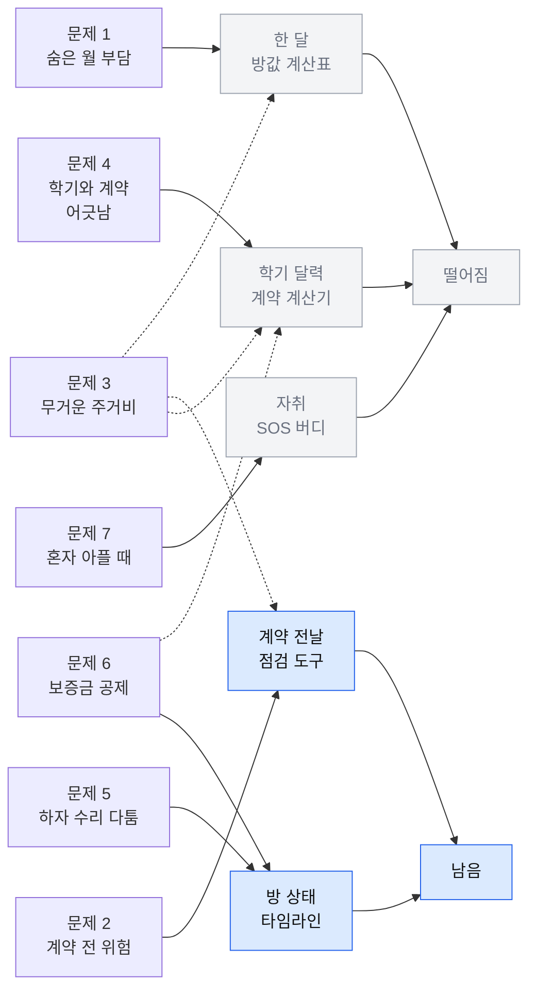

# 2. 자취하는 대학생

[사회 문제 대상별 아이디어](README.md)의 대상별 문서다. 조사와 평가 방법은 README에 있다.

## 1. 대상

집을 떠나 학교 근처 원룸·다가구·오피스텔에 혼자 사는 대학생이다. 대부분 처음으로 임대차 계약을 하고, 1년 단위 계약과 학기·방학 일정이 어긋나는 생활을 한다. 제주대 주변 자취생을 함께 보았다.

제주는 2025년 1분기 주택 임대차 계약의 80%가 월세로 전국(60.7%)보다 높고, 이 통계에는 1년치를 미리 내는 연세가 월세로 들어간다 [1]. 제주대 자취생만 다룬 조사, 제주대 기숙사 수용률, 제주 대학가 원룸 평균 월세는 찾지 못해 청년 통계와 서울 대학가 자료로 대신했다.

### 가. 처음 짐작과 조사 뒤 달라진 점

- 처음에는 임대차 계약이 어렵고, 전세사기 위험이 있고, 관리비가 불투명하다고 짐작했다. 관리비는 그대로 확인됐다.
- 계약의 어려움은 계약서를 못 읽는 데보다 계약 전에 확인할 정보가 흩어져 있고 학기 생활과 계약 구조가 맞지 않는 데 있었다.
- 전세사기 피해자는 40세 미만이 75.9%지만 가장 많은 연령대는 30대(50.7%)이고 20대는 25.2%다 [2]. 그래서 대학생에게는 보증금이 적은 월세·연세 계약의 위험이 더 직접적이라고 보았는데, 대학생만 따로 본 통계를 찾지 못한 추정이다.
- 짐작 밖에서 사는 동안의 하자 수리 다툼, 퇴실 때 보증금 공제 다툼, 혼자 아플 때 기댈 곳이 없는 문제를 새로 찾았다. 이미 있는 서비스를 다시 확인해 보니 지역 제한 없는 계약 전 위험 점검 서비스가 있어, 처음에 본 "제주는 공공 점검 서비스의 빈칸"이라는 차이는 약해졌다.

## 2. 이 대상이 가진 문제

| 번호 | 문제 | 근거 |
|---|---|---|
| 1 | 방을 고를 때 월세 밖의 실제 월 부담(관리비·공과금)을 미리 알기 어렵다 | 서울 주요 10개 대학가 원룸 관리비가 1년 새 10.9% 올라 월세(7.7%)보다 빨리 올랐고, 관리비 공개 의무는 100세대 이상 단지에만 있다 [3]. 대학가 매물 광고 1,100건 중 155건이 소재지·관리비·거래금액 같은 필수 정보를 빠뜨렸다 [4] |
| 2 | 계약 전에 집과 집주인의 위험을 혼자 가려내기 어렵다 | 전세사기 피해자 결정 4만 1,559건 중 40세 미만이 75.9%다 [2]. 대학가 부당 광고에는 근저당이 있는데 "융자금 없음"으로 적은 사례가 있었고 [4], 다가구 원룸은 호수별 등기가 어려워 앞선 세입자들의 보증금 규모를 알기 어렵다 [5] |
| 3 | 주거비가 무겁고, 기숙사·공공 지원으로 빠져나갈 길이 좁다 | 청년가구 RIR(월소득 대비 월임대료 비율)이 16.0%에서 17.4%로 올랐다 [6]. 4년제 대학 기숙사 수용률은 21.7%로 최근 6년 중 가장 낮고 [7], 청년월세 지원은 신청자의 33%만 받았다(2024년 보도) [8] |
| 4 | 학기·방학 생활과 계약 구조(1년 계약, 연세 선납, 중도 퇴거)가 맞지 않는다 | 제주는 임대차 계약의 80%가 월세(연세 포함)이고, 연세는 중도 퇴거 때 남은 기간 환불을 둘러싼 다툼이 잦다 [1]. 1년치를 한꺼번에 내고 9개월 정도 살면서 방학 기간 월세까지 낸 대학생 사례가 있다(2018년 보도) [9] |
| 5 | 사는 동안 생긴 하자의 수리 책임을 두고 집주인과 다툰다 | 서울 대학생 600명 조사에서 곰팡이·방음·채광 부족이 주된 불편이었다 [10]. 2026년 1~4월 임대차분쟁조정위원회 주택 분쟁 618건 중 147건이 유지·수선 의무 관련이었다 [11] |
| 6 | 나갈 때 보증금을 제때, 깎이지 않고 돌려받기 어렵다 | 2026년 1~4월 주택 분쟁 접수는 전년 같은 기간보다 125.5% 늘었고, 보증금·주택 반환 관련이 210건으로 가장 많았다. 벽 스티커 자국에 420만 원 견적을 받고 절반을 요구받은 사례도 보도됐다 [11] |
| 7 | 혼자 아프거나 위험할 때 기댈 사람이 없다 | 1인 가구 중 "아플 때 도움받을 사람이 있다"는 68.9%로 전체(75.1%)보다 낮다 [12]. 제주 19~34세 은둔 비율은 4.5%로 전국(2.8%)보다 높다 [13] |

## 3. 해결 방법과 결과

실선은 주로 겨냥한 문제, 점선은 보조로 겨냥한 문제다. 아래에 나오는 MCP(Model Context Protocol)는 AI(인공지능) 도구가 바깥 데이터와 기능을 불러 쓰게 하는 연결 규격이다.

### 가. 한 달 방값 계산표

- 겨냥한 문제: 1 (보조 3)
- 어떻게 푸는지: 후보 방 3~5곳의 광고 캡처, 중개사 문자, 관리비 안내문 사진을 올리면 보증금·월세·관리비 속 항목·따로 낼 공과금을 한 표에 놓는다. 빈 칸은 "확인 필요"로 남기고 중개사에게 보낼 질문 문자를 만든다.
- 이미 있는 것(다시 확인한 결과): 비슷한 것 있음. 미국 RentCafe는 ChatGPT 안에서 매물을 비교하고 총 월 비용을 보여 준다 [14]. 매물 비교·숨은 요금 점검 MCP 서버도 공개돼 있다 [15]. 국내에서 캡처를 모아 비교표로 바꾸는 서비스는 못 찾음

### 나. 계약 전날 점검 도구

- 겨냥한 문제: 2 (보조 3)
- 어떻게 푸는지: 계약 전날 밤 AI 도구에 주소·보증금·월세와 인터넷등기소에서 뗀 등기부 PDF(문서 파일)를 넣으면, AI가 MCP 도구로 건축물대장과 같은 동네 전월세 실거래를 불러와 "확인됨 / 위험 신호 / 내일 물어볼 것" 세 칸 점검표를 만든다.
- 이미 있는 것(다시 확인한 결과): 있음. 직방 지킴진단은 주소만 넣으면 원룸까지 계약 전 위험을 점검하고 특약을 제안하며, 지역 제한 언급이 없다 [16]. 국토교통부·HUG(주택도시보증공사) 안심전세앱 위험진단은 등기·건축물대장 등 57종 연계를 발표했으나 실제 개시는 확인하지 못했다 [17] [18]

### 다. 학기 달력 계약 계산기

- 겨냥한 문제: 4 (보조 3, 6)
- 어떻게 푸는지: 1월에 연세 방과 월세 방 사이에서 고민하는 신입생이 두 방 조건과 "여름방학엔 본가, 2학기 뒤 입대 가능" 같은 계획을 적으면, 시나리오(예정대로 1년, 1학기 후 휴학, 여름에 짐 빼기)별 총비용과 목돈이 나가는 시점, 연세 특약 문구 후보를 보여 준다.
- 이미 있는 것(다시 확인한 결과): 비슷한 것 있음(일부). 미국 대학은 9개월·12개월 계약을 여름 거처까지 넣어 비교하는 워크시트를 준다 [19] [20]. 국내에는 전월세 전환 계산기가 있다 [21]. 학사 일정·연세·중도 퇴거를 합친 계산기는 못 찾음

### 라. 방 상태 타임라인

- 겨냥한 문제: 5, 6
- 어떻게 푸는지: 입주 날 방을 한 바퀴 영상으로 찍고, 사는 동안 곰팡이·누수 사진과 수리 요청을 남기고, 퇴실 날 입주 사진을 겹쳐 보는 화면에 맞춰 다시 찍는다. AI가 같은 자리끼리 비교해 "원래 있던 흠 / 수리 요청했던 흠 / 새로 생긴 흠"으로 나눈다.
- 이미 있는 것(다시 확인한 결과): 비슷한 것 있음. 해외에는 세입자용 앱이 여럿이다. TenantDesk는 입퇴실 사진 비교와 수리 요청 기록을 하고(AI 언급 없음) [22], RentProof AI는 얼룩·균열·곰팡이 AI 감지를 구독으로 준다 [23]. 국내 원룸 세입자용은 못 찾음(앱스토어 직접 확인 필요)

### 마. 자취 SOS 버디

- 겨냥한 문제: 7
- 어떻게 푸는지: 친구 2~3명을 미리 버디로 묶어 두고, 밤에 "열 나고 못 일어나겠어"라고 쓰면 AI가 급한 정도를 갈라 위급하면 119 안내를, 아니면 문 연 약국 정보와 버디 도움 요청을 보낸다. 평소엔 하루 한 번 안부 확인을 받는다.
- 이미 있는 것(다시 확인한 결과): 비슷한 것 있음. Are You Dead?는 매일 체크인을 놓치면 비상 연락처에 알린다 [24] [25]. Snug Safety는 대학생까지 대상을 넓혔고, 이웃끼리 서로 비상 연락처가 된 사례가 있다 [24]

## 4. 평가

### 가. 점수표

| 아이디어 | 주제·독창성 | 기술 도구 | 도전과 해결 | 완성도 | 발표 | 합계(25) | AI 채팅으로 해결 | 사회 도움 | 법·윤리 | 2명·4주 |
|---|---|---|---|---|---|---|---|---|---|---|
| 방 상태 타임라인 | 3 | 4 | 5 | 3 | 4 | 19 | 통과 | 통과 | 주의 | 주의 |
| 계약 전날 점검 도구 | 2 | 4 | 4 | 3 | 4 | 17 | 주의 | 통과 | 주의 | 주의 |
| 학기 달력 계약 계산기 | 3 | 2 | 2 | 4 | 3 | 14 | **탈락** | 통과 | 주의 | 통과 |
| 한 달 방값 계산표 | 2 | 2 | 2 | 4 | 3 | 13 | **탈락** | 통과 | 통과 | 통과 |
| 자취 SOS 버디 | 2 | 2 | 2 | 4 | 3 | 13 | 주의 | 통과 | **탈락** | 주의 |

"AI 채팅으로 해결" 칸이 탈락이면 점수와 관계없이 남기지 않았다. 자취 SOS 버디는 법·윤리에서 탈락했고 합계도 가장 낮다.

### 나. 남은 2개

#### 1) 방 상태 타임라인 (19점)

- "본 적 없는" 정의 초안: 집주인이 보낸 보증금 공제 목록의 항목마다, 입주 날 찍어 둔 영상에서 같은 자리가 보이는 장면(몇 분 몇 초)과 사는 동안 보낸 수리 요청 기록을 AI가 찾아 붙여 "원래 있던 흠 / 알렸던 흠 / 새로 생긴 흠"으로 나눠 주는 세입자 쪽 기록 도구. 해외 앱이 내세우는 손상 탐지, 사진 나란히 보기와 겹치지 않게 주장을 "공제 항목 한 줄과 근거 장면 짝짓기"로 좁혔고 [22] [23], 판정은 사람이 근거 장면을 보고 한다.
- 시연 장면
  - 미리 준비: 발표 전날 소품 책상과 벽판을 30초 영상으로 찍어 입주 영상으로 올리고, "7월 3일 욕실 실리콘 곰팡이, 수리 요청 문자 보냄" 기록 1건을 넣어 둔다.
  - 입력: 발표장에서 책상에 마스킹테이프 자국을 내고 사진 4장을 찍은 뒤, 집주인 공제 문자 "벽지 얼룩 10만 원, 책상 상판 긁힘 5만 원, 욕실 곰팡이 청소 8만 원"을 붙여 넣는다.
  - 출력(예시 값): 벽지 얼룩은 입주 영상 00:14에 같은 얼룩이 보여 "원래 있던 흠", 욕실 곰팡이는 7월 3일 요청 기록이 있어 "알렸던 흠", 책상 긁힘은 입주 영상 00:21에 없어 "새로 생긴 흠"으로 나온다. 끝에 근거 사진 목록을 붙인 답장 초안과 임대차분쟁조정위원회 안내가 붙는다.
- Skill·MCP가 들어갈 자리
  - Skill(꼭 필요): Skill은 Claude가 필요할 때 불러 쓰는 작업 지침·규칙 묶음이다. "공제 항목 대조" Skill 하나에 세 갈래 분류 기준, 근거 장면을 못 찾으면 "판단 보류"로 두는 규칙, 쓰면 안 되는 법적 판단 문구("통상 손모입니다", "돌려받을 수 있습니다"), 답장 양식을 묶는다. 규칙이 한곳에 있어야 고칠 때마다 시험 결과가 흔들리지 않는다.
  - MCP(억지에 가까움): 방 기록을 AI 비서에서 찾게 하는 MCP 서버는 만들 수 있지만, 자취생이 AI 비서에 도구를 붙여 쓸 이유가 약해 장식에 가깝다. 정직하게 쓸 곳은 개발 과정(Playwright MCP로 모바일 웹 화면 시험 자동화)이고, 발표에서 "앱 기능에는 MCP를 넣지 않았다"고 이유와 함께 밝히는 편이 낫다.
- AI가 틀릴 수 있는 곳과 시험 방법
  - 틀릴 곳: 조명·각도 차이를 새 흠으로 봄, 작은 흠을 놓침, 공제 항목 글을 엉뚱한 자리 장면과 짝지음, 입주 영상에 없던 흠을 "원래 있었다"고 지어냄(세입자에게 가장 해로운 오류).
  - 시험: 4주 안에 실제 입주와 퇴실을 겪기 어려우므로 정답을 아는 통제 실험으로 한다. 팀원 방 2곳에서 20곳씩, 모두 40곳을 입주 영상으로 찍고 20곳에만 흠 흉내(마스킹테이프, 지워지는 마커 점, 스티커, 물건 자리 바꿈)를 낸다. 흠은 다른 팀 학생 2~3명이 내서 팀은 위치를 모르게 한다. 그대로인 20곳 중 10곳은 조명과 각도를 바꿔 다시 찍는다. 가짜 공제 목록 30항목(세 갈래 10개씩)의 정답표를 미리 만든다.
  - 내놓을 숫자: 새 흠 20곳 중 찾은 수, 그대로인 20곳 중 흠이라고 잘못 말한 수(조명·각도 바꾼 10곳은 따로), 공제 30항목 중 세 갈래를 맞힌 수, 근거 장면 시각이 실제 자리와 맞은 비율, 지어냄 오류 건수(목표 0), 같은 입력을 5번 돌렸을 때 결과가 같은 비율. 처음 판과 고친 판(겹쳐 찍기 화면, "판단 보류" 규칙 추가)의 숫자를 나란히 보인다.
- 가장 큰 위험: AI가 입주 영상에 없던 흠을 "원래 있던 흠"이라고 붙여, 세입자가 그 근거로 집주인이나 조정위원회와 다투다 신뢰를 잃는 경우다. 그래서 AI는 근거 장면 후보만 내고, 사람이 장면을 보고 확정하기 전에는 답장 초안에 넣지 않는다.
- 고치면 나아질 점: 영상 전체에서 흠을 찾는 손상 탐지(해외 앱이 이미 함) 대신 "공제 항목 한 줄 → 근거 장면 찾기"를 기능의 중심에 두면 독창성 주장과 4주 범위가 함께 좋아진다. 각도 맞춤 촬영은 겹쳐 보기 화면까지만 한다.

#### 2) 계약 전날 점검 도구 (17점)

- "본 적 없는" 정의 초안: 계약 전날 밤 AI 비서에게 주소와 등기부만 건네면, AI가 건축물대장과 전월세 실거래를 직접 불러와 "안전·위험"을 판정하는 대신 모든 칸에 원문 근거 위치(대장 항목명, 등기부 순위번호)를 붙인 "내일 집주인에게 물을 질문"으로 바꿔 주는, 보증금이 작은 월세·연세 학생용 점검. 평가에서는 이 정의도 약하다고 보았다. 직방 지킴진단, 안심전세앱 위험진단과 확인할 수 있는 차이는 "판정을 내리지 않는다"와 "모든 칸에 원문 근거 위치가 붙는다" 두 가지뿐이고 [16] [17], 둘 다 시험으로 보일 수 있다는 점이 그나마 강점이다.
- 시연 장면
  - 입력: Claude Desktop에 "제주시 아라동 ○○번지 원룸, 보증금 300만 원, 월세 38만 원, 내일 오후 계약"과 등기부 PDF(소유자 이름 가림)를 넣는다.
  - 화면: MCP 도구 호출 세 번이 차례로 보인다(건축물대장 조회 → 전월세 실거래 조회 → 등기부 항목 추출).
  - 출력(예시 값): 확인됨은 "소유자 1명(갑구 순위 2번), 계약서 임대인 이름과 맞는지는 내일 신분증으로 확인". 위험 신호는 "건축물대장 주용도 제2종근린생활시설(주택 아님), 을구 근저당 채권최고액 1억 2천만 원(말소 안 됨)". 내일 물을 것은 "같은 건물 다른 호실 보증금 합계, 주거용으로 쓰는 근린생활시설에 대한 설명, 연세라면 중도 퇴거 정산 특약".
- Skill·MCP가 들어갈 자리
  - MCP(꼭 필요): 건축물대장과 실거래 공공 API(응용 프로그램 연결 규격)는 채팅 창에 붙여 넣을 수 없는 바깥 데이터라, AI가 대화 중에 직접 불러야 이 도구가 성립한다. 다만 real-estate-mcp(전월세 실거래) [26]와 building-register-mcp(건축물대장) [27]가 이미 공개돼 있어 가져다 쓴 것과 새로 만든 것을 발표에서 나눠 밝혀야 한다. 팀이 새로 만들 몫은 등기부 PDF 항목 추출 도구와 주소 하나로 세 결과를 묶는 도구다.
  - Skill(꼭 필요): 어떤 값이면 "위험 신호"에 넣는지, 근거 위치가 없는 칸은 쓰지 않는다는 규칙, "안전합니다", "계약해도 됩니다" 같은 단정 금지어, "공식 판단이 아님" 문구를 Skill로 고정한다. 법률 상담처럼 보이지 않게 하는 장치를 코드 밖 규칙으로 한곳에 두는 것이다.
- AI가 틀릴 수 있는 곳과 시험 방법
  - 틀릴 곳: 말소된 근저당을 살아 있는 것으로(또는 반대로) 읽음, 채권최고액 자릿수 오류, 지번 주소를 조회 값으로 바꾸다 옆 건물을 불러옴, 주용도 "근린생활시설"을 주택처럼 요약함, "안전합니다" 같은 단정. 위험 신호를 놓쳐 "확인됨"에 넣는 오답은 보증금 손실로 이어질 수 있다.
  - 등기부 20통(열람 수수료가 든다)을 사람이 먼저 손으로 정리해 소유자 수, 근저당 건수, 채권최고액, 말소 여부, 압류·가압류 유무로 100개 이상 항목의 정답표를 만든다. 내놓을 숫자는 항목 정확도와 말소·유효 혼동 건수(목표 0)다.
  - 제주시 원룸 건물 주소 30곳을 도구로 조회하고 세움터 화면과 대조해 맞는 건물을 불러온 비율을 낸다.
  - 점검표 50개에서 금지어가 나온 횟수를 자동으로 센다(목표 0). 같은 입력을 5번 돌려 세 칸 분류가 같은 비율을 낸다.
  - 시험용 등기부는 깃허브에 올리지 않고, 올리는 예시는 이름과 주소를 가린다.
- 가장 큰 위험: 독창성 설득 실패다. 직방 지킴진단과 안심전세앱 위험진단이 "주소를 넣으면 계약 위험을 보여 준다"는 같은 장면을 이미 보여 주므로, "직방이 하는 것과 무엇이 다른가"에 답하지 못하면 주제·독창성 점수가 크게 깎인다.
- 고치면 나아질 점: 처음 조사에서 차이로 든 "건축물 용도와 청년월세 지원 자격 연결"은 2026년 청년월세 지원사업 자주 묻는 질문(FAQ)에서 건축물 용도 요건을 찾을 수 없어 [28], 공고문 원문을 확인하기 전에는 차이로 쓰지 않는다. 대신 "판정 없음 + 모든 칸에 원문 근거 위치"를 차이로 삼으면 확인하기도, 시험으로 보이기도 쉽다.

### 다. 떨어진 3개와 이유

#### 1) 학기 달력 계약 계산기 (14점, AI 채팅으로 해결 탈락)

두 방의 조건과 "여름엔 본가에 가고 2학기 뒤 입대할 수도 있다"를 AI 채팅에 쓰면 시나리오별 총비용 표와 특약 문구 후보가 바로 나온다. 팀이 더하는 것은 계산을 코드로 고정하는 것인데, 방 2~3개와 시나리오 3개의 사칙연산이라 쓰는 사람이 느낄 차이가 작다. 정작 어려운 "중도 퇴거 때 남은 연세를 얼마 돌려받나"는 특약과 집주인 합의에 달렸고 일할 계산도 실제 일수 기준과 30일 기준으로 갈려 [29], 숫자로 보여 주면 확정된 금액처럼 읽힐 수 있다. 같은 생각의 9개월·12개월 비교 워크시트는 미국 대학에 이미 흔하다 [19] [20].

#### 2) 한 달 방값 계산표 (13점, AI 채팅으로 해결 탈락)

매물 캡처 3~5장을 AI 채팅에 올리고 "한 달 실제 부담 비교표와 중개사에게 물을 질문을 만들어 줘"라고 하면 결과 대부분이 나온다. 팀이 내세운 차이인 공과금 계산식 고정은 4주 범위에서 전기요금 하나뿐이다. 2023년 9월부터 월 10만 원 이상 정액 관리비는 항목별 금액 표시가 의무이고 [30], RentCafe는 ChatGPT 안에서 매물 비교와 총 월 비용을 보여 주며 [14], 숨은 요금 점검 MCP 서버도 공개돼 있다 [15]. AI 몫이 숫자 뽑기라 AI가 틀렸을 때 바로잡은 과정을 보여 줄 것도 적다.

#### 3) 자취 SOS 버디 (13점, 법·윤리 탈락)

매일 체크인과 무응답 알림은 Are You Dead?가(2026년 1월 미국·호주·스페인 유료 앱 상위권), 이웃끼리 서로 비상 연락처가 되는 구조는 Snug Safety가 이미 한다 [24] [25]. 지금 문 연 약국은 E-Gen(국립중앙의료원 응급의료포털) 앱과 119·129가 안내하고 [31], 친구에게 약을 부탁하는 일은 단톡방 한 줄로 된다. 남는 AI 몫인 "증상 문장으로 급한 정도 가르기"는 의료 판단으로 보일 위험이 크고, 위급한데 약국으로 안내하는 오답은 생명에 닿으며, 건강 정보는 개인정보 보호법 제23조의 민감정보다. 분류가 맞는지 재려면 의료인이 정한 정답이 필요해 4주 안에 시험 결과를 낼 수 없고, 분류를 빼면 AI가 할 일이 거의 사라진다.

## 5. 출처

1. [As More People Choose to Live in Jeju, Monthly Rentals Hit 80%, Highest in the Nation](https://www.asiae.co.kr/en/article/2025050413455958938) (The Asia Business Daily, 2025-05-04, 국토교통부 자료 인용)
2. [전세사기 누적 피해자 4만명 넘어…4명 중 3명은 40세 미만](https://biz.sbs.co.kr/amp/article/20000339241) (SBS Biz, 2026-10-12)
3. [Students left in the dark as maintenance fees rise](https://www.koreajoongangdaily.com/korea/students-left-in-the-dark-as-maintenance-fees-rise/12841674) (Korea JoongAng Daily, 2026-08-26, 다방 매물 분석 인용)
4. [국토부, 청년주거지 대학가 원룸촌 '허위매물' 집중 단속…321건 적발](https://www.smarttoday.co.kr/ko-kr/articles/93151) (스마트투데이, 2025-10-10, 국토교통부 발표 인용)
5. ['집주소만 입력하면 끝'…'청년 전세사기' 위험도, AI가 진단해준다](https://www.mt.co.kr/estate/2026/03/24/2026032410261048253) (머니투데이, 2026-03-24, 서울시 전세사기 위험분석 보고서)
6. [영끌해 집사고, 주거비는 올랐다...'내집 마련' 포기도 ↑](https://www.fnnews.com/news/202611171546035337) (파이낸셜뉴스, 2026-11-17, 국토교통부 2025년도 주거실태조사 인용)
7. [대학 기숙사 4곳 중 3곳은 카드 결제 불가, 수용률도 6년 새 최저인 이유는?](https://newneek.co/@newneek/article/48238) (뉴닉, 2026-10-29, 2026년 10월 대학정보공시 분석 인용)
8. [청년월세 지원 받고 싶어요… 신청자 50만, 수혜자는 16만](https://www.sidae.com/article/2024100414081152412) (시대, 2024-10-04)
9. [대학생들 상대로 '1년 치' 월세 한꺼번에 내라는 '갑질' 주인](https://www.insight.co.kr/news/95925) (인사이트, 2018-05-18, KBS 보도 인용)
10. ['High Rent but Mold and Poor Soundproofing'... University Students Still Dissatisfied with Rented Rooms](https://www.asiae.co.kr/en/article/2025071509490651405) (The Asia Business Daily, 2025-07-15, PCP스탠다드 2025 대학생 주거 실태조사 인용)
11. [6년 산 전셋집서 '시트지 들떠, 150만원 청구'...전셋값 오르자 분쟁 급증](https://www.mt.co.kr/estate/2026/06/27/2026062414343360002) (머니투데이, 2026-06-27, 임대차분쟁조정위원회 자료 인용)
12. [1인 가구 첫 800만 돌파 역대 최고…절반은 年 3000만원 못 번다](https://www.newsis.com/view/NISX20251209_0003433761) (뉴시스, 2025-12-09, 국가데이터처 2025 통계로 보는 1인 가구 인용)
13. [제주 고립·은둔청년, 온라인부터 일 경험까지… '온바람' 문 열어](https://www.fnnews.com/news/202610121043465328) (파이낸셜뉴스, 2026-10-12, 제주여성가족연구원 분석 인용)
14. [Your happy place is just a conversation away with the new RentCafe app in ChatGPT](https://www.rentcafe.com/blog/renting/rentcafe-app-in-chatgpt/) (RentCafe, 2026-04-30, 총 월 비용 표시는 같은 블로그의 관련 글에서 언급)
15. [rental-agent-mcp](https://glama.ai/mcp/servers/bqg1t4jplg) (Glama 등록 MCP 서버)
16. [Zigbang Launches 'Jikim Diagnosis,' AI for Pre-Contract Risk Analysis](https://www.venturesquare.net/en/1076651/) (VentureSquare, 2026-04-17)
17. [9월부터 전세 위험정보 한 눈에…'안심전세앱'에서 권리정보 원스톱 제공](https://www.dailian.co.kr/news/view/1657290/) (데일리안, 2026-06-18)
18. [안심전세앱서 임대차 정보 한눈에…통합정보 시스템 구축](https://www.dailian.co.kr/news/view/1677510/) (데일리안, 2026-08-12)
19. [Budget Planning](https://www.och.umd.edu/resources/handouts/Uploads/BudgetPlanning.pdf) (University of Maryland Off-Campus Housing, 워크시트) (검색 요약으로 확인)
20. [Housing Cost Comparison Worksheet](https://ot.und.edu/student-life/housing/_files/docs/und-housing-cost-comparison-worksheet-8.5x11.pdf) (University of North Dakota) (검색 요약으로 확인)
21. [전월세 전환 계산기](https://realty.daangn.com/tools/jeonse-monthly-converter) (당근부동산)
22. [TenantDesk: Rental Inspection](https://apps.apple.com/app/id6762469956) (App Store)
23. [RentProof AI](https://apps.apple.com/in/app/id6754582188) (App Store) (검색 요약으로 확인)
24. [Here's why people say they're using 'Are You Dead?' and apps like it](https://www.michiganpublic.org/2026-02-03/heres-why-people-say-theyre-using-are-you-dead-and-apps-like-it) (Michigan Public, NPR 기사 게재, 2026-02-03)
25. ['Are You Dead?' app taps into global loneliness crisis](https://www.foxnews.com/tech/are-you-dead-app-taps-global-loneliness-crisis) (Fox News) (검색 요약으로 확인)
26. [real-estate-mcp](https://github.com/tae0y/real-estate-mcp) (GitHub 저장소)
27. [building-register-mcp](https://glama.ai/mcp/servers/coding-realtor/building-register-mcp) (Glama 등록 MCP 서버) (검색 요약으로 확인)
28. [2026년 청년월세 지원사업 자주 묻는 질문(FAQ)](https://jeonju.go.kr/youth2/download/faq.pdf) (전주시, 2026-03-25 파일 작성)
29. [선납 월세(사글세)로 임대차 계약 후 만기 전에 퇴거하게 되었을 때, 남은 기간의 월세 반환 범위를 일할 계산하여 임대인과 정산하는 방법](https://bokduckbbang.com/blog/선납-월세사글세로-임대차-계약-후-만기-전에-퇴거하게-되었을-때-남은-기간의-월세-반환-범위를-일할-계산하여-임대인과-정산하는-방법/) (복덕빵 블로그 해설, 법률 자문 아님) (검색 요약으로 확인)
30. [원룸 관리비 '세부내역' 공개된다…거짓 광고 시 '500만원' 과태료](https://www.fnnews.com/news/202309051739109268) (파이낸셜뉴스·뉴스1, 2023-09-05)
31. ['약국 다 닫았다고?' 추석 연휴 당황할 때 '이곳' 켜세요](https://www.dailian.co.kr/news/view/1694196) (데일리안) (검색 요약으로 확인)
