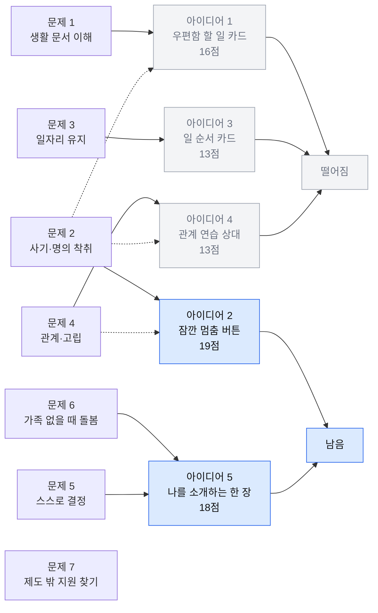

# 3. 경계선 지능인·발달장애인

[사회 문제 대상별 아이디어](README.md)의 대상별 문서다. 조사와 평가 방법은 README에 있다.

## 1. 대상

발달장애인은 「발달장애인 권리보장 및 지원에 관한 법률」(이하 발달장애인법)이 정한 지적장애인과 자폐성장애인으로, 2021년 6월 기준 등록 인원은 25만 2천 명이다(지적장애 21만 9천 명, 자폐성장애 3만 2천 명) [1]. 경계선 지능인은 지능지수(IQ) 71~84 구간에 있어 지적장애로 등록되지 않는 사람으로, 교육부는 전체 국민의 약 13.59%로 추정했다 [2]. 이 문서의 사용자는 당사자뿐 아니라 가족(주로 부모)과 지원 인력(발달장애인지원센터 직원, 직무지도원·동행코치, 활동지원사, 복지관 사회복지사)까지 포함한다.

- 경계선 지능인 숫자: 위의 13.59%는 지능지수 구간 비율로 낸 추정이다. 한국보건사회연구원이 전국 9천 명을 온라인으로 선별 조사한 위험집단 비율(아동·청소년 5.1%, 성인 6.8%)은 선별 조사 결과라서 바로 비교할 수 없다 [3].
- 제주: 2023년 8월 「제주특별자치도 경계선지능인 평생교육 지원 조례」가 제정됐고, 2024년 11월 도의회 간담회에서 제주 인구의 약 14%, 약 9만 명이 경계선 지능인으로 추정된다는 수치가 소개됐다 [4].
- 제주: 구좌읍 중장년 발달장애인 30명 조사(2026-09)에서 미래의 가장 큰 걱정은 "가족·친척 등의 부재로 나를 도와줄 사람이 없음"(복수응답 14건)이었다 [5].

### 가. 처음 짐작과 조사 뒤 달라진 점

- 처음 짐작은 "공문, 계약서, 안내문이 너무 어렵다"였다. 짐작은 맞았고, 발달장애인법도 국가와 지방자치단체가 정책정보를 "이해하기 쉬운 형태"로 만들도록 정해 두었다 [6].
- 다만 글이 어렵다는 것은 더 큰 문제의 입구에 가까웠다. 실제 피해는 이해하지 못한 채 서명하거나 신분증·휴대폰·통장을 넘기는 순간에 더 크게 생겼다. 2025년 장애인학대 피해자의 76.2%가 발달장애인이고, 학대 유형의 20.3%가 경제적 착취였다 [7].
- 경계선 지능인은 장애 등록이 없어서 발달장애인에게 적용되는 보호 장치(전담 수사관, 신뢰관계인 동석, 장애인권익옹호기관 지원)에서 빠지는 일이 많다는 점이 따로 확인됐다 [8].
- 그 밖에 일자리 유지, 관계와 고립, 스스로 결정하기, 부모가 떠난 뒤의 돌봄이 여러 자료에서 되풀이해 나왔다.

## 2. 이 대상이 가진 문제

| 번호 | 문제 | 근거 |
|---|---|---|
| 1 | 생활 문서를 읽고 무엇을 해야 하는지 알기 어렵다 | 발달장애인법의 쉬운 정보 의무는 정책정보에만 걸리고 통신 계약서, 대출 안내, 고지서 같은 생활 문서는 들어가지 않는다 [6]. 경계선 지능 위험집단은 대중교통 이용, 병원 방문 같은 지역사회 이용 기술에서 어려움을 겪는 비율이 일반군보다 최대 4.7배 높았다 [3]. |
| 2 | 금융 사기, 명의도용, 경제적 착취를 막기 어렵다 | 장애인학대 재학대 238건 가운데 88.2%가 발달장애인이었다 [7]. 지능지수 71인 21세 청년이 소액대출 광고에 연락했다가 이틀 사이 휴대폰 4대(800만 원 상당)가 개통됐고, 경찰은 "기망행위가 없다"며 불송치했으며, 장애 판정이 없어 권익옹호기관 도움도 받기 어려웠다 [8]. |
| 3 | 일자리를 얻고 지키기 어렵다 | 경계선 지능 성인 위험집단의 평생 근로 경험률은 72.3%지만 조사 당시 일자리가 있는 비율은 30.0%였고, 취업자의 61%가 비정규직이었다 [3]. 15세 이상 발달장애인 취업자 비율은 20.3%였다(2021년 조사) [1]. |
| 4 | 관계를 맺기 어렵고 고립되며, 관계가 피해 통로가 되기도 한다 | 경계선 지능 위험집단은 관계 맺기 어려움 비율이 일반군보다 4배 이상 높았고, 성인 위험집단의 60% 이상이 3개월 넘게 집 안에서만 지낸 경험이 있었다 [3]. 경계선 지능인이 가해에 연루될 때 영향을 준 사람은 친구, 연인, 선배가 가장 많았다 [8]. |
| 5 | 스스로 결정하고 그 결정을 존중받기 어렵다 | 18세 이상 발달장애인의 61%가 자기 의사를 표현할 수 있지만 주요 결정을 스스로 하는 비율은 28.6%, 부모가 결정하는 비율은 50.4%였다(2021년 조사) [1]. 개인별지원계획서와 공공후견 정보를 쉬운 글로 바꾸는 시범사업은 2026년 8월에 시작됐다 [9]. |
| 6 | 가족이 없을 때 돌봄이 끊길까 걱정한다 | 가족의 가장 큰 어려움은 "보호자 사후의 불확실성"(34.9%)이고, 주 돌봄자의 78.6%가 부모이며 평균 나이는 56.6세였다(2021년 조사) [1]. 60대 이상 부모 62명 가운데 37.1%가 활동지원사의 돌봄 거부나 중단을 "자주" 또는 "종종" 겪었다 [10]. |
| 7 | 제도 밖에서 맞는 지원을 찾기 어렵다(경계선 지능인) | 교육부는 경계선 지능인이 지적장애에 해당하지 않아 각종 지원 대상에서 빠져 "정책 사각지대"에 있었다고 밝혔다 [2]. 경계선 지능 아동 보호자의 85.1%가 발달·학습을 위해 사비를 쓰고 있었고 월평균 지출은 80만 3천 원이었다 [3]. |

문제 2의 기사 사례 [8][11][12]는 흐름이 비슷했다. 아는 사람이나 친절한 사람이 "도와주겠다"고 다가와 신분증·휴대폰·통장을 받아 가고, 본인이 직접 서명했다는 이유로 계약 취소가 어렵다. 글을 쉽게 바꾸는 것만으로는 막기 어려운 문제다.

## 3. 해결 방법과 결과

실선은 주로 겨냥한 문제, 점선은 보조로 겨냥한 문제다. 문제 7은 지역별 조례·사업을 모아 맞는 지원을 알려 주는 도구로 만들 수 있으나, 흔한 정보 검색 챗봇 꼴에 가까워 이번 5개에서는 겨냥하지 않았다.

| 아이디어 | 겨냥한 문제 | 어떻게 푸는지 | 이미 있는 것 (다시 확인한 결과) |
|---|---|---|---|
| 1. 우편함 할 일 카드 | 1 (보조로 2) | 우편함에서 꺼낸 과태료 통지서를 사진으로 찍으면 할 일 1개, 마감 날짜, 금액, 문의처를 담은 큰 글씨 카드와 창구에서 보여 줄 "이 종이 때문에 왔어요" 카드가 나온다. 링크를 누르라거나 개인정보를 요구하는 문구가 있으면 빨간 표시를 붙인다. | 있음(핵심 기능). 사진에서 마감과 할 일을 뽑아 알림과 답장 초안까지 주는 xPlainly [13], 마감을 날짜로 뽑아 단계별 행동 계획을 주는 BriefAI [14]. 발달장애인용 쉬운 말, 창구 카드, 지원자 공유를 묶은 것은 못 찾음. |
| 2. 잠깐 멈춤 버튼 | 2 (보조로 4) | 아는 사람이 "신분증이랑 통장 사진 보내"라고 할 때 당사자가 "잠깐"을 누르고 상황을 말하면, 당사자 화면에는 "아직 주지 마세요"가, 미리 등록한 믿는 사람의 폰에는 상황 요약과 위험 신호가 간다. 믿는 사람이 "멈춰" 또는 "괜찮아"로 답하면 당사자 화면에 크게 뜬다. | 비슷한 것 있음. 통화 중 보이스피싱이 의심되면 보호자에게 알리는 SK텔레콤 에이닷 "가족 케어" [15], 당사자가 빨강 버튼을 누르면 지원 인력에 연결되는 Brain in Hand(사기 판별 AI 없음) [16]. 대면·지인 요구를 다루며 당사자가 직접 눌러 믿는 사람의 답을 받아 오는 것은 못 찾음. |
| 3. 일 순서 카드와 다시 묻기 문장 | 3 | 점장의 "마감 전에 냉장고 정리하고, 날짜 지난 건 빼서 적어 두고, 바닥 청소해 줘"를 녹음하면 한 장씩 넘기는 체크 카드 3~5장이 나온다. 막히면 "날짜 지난 것은 어디에 두면 되나요?" 같은 다시 묻기 문장을 화면에 띄우거나 읽어 준다. | 비슷한 것 있음. 음성·사진으로 일터 업무 단계 안내를 만드는 Work Autonomy(AI 언급 없음) [17], 할 일을 작은 단계로 쪼개는 goblin.tools Magic ToDo [18]. 한국어 앱은 못 찾음(국내 앱 장터가 잘 잡히지 않아 검색 실패일 수 있음). |
| 4. 관계 연습 상대 | 4 (보조로 2) | "친한 형이 신분증을 빌려 달라고 함" 같은 장면을 고르고 AI 상대와 3~5번 말을 주고받으면, "좋았던 말 1개, 바꿔 볼 말 1개"와 저장해 둘 거절 문장 2~3개가 나온다. 장면은 복지관 사회복지사나 자조모임 진행자가 넣는다. | 있음에 가까움. 돈을 빌려 달라는 친구 같은 상대와 거절을 연습하는 Boundary Trainer AI(한국어 없음) [19], 경계선 지능 청소년 대상 한국어 AI 사회성 훈련 연구(한림대 연구진, 기초연구 단계) [20]. 착취 상황 장면만 모은 한국어 도구는 못 찾음. |
| 5. 나를 소개하는 한 장 | 6, 5 | 부모가 "화가 나면 이렇게 해요"처럼 말하면 AI가 빠진 항목을 묻고, 당사자는 그림 선택형 질문에 답한다. 새 활동지원사에게 줄 한 장 소개서와 당사자가 읽는 쉬운 판이 나오고, 부모와 당사자의 답이 다르면 둘 다 나란히 둔다. | 비슷한 것 있음. 양식을 채워 병원에서 보여 줄 소개서를 만드는 영국 Hospital Passport 앱(AI 생성 아님) [21], 취업용 발달장애인 자기소개서를 돕는 맞춤 GPT [22]. 인터뷰하며 빠진 항목을 묻는 것과 두 목소리를 나란히 두는 것은 못 찾음. |

## 4. 평가

### 가. 점수표

| 아이디어 | 주제·독창성 | 기술 도구 | 도전과 해결 | 완성도 | 발표 | 합계(25) | AI 채팅으로 해결 | 사회 도움 | 법·윤리 | 2명·4주 |
|---|---|---|---|---|---|---|---|---|---|---|
| 2. 잠깐 멈춤 버튼 | 4 | 4 | 4 | 3 | 4 | 19 | 주의 | 통과 | 주의 | 주의 |
| 5. 나를 소개하는 한 장 | 3 | 3 | 4 | 4 | 4 | 18 | 주의 | 통과 | 주의 | 주의 |
| 1. 우편함 할 일 카드 | 2 | 3 | 3 | 4 | 4 | 16 | 탈락 | 통과 | 주의 | 통과 |
| 3. 일 순서 카드와 다시 묻기 문장 | 2 | 3 | 3 | 2 | 3 | 13 | 탈락 | 통과 | 주의 | 주의 |
| 4. 관계 연습 상대 | 2 | 3 | 2 | 3 | 3 | 13 | 탈락 | 통과 | 주의 | 주의 |

"AI 채팅으로 해결" 칸이 탈락이면 점수와 관계없이 남기지 않았다. 남은 두 개도 이 칸이 "주의"라서, 아래 정의와 시연 장면이 채팅으로 안 되는 부분을 중심에 둘 때만 통과한다는 조건이 붙는다.

### 나. 남은 2개

#### 1) 잠깐 멈춤 버튼 (19점)

- "본 적 없는" 정의 초안: 통화 중 보이스피싱 탐지는 이미 있지만, 아는 사람이 얼굴을 맞대고 신분증·휴대폰·통장을 달라는 순간에 당사자가 직접 "잠깐"을 눌러 AI의 쉬운 경고와 믿는 사람의 "멈춰/괜찮아"를 받아 오는 서비스는 없다.
  - 모든 기능이 "대면·지인 요구", "당사자가 누름", "판단은 믿는 사람" 가운데 하나를 보여 줘야 한다. AI가 스스로 안전을 판정하는 기능은 넣지 않는다.
  - "형이 신분증 달래, 줘도 돼?"는 채팅으로도 물을 수 있다. 채팅으로 안 되는 것은 미리 등록한 믿는 사람에게 묻고 그 답을 받아 오는 고리이고, 이 고리가 시연의 중심이어야 "AI 채팅으로 해결"이 통과로 바뀐다.
  - 당사자가 스스로 누를 때만 공유되게 해서 가족이 감시 도구로 쓰지 못하게 한다.
- 시연 장면: 당사자 폰(모바일 웹)과 믿는 사람(누나) 폰을 화면에 나란히 띄운다.
  - 입력: 당사자가 "잠깐"을 누르고 "아는 형이 대출 알아봐 준대. 신분증이랑 통장 사진 보내래."라고 말한다.
  - 출력 1, 당사자 화면: "신분증과 통장 사진은 아직 보내지 마세요. 누나에게 물어보고 있어요."
  - 출력 2, 누나 폰 알림: "[잠깐 요청] 동생이 '아는 형'에게 신분증·통장 사진을 요구받음. 위험 신호 3번(대출을 알아봐 준다며 신분증 요구), 5번(통장 사진 요구). 원문 보기"와 [멈춰] [괜찮아] [전화할게] 버튼.
  - 누나가 [멈춰]를 누르면 당사자 화면 전체가 빨간색으로 바뀌고 "멈춰요. 누나가 전화할게요."가 크게 뜬다.
  - 이어서 "이미 보냈어요"를 누르면 지금 할 일(명의도용 조회와 휴대폰 가입 제한, 여신거래 안심차단 신청, 상담 창구 연락)이 그림 카드 3장으로 나온다.
- Skill·MCP가 들어갈 자리:
  - Skill(작업 규칙, 예시, 스크립트를 한 폴더로 묶어 AI가 필요할 때 불러 쓰게 하는 꾸러미)은 자연스럽다. "위험 신호 판정" Skill에 규칙표 15~20개(규칙마다 근거 기사 번호), 출력 형식(근거는 규칙 번호로만, "안전" 판정 금지, 당사자 문장 길이 기준), 사례 시험 세트와 채점 스크립트를 함께 둔다. 앱 품질은 규칙표가 정하고 규칙이 바뀔 때마다 사례 시험을 다시 돌려야 하므로, 개발 중 Claude Code, 앱 실행 시 프롬프트, 시험 스크립트가 같은 파일을 읽게 하는 것이 맞다. 다만 앱 실행만 보면 시스템 프롬프트 파일로도 되므로 "꼭 필요"까지는 아니다.
  - 모델 컨텍스트 프로토콜(MCP, AI가 외부 도구와 데이터를 표준 방식으로 불러 쓰게 하는 규약)은 앱 안에서는 억지다. 알림을 보낼지는 버튼이 정하고 AI가 도구를 고를 일이 없어서, 텔레그램 봇 응용 프로그램 인터페이스(API)를 바로 부르는 편이 단순하다.
  - 개발 과정에서는 MCP가 자연스럽다. Playwright MCP로 당사자 화면과 믿는 사람 화면을 함께 띄워 "요청 → 알림 → 멈춰 표시"를 자동 시험하고, 그 기록을 발표의 시험 결과로 쓴다.
- AI가 틀릴 수 있는 곳과 시험 방법:
  - 틀릴 수 있는 곳: 돌려 말한 위험 요구를 놓친다("통장 잠깐만 맡겨 둬", "네 이름으로 하나만 개통해 주면 요금은 내가 낼게"). 규칙표에 없는 근거를 지어내거나 규칙 번호를 틀리게 붙인다. "괜찮아요", "안전해요"처럼 판단을 내려 버린다(이 앱에서 "괜찮아"는 믿는 사람만 말한다). 당사자 화면에 명의, 개통, 여신 같은 낱말을 그대로 쓴다. 음성 인식이 신분증, 통장, 대출 같은 핵심 낱말을 잘못 받아 적는다.
  - 시험 세트 80개: 위험 40개는 기사 사례 [23][8][11][12][24]를 문장으로 바꾸고 대출 알선, 명의 개통, 통장 대여, 고액 아르바이트, 연인의 돈 요구, 복지카드 맡기기를 고르게 넣는다. 정상 40개는 은행 창구의 신분증 확인, 휴대폰 매장에서 본인 개통, 부모가 통장 정리를 도와줌, 친구와 밥값 나누기처럼 겉모습이 비슷한 것으로 채운다.
  - 숫자로 보일 것: 위험 40개 중 놓친 수(목표 0), 정상 40개 중 경고한 수, 규칙표에 없는 근거 번호 수(목표 0), 금지 문장 등장 수(목표 0), 같은 사례를 3번 돌렸을 때 판정 일치율, 당사자 문장의 평균 어절 수와 어려운 낱말 등장 수, 팀원 두 명이 읽은 녹음 20개의 핵심 낱말 인식률.
  - 바로잡기 기록: 1차 측정에서 놓친 사례 → 규칙표·프롬프트 수정 → 2차 측정을 전후 표로 남긴다. 정상 사례를 경고하는 것이 위험 사례를 놓치는 것보다 덜 나쁘다는 해석 기준을 미리 적어 둔다(어차피 믿는 사람이 판단한다).
- 가장 큰 위험: 실제 위험 순간에 당사자가 버튼을 누르지 않는 것이다. 기사 사례의 공통점은 가해자가 "도와주겠다는 아는 사람"이어서 당사자가 의심 자체를 하지 않았다는 것이다 [8][11][12]. 4주 안에 이것을 확인할 방법이 없으므로 발표에서 "막을 수 있다"는 효과를 말하면 안 되고, "누르면 무엇이 달라지는지"와 사례 시험 숫자까지만 보여 줘야 한다.
- 고치면 나아질 점: 믿는 사람이 10분 안에 답하지 않으면 두 번째 사람에게 넘기고 그동안 당사자 화면은 "아직 주지 마세요"를 유지하게 하면, 심사에서 나올 "아무도 답하지 않으면" 질문에 답할 수 있다.

#### 2) 나를 소개하는 한 장 (18점)

- "본 적 없는" 정의 초안: 부모의 기억 속에만 있던 돌봄 방법을 AI 인터뷰로 꺼내 한 장으로 남기되, 부모와 당사자의 말이 다르면 AI가 한쪽으로 고치지 않고 둘 다 남기는 돌봄 인수인계 문서는 본 적 없다.
  - "정리"보다 "빠진 항목을 묻는 인터뷰"와 "두 목소리 칸"이 기능의 중심이 된다. 녹음 글을 채팅에 붙여 넣고 한 장으로 정리해 달라는 것은 이미 되므로, 당사자 선택형 화면과 두 목소리 비교가 빠지면 "AI 채팅으로 해결"이 탈락으로 내려간다.
  - 장애·건강·행동 정보는 개인정보 보호법상 민감정보다. 당사자 동의 없이 공유하지 않고, 누구에게 보여 줄지는 당사자와 가족이 정한다.
- 시연 장면:
  - 입력 1, 부모 음성 2분: "아들은 화가 나면 귀를 막고 방으로 들어가요. 그때 말 걸면 더 심해져요. 10분 두면 나와요. 아침엔 바나나를 먼저 먹어야 해요. 옷은 제가 골라 줘요."
  - 입력 2, 당사자 그림 선택 화면 5문항: "옷은 누가 골라요?" → [내가], "화가 나면 어떻게 해 주면 좋아요?" → [혼자 있게 해 주세요].
  - 출력: 한 장 소개서 4칸(좋아하는 것, 힘든 것, 이렇게 도와주세요, 이건 내가 정해요).
    - 이렇게 도와주세요: "귀를 막으면 말을 걸지 말고 10분 기다려 주세요. (부모 녹음 0:12)"
    - 이건 내가 정해요: "옷 고르기. 본인: 내가 골라요. / 부모: 제가 골라 줘요."를 두 칸에 나란히 표시.
    - 빠진 항목 질문: "먹는 약이 있나요?", "못 먹는 음식이 있나요?"
  - 마지막으로 새 활동지원사에게 줄 인쇄본과 당사자가 읽는 쉬운 판을 나란히 보여 준다.
- Skill·MCP가 들어갈 자리:
  - Skill은 자연스럽다. "한 장 소개서 작성 규칙" Skill에 4칸 구성, 모든 문장에 근거(녹음 시각 또는 당사자 응답 번호) 붙이기, 근거 없는 문장 금지, 당사자 답은 글자 그대로 두기, 부모와 당사자 답이 다르면 둘 다 표시, 약·알레르기·발작·위험 행동 칸이 비면 반드시 질문하기를 담는다. 결과물의 신뢰가 이 규칙에서 나오고 시험 스크립트도 같은 규칙으로 채점하므로 한 꾸러미로 두는 이유가 있다. 앱 실행만 보면 프롬프트 파일로도 되므로 "꼭 필요"까지는 아니다.
  - MCP는 억지다. 인쇄용 문서는 HTML에서 PDF로 뽑으면 충분하다. 노션이나 구글 문서로 내보내는 MCP를 붙일 수는 있으나 민감정보를 외부로 더 퍼뜨리는 방향이라 빼는 편이 낫다. 개발 과정에서 Playwright MCP로 당사자 선택 화면을 자동 시험하는 쓰임은 가능하다.
- AI가 틀릴 수 있는 곳과 시험 방법:
  - 틀릴 수 있는 곳: 부모가 말하지 않은 돌봄 지시(약 시간, 음식, 진정시키는 방법)를 지어낸다. 당사자 답을 부모 답에 맞춰 고치거나 "다듬어" 버린다. 약·알레르기 같은 안전 항목이 비어 있는데 묻지 않고 넘어간다. 힘든 것을 좋아하는 것 칸에 넣는 것처럼 칸을 잘못 고른다.
  - 시험 자료: 가상 가족 5쌍의 인터뷰 대본을 만든다. 가족마다 정답 사실 30개, 부모와 당사자의 불일치 3개, 일부러 빼 둔 안전 항목 3개를 넣고, 팀원이 읽어 녹음하거나 음성 합성으로 만든다.
  - 숫자로 보일 것: 사실 반영률(150개 중 몇 개), 근거 없는 문장 수(목표 0), 정답표에 없는 돌봄 지시 수(목표 0), 불일치 15개 중 둘 다 표시한 수(목표 15), 당사자 답 글자 일치율(목표 100%), 빠진 안전 항목 15개 중 질문을 만든 수(목표 15), 칸 분류 정확도, 같은 대본을 3번 돌렸을 때 항목 일치율.
  - 바로잡기 기록: 지어낸 문장이 나온 대본과 그때 고친 규칙을 전후 표로 남긴다.
- 가장 큰 위험: 차별점이 당사자 선택 화면에 달려 있는데, 그 화면이 발달장애인에게 실제로 쓸 만한지 4주 안에 확인받을 길이 없다. 확인 없이 만들면 시연에서 부모 녹음 정리 기능만 눈에 띄어 "ChatGPT에 붙여 넣으면 되지 않나"에 걸리므로, 쉬운 정보 감수 경험이 있는 기관 [25][9]에 화면 사진만이라도 보여 의견을 받는 일정을 첫 주에 잡아야 한다.
- 고치면 나아질 점: 쓰는 장면을 "새 활동지원사 첫날 인수인계"로 좁히면 지금 바로 쓸 일이 생기고(60대 이상 부모 62명 중 37.1%가 활동지원사의 돌봄 거부·중단을 겪음 [10]), "부모 사후"는 발표의 배경으로만 쓰면 된다.

### 다. 떨어진 3개와 이유

#### 1) 우편함 할 일 카드 (16점, AI 채팅으로 해결 탈락)

사진을 찍으면 마감과 납부 할 일을 찾고 3일 전 알림과 답장 초안까지 주는 xPlainly, 마감을 날짜로 뽑아 단계별 행동 계획을 주는 BriefAI 같은 앱이 이미 있고 [13][14], 국내 생활 안내서는 종이 안내문을 사진으로 찍어 범용 AI에 올리고 쉬운 설명을 요청하는 방법을 그대로 권한다 [26]. 남는 차이인 창구 카드와 지원자 공유는 기능 한두 개라 "본 적 없는" 한 문장을 세울 만큼 크지 않고, 금액이나 마감을 틀리면 가산금이 붙는 문서라 오답 비용도 크다. 합계는 떨어진 셋 중 가장 높지만 "AI 채팅으로 해결" 기준에서 탈락했고, 버리기 아까운 "이미 넘긴 뒤 할 일" 카드와 지원자 공유는 잠깐 멈춤 버튼의 사후 대응 화면으로 옮겨 쓸 수 있다.

#### 2) 일 순서 카드와 다시 묻기 문장 (13점, AI 채팅으로 해결 탈락)

할 일을 작은 단계로 쪼개는 일은 goblin.tools Magic ToDo가, 사진·음성으로 일터 업무 단계 카드를 만드는 일은 Work Autonomy가 이미 하고 [18][17], 지시문을 ChatGPT에 붙여 넣고 "단계로 나누고 확인할 질문을 만들어 줘"라고 하면 핵심 산출물이 그대로 나온다. 의미 있는 시험을 하려면 실제 매장 소음 속 녹음, 상사·동료 목소리 녹음 동의, 직무지도원 협조가 필요한데 4주 안에 협조할 일터를 구할 길이 없다. 팀이 지어낸 지시문으로만 시연하면 완성도(2점)와 발표(3점) 점수가 함께 낮아진다.

#### 3) 관계 연습 상대 (13점, AI 채팅으로 해결 탈락)

돈을 빌려 달라는 친구와의 거절 역할극과 "어디서 밀렸는지" 분석은 Boundary Trainer AI가 이미 하고, 한국어로 경계선 지능 청소년과 AI가 쉬운 문장으로 대화하는 훈련은 한림대 연구진이 2026년 6월 발표했다 [19][20]. ChatGPT 음성 모드에 역할을 정해 주면 같은 연습이 바로 되고, 연습이 실제 거절로 이어지는지는 4주 안에 숫자로 보일 수 없어 시험 결과가 비게 된다. AI가 착취자 역할을 연기하며 조종 화법을 들려주는 것 자체가 당사자에게 해가 될 수 있어 전문가 검토 없이 내놓기도 어렵고, 착취 상황 거절 장면 몇 개는 잠깐 멈춤 버튼의 "연습 모드"로 넣는 편이 낫다.

## 5. 출처

1. ['현실판 우영우' 자폐성 장애인 전국에 3만2000명 있다](https://www.newsis.com/view/NISX20220906_0002004549) (뉴시스, 보건복지부 2021년 발달장애인 실태조사 보도, 2022-09-06)
2. ['경계선지능인' 지원 사각지대 해소…올 하반기 실태조사 첫 실시](https://www.korea.kr/news/policyNewsView.do?newsId=148931023) (교육부, 정책브리핑, 2024-07-03)
3. [경계선 지능인 위험군 아동 5.1%·성인 6.8%... '상설 지원 법제화 시급'](https://www.insight.co.kr/news/565422) (인사이트, 한국보건사회연구원 실태조사 보도, 2026-07-29)
4. [경계선 지능인 평생교육, 정책 사각지대 해소한다](https://newsseoul.co.kr/news/view/1065609647511227) (뉴스서울, 제주도의회 간담회 보도, 2024-11-08)
5. [제주 구좌읍 중장년 발달장애인, 미래 가장 큰 걱정은 '가족 부재 후 도와줄 사람 부족'](https://www.koddi.or.kr/bbs/press_view.jsp?brdNum=7430749) (한국장애인개발원 제주특별자치도장애아동·발달장애인지원센터, 2026-10-30)
6. [「발달장애인 권리보장 및 지원에 관한 법률」 제10조(의사소통지원), 같은 법 시행령 제4조](https://www.law.go.kr) (국가법령정보센터, 2026-05-12 시행으로 표시됨) (검색 요약으로 확인)
7. [2025년 장애인학대 신고 6,608건 1년 새 9.6%↑, 학대의심사례의 23.9%는 본인 신고](https://eiec.kdi.re.kr/policy/materialView.do?num=288815) (보건복지부 「2025 장애인학대 현황보고서」, KDI 경제정보센터 게재, 2026-10-30)
8. ['장애인 등록증 있어요?'…범죄 사각지대 놓인 사람들](https://www.nocutnews.co.kr/news/6494321) (노컷뉴스, 2026-04-01)
9. [개발원 광주센터, 개인별지원계획서·공공후견 정보 '쉬운 글'로 바꾼다](https://www.koddi.or.kr/bbs/press_view.jsp?brdNum=7430149) (한국장애인개발원 광주장애아동·발달장애인지원센터, 2026-08-31)
10. [고령 보호자 10명 중 4명 '공적돌봄 배제 경험'](https://www.segye.com/newsView/20260628508599) (세계일보, 심층기획 「죽어야 끝나는 돌봄」, 2026-06-28)
11. [장애수당 800만원 가로챈 것도 모자라…사채 대출도 가져갔다](https://www.heraldk.com/article/2026040100200042401) (헤럴드경제, 2026-04-01)
12. [디스코팡팡 단골 여성만 노린 '그 놈'…발달장애 여성 무방비로 당했다](https://www.heraldk.com/article/2026062700450080974) (헤럴드경제, 2026-06-27)
13. [xPlainly](https://apps.apple.com/app/xplainly/id6764679503) (App Store)
14. [BriefAI: Scan Official Letters](https://apps.apple.com/us/app/-/id6757674090) (App Store) (검색 요약으로 확인)
15. [에이닷 '가족 케어' 발표](https://news.sktelecom.com/224228) (SK텔레콤 뉴스룸, 2026-04-27)
16. [Brain in Hand](https://play.google.com/store/apps/details?id=com.bih.mobile) (Google Play) (검색 요약으로 확인)
17. [Work Autonomy](https://apps.apple.com/us/app/id687348090) (Able Opportunities, App Store) (검색 요약으로 확인)
18. [goblin.tools](https://goblin.tools) (Magic ToDo) (검색 요약으로 확인)
19. [Boundary Trainer AI: Say No](https://apps.apple.com/us/app/id6757921278) (App Store)
20. [일송학원, 'AI 기반 사회복지 실천포럼' 성료](https://medifonews.com/mobile/article.html?no=214235) (메디포뉴스, 2026-06) (검색 요약으로 확인)
21. [New Hospital Passport app set to improve hospital experience for patients with learning disabilities](https://www.plymouthhospitals.nhs.uk/latest-news/new-hospital-passport-app-set-to-improve-hospital-experience-for-patients-with-learning-disabilities-5701) (University Hospitals Plymouth NHS Trust) (검색 요약으로 확인)
22. [발달장애인 자기소개서 작성 GPT 소개 글](https://tilnote.io/pages/6781a88d937c8d222108eba9) (tilnote) (검색 요약으로 확인)
23. [요금 보고 화들짝…지적장애인 노린 '폰 개통 사기' 기승](https://www.newsis.com/view/NISX20230112_0002157196) (뉴시스, 2023-01-13)
24. [보이스피싱·고수익 알바…경계선지능청년, 금융 사기 피하는 법 배운다](https://futurechosun.com/archives/115653) (더나은미래, 2025-03-04)
25. [발달장애 감수위원 '이해하기 쉬운 정보 만들어요'](https://www.newsis.com/view/NISX20260220_0003520532) (뉴시스, 2026-02-21)
26. [AI 생활 사용 안내서: 종이 안내문을 사진으로 찍어 AI에 묻기](https://tilnote.io/books/6a5ef5737941dd858e4616c8/6a5ef5727941dd858e4616b0) (tilnote) (검색 요약으로 확인)
