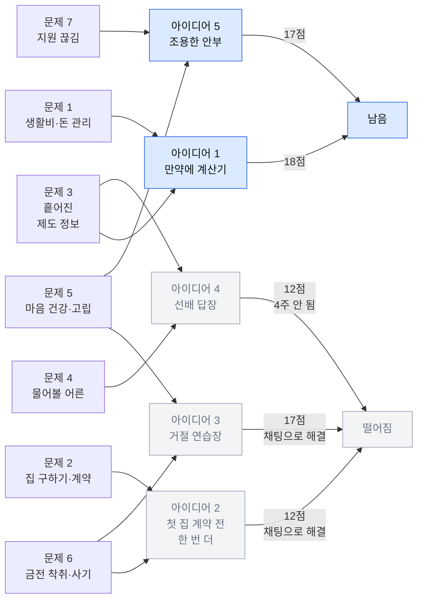

# 4. 자립준비청년

[사회 문제 대상별 아이디어](README.md)의 대상별 문서다. 조사와 평가 방법은 README에 있다.

## 1. 대상

자립준비청년은 가정위탁이나 아동복지시설에서 보호를 받다가 원가정으로 돌아가지 못하고 만 18세 이후 보호가 끝난 청년이다. 예전에는 보호종료아동이라고 불렀다. [1] 2023년 조사 당시 보호 종료 5년 이내 자립준비청년은 9,670명이었다. [2]

- 보호가 끝나는 나이와 연장 제도: 본인이 원하면 별도 사유 없이 만 24세까지 보호 기간을 늘릴 수 있고, 보호가 끝난 뒤에도 필요하면 만 24세까지 다시 보호(재보호)를 받을 수 있다. [3] 그래서 실제로 보호가 끝나는 나이는 만 18세부터 만 24세 사이로 사람마다 다르다. 2023년 조사 응답자 중 나이가 차서 끝난 경우가 50.4%, 연장 보호 뒤 끝난 경우가 49.6%였다. [2]
- 지원 기간과 돈: 자립 지원은 보호 종료 뒤 5년 이내인 사람이 대상이다. [4] 자립수당은 월 50만 원, 최대 5년이다. [3] 자립정착금은 지자체가 주며 지역마다 금액이 다르다. [4]
- 기준 시점: 위 나이·연장 제도와 자립수당 금액은 보건복지부 2025-07-18 안내 기준이다. [3] 자립수당은 2026-10 민간 정리글도 같은 금액으로 적고 있으나 [5], 2026년 공식 원문은 조사 때 직접 열어 보지 못했다.
- 제주: 자립정착금이 2022년 500만 원에서 2023년 1,500만 원으로 올랐고, 대학 입학 준비금은 2025년 500만 원이다. [6] 2022년 자료를 다시 분석하면 제주 19~34세 청년의 은둔 비율은 4.5%로 전국 2.8%보다 높고, 2026-10-12 제주 청년 전체를 대상으로 하는 고립·은둔 청년 지원 기관 '제주청년미래센터 온바람'이 문을 열었다. [7] 제주 자립준비청년 인원은 조사에서 찾지 못했다.

### 가. 처음 짐작과 조사 뒤 달라진 점

처음에는 집, 돈, 행정을 혼자 처리해야 하는 어려움을 짐작했고, 조사해 보니 셋 다 근거가 있었다. 여기에 마음 건강과 고립, 물어볼 어른이 없음, 가족·지인의 금전 착취, 연락이 끊기면 지원도 끊기는 문제가 더 나왔다.

한편 2023년 조사에서 고용률(42.2%에서 52.4%), 대학 진학률(62.7%에서 69.7%), 삶의 만족도(5.3점에서 5.6점)는 2020년보다 나아졌다. [2][8] 당사자들은 선배 상담사, 자조모임, 정책 기고, 국회 토론회 발언으로 제도 개선에 직접 참여하고 있다. [9][10][11][12] 그래서 아이디어는 당사자를 도움받는 쪽으로만 두지 않고, 스스로 판단하고 서로 돕는 일을 거드는 쪽으로 잡았다.

## 2. 이 대상이 가진 문제

| 번호 | 문제 | 근거 |
|---|---|---|
| 1 | 생활비가 모자라고 돈 관리 경험이 적다. 지원은 5년 뒤 끝난다 | 보호 종료 뒤 가장 어려운 점으로 생활비·학비 부족 19.6%, 돈 관리 지식 부족 10.0% [13]. 현재 빚이 있다 36.2%, 갑자기 돈을 빌릴 사람이 없다 28.2% [14] |
| 2 | 보증금, 계약, 관리비 같은 집 문제를 처음 혼자 겪는다 | 1인 가구 69.5%, 공공임대주택 45.3%·월세 21.2%. 보증금 마련 방법은 자립정착금이 40.9%로 가장 많다 [8]. 가장 어려운 점으로 거주지 마련 17.3% [13] |
| 3 | 정보가 흩어져 있고, 생활이 바뀌면 받던 지원이 어떻게 될지 미리 알기 어렵다 | 보호 연장을 하지 않은 이유로 "몰라서" 17.9% [2]. 휴학한 뒤에야 휴학 중에는 수급비를 받을 수 없다는 것을 알았다는 당사자 인터뷰 [13] |
| 4 | 생활 속 결정부터 위급한 상황까지 바로 물어보고 기댈 어른이 부족하다 | 주거·금융·법률 같은 실생활 정보를 물어볼 사람이 없다 28.1%, 의지할 사람이 없다고 느낀다 45.6% [14] |
| 5 | 마음 건강이 흔들리고 고립되기 쉽다 | 평생 자살을 생각한 적 있음 46.5%(전체 청년 10.5%), 보통 집이나 방 밖으로 나가지 않는다 10.6%(전체 청년 2.8%) [2]. 이럴 때 가장 필요한 도움은 이야기할 친구나 멘토 30.3% [8] |
| 6 | 큰돈을 받는 때에 친부모나 지인의 돈 요구와 착취를 겪는다 | 디딤씨앗통장과 자립정착금을 빼앗기는 피해 보도에 보건복지부가 금융교육 강화와 법률·금융 지원 연계를 밝혔다(2026-10-21) [15] |
| 7 | 연락이 끊기면 지원도 끊기고, 전담인력이 자주 바뀐다 | 2021년 기준 보호 종료 5년 이내 11,397명 중 20.2%가 연락 두절 [16]. 전담인력 1명이 사후관리하는 청년 전국 평균 38.8명, 3년 누적 퇴사자 175명(지난해 정원 230명의 76%) [17] |

표의 실태조사·패널조사 수치([2], [8], [13], [14])는 보고서 원문이 아니라 기사 인용으로만 확인했다. 발표에 쓸 때는 원문 대조가 필요하다. 전국 자립지원 실태조사는 2023년 조사(2024-06 발표)가 확인된 가장 최근 것이다.

## 3. 해결 방법과 결과

### 가. 만약에 계산기

- 겨냥한 문제: 3, 1 (주로 3)
- 어떻게 푸는지: 지금 받는 지원에 체크하고 "다음 학기 휴학하고 3월부터 주 20시간 아르바이트"처럼 계획을 적으면, 지원별 영향 표(유지, 줄어듦, 중단 가능, 확인 필요)와 근거 문서, 월별 예상 수입 그래프, 담당자에게 물을 질문이 나온다. 판정은 팀이 만든 규칙표가 하고 인공지능(AI)은 문장 해석과 설명만 맡는다
- 이미 있는 것(다시 확인한 결과): 비슷한 것 있음. 미국 애틀랜타 연방준비은행의 CLIFF(경력 사다리 확인·재무 예측 도구)가 임금·근무시간이 바뀌면 공공 지원이 어떻게 바뀌는지 계산한다 [18]. 국내는 복지로 모의계산처럼 제도 하나를 다루는 계산기만 있다 [19]. 여러 지원과 휴학·이사 같은 생활 사건을 묶은 국내 개인용 도구는 못 찾음

### 나. 첫 집 계약 전 한 번 더

- 겨냥한 문제: 2, 6 (주로 2)
- 어떻게 푸는지: 첫 월세방 계약 전에 등기부등본이나 계약서 초안을 올리면, 확인할 칸(소유자와 계약 상대가 같은지, 근저당 위치)과 특약 풀이, 중개사·집주인에게 물을 질문, 계약 당일 목록이 나온다
- 이미 있는 것(다시 확인한 결과): 있음. 서울시가 만 39세 이하 청년에게 주소만 넣으면 전세사기 위험을 AI로 분석한 보고서를 무료로 준다 [20]. 경기 안심 부동산 [21], 주택도시보증공사(HUG) 안심전세앱 [22]. 계약서를 일반 AI 채팅에 올려 검토하는 안내 글도 있다 [23]

### 다. 거절 연습장

- 겨냥한 문제: 6, 5 (주로 6)
- 어떻게 푸는지: "연락 없던 가족이 정착금 받은 날 연락해 옴" 같은 상황 카드를 고르고, 그 역을 맡은 AI와 5~10번 주고받으며 거절하는 말을 연습한다. 끝나면 상대가 쓴 압박 방식과 다음에 써 볼 문장이 나온다
- 이미 있는 것(다시 확인한 결과): 비슷한 것 있음(형태는 이미 있음). '하마터면'은 생성형 AI가 사기범 역을 맡아 문자·음성으로 대화하고 끝나면 예방 점수를 준다 [24][25]. 못 찾은 것은 가족·지인의 돈 요구 장면뿐

### 라. 선배 답장

- 겨냥한 문제: 4, 3 (주로 4)
- 어떻게 푸는지: 밤 11시에 "보일러가 고장 났는데 수리비를 누가 내요?"라고 적으면 선배가 남긴 비슷한 답 3개와 공식 안내 링크가 나오고, 맞는 답이 없으면 개인정보를 가린 질문이 선배 답변자에게 간다. AI는 답을 지어내지 않는다
- 이미 있는 것(다시 확인한 결과): 비슷한 것 있음. 국내는 선배 상담사가 전화·카카오톡으로 상담한다(평일 9~18시) [12]. 영국에는 보호 경험 청년끼리 조언을 주고받는 IMO(In My Opinion), UpLift가 있었다 [26][27]. 묻고 답한 내용이 쌓여 다시 검색되는 국내 공개 창구는 못 찾음

### 마. 조용한 안부

- 겨냥한 문제: 7, 5 (주로 7)
- 어떻게 푸는지: 청년은 자기가 고른 주기에 메신저 봇의 안부에 버튼이나 한 줄로 답하고 그 주에 쓸 만한 정보 하나를 받는다. 전담인력은 월요일 아침 화면에서 3주 넘게 답이 없는 사람, "도움 필요"를 고른 사람을 이유와 함께 본다
- 이미 있는 것(다시 확인한 결과): 비슷한 것 있음(부분마다). 서울시 AI 안부확인서비스(AI가 전화하고 결과를 동주민센터에 넘김) [28], 전남 '청년들 잘지내니'(사람이 하는 1대1 안부) [29], 보건복지부 위기가구 우선 방문 [30]. 셋을 묶어 청년과 전담인력을 잇는 도구는 못 찾음

## 4. 평가

### 가. 점수표

점수 5칸은 교수 채점 기준(각 1~5점)이고, 뒤 4칸은 팀 기준(통과/주의/탈락)이다.

| 아이디어 | 주제·독창성 | 기술 도구 | 도전과 해결 | 완성도 | 발표 | 합계(25) | AI 채팅으로 해결 | 사회 도움 | 법·윤리 | 2명·4주 |
|---|---|---|---|---|---|---|---|---|---|---|
| 1. 만약에 계산기 | 3 | 4 | 4 | 3 | 4 | 18 | 주의 | 통과 | 주의 | 주의 |
| 3. 거절 연습장 | 3 | 3 | 3 | 4 | 4 | 17 | 탈락 | 통과 | 주의 | 통과 |
| 5. 조용한 안부 | 3 | 3 | 4 | 3 | 4 | 17 | 통과 | 통과 | 주의 | 주의 |
| 2. 첫 집 계약 전 한 번 더 | 1 | 2 | 3 | 3 | 3 | 12 | 탈락 | 통과 | 주의 | 주의 |
| 4. 선배 답장 | 2 | 3 | 3 | 2 | 2 | 12 | 통과 | 통과 | 주의 | 탈락 |

"AI 채팅으로 해결" 칸이 탈락이면 점수와 관계없이 남기지 않았다. 선배 답장은 "2명·4주" 칸에서 탈락했다.

### 나. 남은 2개

#### 1) 만약에 계산기 (18점)

- "본 적 없는" 정의 초안: "받을 수 있는 지원을 찾아 주는 서비스는 많지만, 자립준비청년이 휴학·아르바이트·이사를 결정하기 전에 그 결정이 지금 받는 여러 지원을 언제 어떻게 바꾸는지 근거 조항과 함께 미리 보여 주는 도구는 국내에 없다."
  - 미국에 소득 변화용 CLIFF가 있다는 점 [18]은 숨기지 않고, "국내 제도 묶음, 소득 밖의 생활 사건, 근거 조항"을 차이로 내세운다.
- 시연 장면
  - 입력: 자립수당, 생계급여, 주거급여에 체크하고 "다음 학기 휴학하고 3월부터 편의점에서 주 20시간 일할래요"라고 적는다.
  - 출력: 문장 해석 확인 칸(휴학 시작 달, 월 근로소득, 주휴수당 포함 여부)을 먼저 보여 주고 사용자가 고칠 수 있게 한다. 이어서 지원별 영향 표와 각 줄의 근거 문서·쪽수, 3월부터 보호 종료 5년이 끝나는 달까지 월별 수입 그래프(근로소득과 지원을 쌓은 막대), 주민센터·전담기관에 가져갈 질문 3개가 나온다.
  - 같은 문장을 일반 AI 채팅에 넣은 답을 옆에 두고 규칙표와 다른 칸을 표시한다. 표의 판정 값은 팀이 2026년 지침으로 확인한 뒤 넣는다.
- Skill·MCP가 들어갈 자리
  - MCP(Model Context Protocol, AI가 외부 도구와 자료에 접속하는 표준 방식): 법제처 Open API(응용 프로그램 인터페이스)를 쓰는 공개 국가법령정보 MCP 서버(예: korean-law-mcp). [31] 규칙표를 만들 때 Claude Code가 국민기초생활보장법·시행령, 아동복지법의 자립지원 조항, 기준 중위소득 고시 원문을 불러와 규칙 한 줄마다 근거를 대조한다. AI가 조항 번호를 지어내는 일을 원문 조회로 막을 수 있다.
  - MCP의 한계: 청년 추가공제 같은 세부 기준은 법령이 아니라 국민기초생활보장사업안내(지침 PDF)에 있어 MCP로 다 잡히지 않는다. 이 부분은 PDF에서 직접 뽑는다. 실행 중에 규칙표를 MCP 도구로 여는 것은 함수 호출로도 되므로 꼭 필요하지는 않다.
  - Skill(Claude가 필요할 때 불러 쓰는 작업 지침 묶음): "규칙표 갱신" Skill. 새해 지침이 나오면 바뀐 숫자 찾기, 규칙표 고치기, 정답 시나리오 시험 다시 돌리기 순서를 담는다. 2025년에서 2026년으로 바뀐 청년 공제 [32]를 실제 사례로 보여 줄 수 있어 억지가 아니라고 평가됐다.
- AI가 틀릴 수 있는 곳과 시험 방법
  - 틀릴 곳: "주 20시간"을 월 소득으로 바꿀 때 주휴수당을 빼먹거나 주·월 단위를 섞는다. "휴학"과 "자퇴", "이사"와 "전입신고"를 섞는다. 2026년부터 청년 근로·사업소득 추가공제가 만 34세 이하·월 60만 원으로 바뀌었는데 [32], 학습 시점 지식으로 2025년 기준(만 29세 이하, 월 40만 원)을 쓴다. 설명 단계에서 규칙표에 없는 "유지됩니다"를 덧붙인다.
  - 시험 1 판정: 팀이 2026년 지침으로 손 계산한 정답 시나리오 40개 → 규칙표 판정 일치 수(목표 40/40).
  - 시험 2 문장 해석: 생활 계획 문장 60개(애매한 표현, 오타, 단위 섞임 포함) → 변화 항목과 금액이 정답과 같은 비율(목표 90% 이상), 틀린 유형별 개수 표.
  - 시험 3 모른다고 말하기: 규칙표 밖 질문 20개(입대, 결혼, 다른 시도로 이사 등) → "확인 필요"로 돌린 비율(목표 100%), 지어낸 판정 0건.
  - 시험 4 일반 채팅 비교: 정답 시나리오 20개를 일반 AI 채팅 2종에 같은 문장으로 넣어 정답률을 비교한다. "AI 채팅으로 해결" 칸이 주의인 데 대한 숫자 답이다. 1주 차에 먼저 해서, 최신 규칙에서 자주 틀리면 계속하고 대부분 맞히면 이 아이디어는 접는다.
- 가장 큰 위험: 팀이 지침을 잘못 읽어 만든 규칙이 화면에서는 근거까지 붙은 "확신 있는 오답"이 되어, 청년이 이를 믿고 일을 늘렸다가 수급 중단이나 환수를 겪는 것. 4주 안에 주민센터나 전담기관 검토를 받기 어려우므로 범위를 1인 가구와 제도 3~4개로 좁히고, 확신이 낮은 칸은 모두 "확인 필요"로 두며, 소득 정보는 서버에 남기지 않는다.
- 고치면 나아질 점: 시험 4 결과를 발표 첫 장면으로 올리면 "그냥 ChatGPT에 물어보면 되지 않나"라는 질문에 숫자로 답하며 시작할 수 있다.

#### 2) 조용한 안부 (17점)

- "본 적 없는" 정의 초안: "지금까지의 안부 확인은 기관이 정한 주기로 묻고 기관이 판단했지만, 이 도구는 청년이 주기·방식·공유 범위를 정하고, 담당자에게는 점수 대신 '이번 주 누구에게 먼저, 왜'만 전한다."
- 시연 장면
  - 입력: 발표장의 청중 한 명이 휴대폰 메신저 봇의 일요일 안부에 "이번 달 월세가 밀릴 것 같아요"라고 답한다.
  - 출력: 청년 화면에 주거 관련 정보 하나와 상담센터 번호가 뜬다. 동시에 전담인력 화면이 새로 고쳐지며, 이 청년이 "집 걱정 처음 언급, 2주 전 답은 '그냥 그럼'"이라는 이유와 함께 맨 위에 오른다. 아래에는 3주 넘게 답이 없는 가상 청년 2명이 있다. 점수나 등급은 화면 어디에도 없다.
  - 시연은 가상 데이터로 하고 실제 청년 정보는 쓰지 않는다. 카카오톡 채널 챗봇은 별도 신청 절차가 있어 다른 메신저나 웹 알림으로 바꿔야 할 수 있다(절차 확인 필요).
- Skill·MCP가 들어갈 자리
  - Skill: "안부 답 분류 기준" Skill. 돈·집·일·마음·위급 분류 기준, 위급 표현에 내보낼 문구, 금지 사항(점수 매기기, 진단처럼 말하기)을 한곳에 두고 봇과 시험이 같은 기준을 쓴다. 프롬프트 파일로도 되지만, 기준을 고칠 때 시험까지 함께 돌리는 절차를 묶을 수 있어 쓸 이유는 있다.
  - MCP: 꼭 필요한 자리는 없다. 넣는다면 "이번 주 쓸 만한 정보 하나"를 고를 때 공공데이터포털의 복지서비스 목록 API를 MCP로 감싸 쓰는 정도이며, 이 API가 자립준비청년 지원을 얼마나 담는지는 확인 전이다. 전담인력 화면의 데이터 조회를 MCP로 만드는 것은 일반 API로 충분해 억지로 평가됐다.
- AI가 틀릴 수 있는 곳과 시험 방법
  - 틀릴 곳: 돌려 말한 위급 표현("다 그만하고 싶다", "괜찮아요 ㅋㅋ")을 놓친다. 관용 표현("배고파 죽겠다")에 과잉 경보를 낸다. 주간 요약에 기록에 없는 사실을 지어낸다. 돈과 집 걱정이 섞인 답의 주제를 하나로 잘못 묶는다.
  - 시험 1 주제 분류: 가상 한 줄 답 300개(주제 5종, 위급·관용 표현 섞음). 팀원 2명이 따로 정답을 달아 일치도를 먼저 잰 뒤 → 주제 분류 정확도.
  - 시험 2 위급 표현: 위급 표현 50개 → 재현율(실제 위급 표현 중 잡아낸 비율, 목표 100%, 키워드 규칙과 AI 판정 중 하나라도 걸리면 경보). 관용 표현 50개 → 오경보율.
  - 시험 3 요약: 주간 요약 50개 → 기록에 없는 사실이 들어간 건수(목표 0).
  - 시험 4 규칙: 3주 무응답, "도움 필요" 선택 같은 규칙 판정 단위 시험(전부 통과).
- 가장 큰 위험: 청년이 "도움 필요"를 누르거나 위급한 말을 적었을 때 누가 언제 응답할지 약속할 수 없는데, 도구가 응답을 약속하는 것처럼 보이는 것. 시연용 가상 시스템이라도 화면에 "이 버튼은 바로 연결이 아니다, 급하면 자살예방상담전화 109·자립준비청년 상담센터 1855-2455"를 고정하고 [12], 위급 표현은 AI 판단을 기다리지 않고 규칙으로 먼저 안내한다. 마음 건강 내용은 개인정보보호법의 민감정보(건강)에 가깝고 감시로 느껴질 수 있어, 실제 데이터는 쓰지 않고 주기·공유 범위·참여 여부는 청년이 정하며 언제든 끌 수 있게 한다.
- 고치면 나아질 점: 전담인력 1명에게라도 화면 시안을 보여 받은 의견을 발표에 넣으면 "가상 데이터뿐"이라는 약점이 줄어든다.

### 다. 떨어진 3개와 이유

#### 1) 거절 연습장 (17점, AI 채팅으로 해결 탈락)

'하마터면'은 생성형 AI가 사기범 역을 맡아 문자·음성으로 대화하고 끝나면 예방 수준 진단과 대응 안내를 주는 체험을 사례 39개로 제공하며, 은행 앱의 보이스피싱 예방 메뉴에도 들어갔다는 보도가 있다. [24][25][33] 남는 차이인 가족·지인의 돈 요구 장면은 일반 AI 채팅에 "너는 연락이 끊겼던 가족 역, 나는 거절 연습"이라는 지시 한 문단으로 거의 재현되고, 실제 메시지 붙여 넣기 모드는 채팅 사용법 그대로다. 자신을 떠났던 부모 역을 AI가 연기하면 상처를 다시 건드릴 수 있어 전담기관이나 당사자 검토 없이 공개 시연하기도 어렵다.

#### 2) 첫 집 계약 전 한 번 더 (12점, AI 채팅으로 해결 탈락)

서울시는 2026-03-25부터 서울에서 계약할 만 39세 이하 청년에게 주소만 넣으면 임대인·주택 24개 항목으로 전세사기 위험을 AI로 분석한 보고서를 무료로 준다. [20] '경기 안심 부동산'은 계약 전 권리분석, 계약 중 음성 인식으로 설명 누락 확인, 계약 후 등기 변동 감시까지 하고(2026-10 시범 예정, 시작 여부는 다시 확인하지 않음) [21], 계약서 사진을 일반 AI 채팅에 올려 위험 조항을 찾는 방법도 안내 글로 돌아다닌다. [23] 남는 질문 목록과 계약 당일 목록은 공공 체크리스트 한 장으로 되고, 권리관계 풀이는 법률 상담 대행으로 보일 위험과 등기부 속 남의 개인정보 문제를 함께 안는다.

#### 3) 선배 답장 (12점, 2명·4주 탈락)

핵심 가치가 "선배가 단 진짜 답"인데, 4주 안에 실제 선배 답변자를 섭외하고 답을 쌓기 어렵다. 공개 인터뷰·기고에서 뽑을 수 있는 시작 데이터는 수십 건 수준이라 비슷한 답 찾기의 품질을 보여 줄 수 없고, 시연은 팀원이 선배 역을 하는 꼴이 된다. 구조도 질문 게시판에 의미 검색과 개인정보 가리기를 더한 것으로, 영국에는 IMO와 UpLift가 있었고 [26][27] 국내에서는 선배 상담사가 전화·카카오톡으로 같은 일을 사람이 한다. [12]

## 5. 출처

1. [자립준비 청년 맞춤형 지원](https://m.korea.kr/multi/visualNewsView.do?newsId=148941640) (보건복지부, 대한민국 정책브리핑, 2025-04-11)
2. [자립준비청년 18%, 자살 고위험군 … 고립·은둔 비율도 일반 청년의 4배](https://biz.newdaily.co.kr/site/data/html/2024/06/26/2024062600255.html) (뉴데일리, 2024-06-26, 보건복지부 2023 자립지원 실태조사 보도)
3. [보호종료확인서 '정부24'에서 발급](https://www.bokjiro.go.kr/ssis-tbu/cms/pc/news/promotion/1308362_1118.html) (보건복지부, 복지로, 2025-07-18)
4. [자립지원 대상 아동·청년 지원사업 평가 발간 안내](https://www.nabo.go.kr/ko/notice/releasesView.do?idx=8846) (국회예산정책처, 2025-08-05)
5. [2026 자립준비청년 지원 정리](https://www.yugacrew.com/crewletter/youth-leaving-care-support-2026) (육아크루 크루레터, 2026-10-17, 민간 정리글)
6. [제주여성가족연구원 민선8기 도정의 아동·청소년 복지시설 자립지원 정책 성과진단](https://newsseoul.co.kr/news/view/1065590453345017) (뉴스서울, 2025-06-11)
7. [제주 고립·은둔청년, 온라인부터 일 경험까지… '온바람' 문 열어](https://www.fnnews.com/news/202610121043465328) (파이낸셜뉴스, 2026-10-12)
8. [막막한 홀로서기…자립준비청년 46.5% "자살 생각 해봤다"](https://www.kukinews.com/article/view/kuk202406260075) (쿠키뉴스, 2024-06-26, 보건복지부 2023 자립지원 실태조사 보도)
9. ['열여덟 어른' 자립준비청년을 아시나요?](https://www.pressian.com/pages/articles/2025072517273136404) (프레시안, 2025-07-26, 자립준비청년 기고)
10. ["생명의 전화처럼… 행정 공백 속 '자립준비청년' SOS 들어줘야"](https://twig24.com/news/2025/06/23/20250623012001) (서울신문, 트윅 게재, 2025-06-22)
11. [자립준비청년 지원 체계 분절…단일 지원 시스템 구축해야](https://www.segye.com/newsView/20251105506896) (세계일보, 2025-11-05)
12. [자립준비청년 온라인 자립정보 플랫폼 안내](https://www.bokjiro.go.kr/ssis-tbu/cms/pc/news/promotion/1304843_1118.html) (보건복지부, 복지로, 2023-04-26, 자립정보ON과 자립준비청년 상담센터)
13. [\[자립, 그 이후의 이야기<상>\] 현실은 생존 위한 몸부림…5년 지나면 국가지원 '단절'](https://news.tf.co.kr/read/life/2207105.htm) (더팩트, 2025-05-20, 아동권리보장원 패널조사 인용)
14. [누구에게 기대야해…홀로 세상에 나온 자립준비청년, 3명 중 1명 빚더미](https://www.mt.co.kr/economy/2023/10/01/2023092713241639529) (머니투데이, 2023-10-01, 한국청소년정책연구원 시설퇴소청년 생활실태조사 인용)
15. [\[보도설명자료\] 날 버렸던 엄마가 찾아왔다...2000만원 자립지원금 받은 날 관련](https://m.korea.kr/briefing/actuallyView.do?newsId=148974063) (보건복지부, 대한민국 정책브리핑, 2026-10-21)
16. [늘어나는 지원이 사각지대도 메울까 \[자립준비청년 지원책 흐름과 한계\]](https://futurechosun.com/?p=88234) (더나은미래, 2024-05-21, 국회입법조사처 2023년 보고서 인용)
17. [\[2026 국정감사\] 자립준비청년전담인력, 해마다 4명 중 1명 떠나는데... 퇴사 반복에도 관리 기준 '미비'](https://www.ibabynews.com/news/articleView.html?idxno=156051) (베이비뉴스, 2026-10-23)
18. [CLIFF tools](https://www.atlantafed.org/economic-mobility-and-resilience/advancing-careers-for-low-income-families/cliff-tool) (미국 애틀랜타 연방준비은행)
19. [\[복지로 활용법 2\] 복지서비스 모의계산](https://www.bokjiro.go.kr/ssis-tbu/cms/pc/news/promotion/1189060_1118.html) (복지로, 2018-11-02)
20. [주소만 넣으면 끝! AI가 청년 전세사기 위험 알려준다](https://mediahub.seoul.go.kr/archives/2017567) (서울특별시 내 손안에 서울, 2026-03-24)
21. [AI로 전세사기 위험 미리 진단한다](https://eiec.kdi.re.kr/policy/materialView.do?num=286877) (과학기술정보통신부, KDI 경제정보센터 게재, 2026-09-15)
22. [HUG, 안심전세앱 위험정보 개방…민간 플랫폼과 연계 추진](https://www.fnnews.com/news/202607151532318922) (파이낸셜뉴스, 2026-07-15)
23. [ChatGPT로 임대차계약서 5분 검토하기: 위험 조항 찾는 7가지 프롬프트(2026)](https://smarttechnote.com/chatgpt-contract-review/) (스마트테크노트) (검색 요약으로 확인)
24. [Korea's First Generative AI-Based Digital Financial Fraud Prevention Experience Service, "Hamateomyeon"](https://www.asiae.co.kr/en/article/2025061720125145037) (아시아경제, 2025-06-17)
25. [한경닷컴, 씽크풀과 금융사기 피해 방지 서비스 '하마터면' 홍보 MOU](https://www.hankyung.com/article/2026052078836) (한국경제, 2026-05-20)
26. [Teens in care and care leavers challenge perceptions and share successes on IMO](https://www.childrenscommissioner.gov.uk/blog/teens-in-care-and-care-leavers-challenge-perceptions-and-share-successes-on-imo/) (Children's Commissioner for England, 2019-04-25)
27. [UpLift](https://uplift.actionforchildren.org.uk) (Action for Children, 2026-11-21 접속 실패) (검색 요약으로 확인)
28. ['AI 안부확인서비스' 일방향에서 양방향으로 업그레이드](https://news.seoul.go.kr/welfare/archives/574354) (서울특별시 복지분야 누리집, 2025-10)
29. [전남여성단체협의회, 자립준비청년 생필품 지원](https://nocutnews.co.kr/news/6559277) (노컷뉴스, 2026-08-06)
30. ['기다리는' 복지에서, 먼저 '찾아가는' 복지](https://www.bokjiro.go.kr/ssis-tbu/cms/pc/news/promotion/1309767_1118.html) (복지로) (검색 요약으로 확인)
31. [korean-law-mcp 소개 글](https://ice-ice-bear.github.io/ko/posts/2026-05-12-korean-law-mcp/), [배포 페이지](https://pypi.org/project/korean-law-mcp/) (2026-05-12 소개 글) (검색 요약으로 확인)
32. [2026년 기초생활보장 달라지는 점](https://m.korea.kr/news/policyNewsView.do?newsId=148957426) (보건복지부, 대한민국 정책브리핑, 2026-01-02)
33. [우리은행, AI 보이스 피싱 예방 '실전 시뮬레이션' 교육 서비스 제공](https://biz.sbs.co.kr/amp/article/20000256968) (SBS Biz, 2025-09-02) (검색 요약으로 확인)
