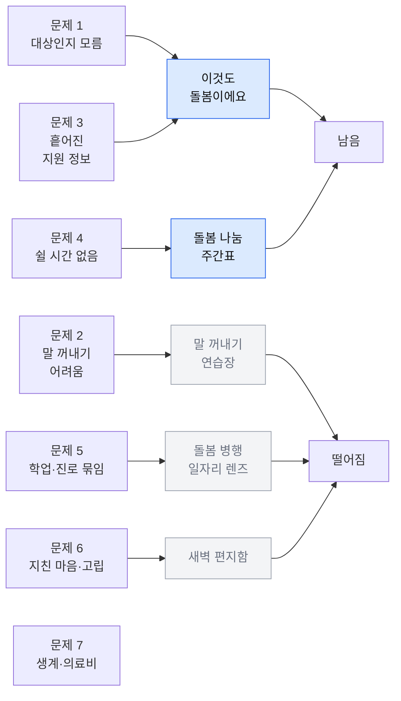

# 5. 가족돌봄청년

[사회 문제 대상별 아이디어](README.md)의 대상별 문서다. 조사와 평가 방법은 README에 있다.

## 1. 대상

장애나 질병이 있는 가족을 돌보거나, 그 때문에 생계를 맡은 청소년·청년이다. 영케어러(young carer)라고도 부르며, 나이 기준은 기관마다 달라 보건복지부 실태조사와 청년미래센터는 13~34세 [1][2], 서울형 자기돌봄비는 9~39세 [3]로 잡는다.

제주에서는 아픈 가족을 직접 돌보거나 가족의 의료비·생활비를 벌기 위해 일하는 39세 이하 청년·청소년도 일상돌봄 서비스를 신청할 수 있다 [4]. 초록우산 제주지역본부는 제주도교육청 등과 협약해 학교에서 가족돌봄 아동·청소년을 찾고, 2026년 31명에게 1억 1,082만 원을 지원했다 [5].

돌봄은 힘든 일로만 기록되지 않는다. 하루를 시간대별로 되짚는 일상재구성 연구에서 피곤함과 스트레스 다음으로 강하게 나타난 정서가 '의미'였고 [6], 당사자들은 직접 자조모임을 꾸리고 돌봄 청소년을 도울 멘토를 길러 내고 있다 [7]. 그래서 아이디어는 당사자를 스스로 판단하는 사용자로 두고, 정보·시간·창구 같은 구조 쪽을 바꾸는 방향으로 잡았다.

### 가. 처음 짐작과 조사 뒤 달라진 점

1) 처음에는 지원 제도가 흩어져 있어 찾기 어렵다고 짐작했고, 짐작은 맞았다. 같은 서울 안에서도 이름이 같은 '자기돌봄비'가 두 가지이고 나이·소득 기준이 서로 다르다 [3][8].
2) 그보다 앞단의 문제가 있었다. 자신이 대상인지 모르고(문제 1), 알아도 주변에 말을 꺼내기 어렵다(문제 2).
3) 숫자로 가장 크게 드러난 것은 쉴 시간 부족(문제 4)과 마음 건강(문제 6)이었다.
4) 당사자 단체 'n인분'은 '가족돌봄청년'이라는 말이 돌봄 부담을 개인과 가족에게 더 지운다고 보고 이 말을 쓰지 않는다 [7]. 화면 문구를 정할 때 참고할 점이다.

## 2. 이 대상이 가진 문제

| 번호 | 문제 | 근거 |
|---|---|---|
| 1 | 자신이 돌봄을 하고 있는지, 지원 대상인지 모른다 | 서울 조사에서 지원 대상인지 모르는 비율 76.4% [9]. 규모 추정이 5만 7천 명에서 63만 3천 명까지 갈려 드러나지 않은 대상이 많음 [10] |
| 2 | 주변에 말하고 도움을 청하기 어렵다 | 낙인, 가족과 떨어지게 될지 모른다는 두려움이 도움 요청을 막음 [10]. 일본 조사에서 가족을 돌보는 중학교 2학년의 67.7%가 누구와도 상담한 적 없음 [11] |
| 3 | 지원 정보가 흩어져 있고 지역·사업마다 기준이 다르다 | 서울 안에서도 자기돌봄비가 9~39세·기준 중위소득 150% 이하와 13~34세·100% 이하 두 가지 [3][8]. 같은 서울형도 3월 공고는 최대 8개월, 5월 추가 모집은 최대 6개월 [12][3] |
| 4 | 돌봄 시간이 길어 쉴 시간, 나를 위한 시간이 없다 | 주당 평균 돌봄 21.6시간(주로 돌보는 사람은 32.8시간), 필요한 지원으로 휴식 지원을 꼽은 비율 71.4% [1] |
| 5 | 학업·진로·취업이 돌봄에 묶인다 | 미래 계획에 어려움을 겪는다는 응답 36.7% [1]. 직장을 고를 때 집과의 거리와 야근 여부를 가장 먼저 따진다는 당사자 [13] |
| 6 | 마음이 지치고, 같은 처지의 또래를 만나기 어렵다 | 우울감 유병률 61.5%(일반 청년 8.5%) [1]. 상의할 상대가 없는 고립이 가장 큰 어려움이라는 당사자 단체의 판단 [7] |
| 7 | 생계와 의료비 부담이 크다 | 필요한 지원으로 생계 75.6%, 의료 74.0% [1]. 서울 조사에서 월 소득 100만 원 미만 45% [9] |

## 3. 해결 방법과 결과

그림의 선은 주로 겨냥한 문제만 이었다. 일부만 닿는 문제는 아래 "겨냥한 문제"에 괄호로 적었다.

### 가. 이것도 돌봄이에요

- 겨냥한 문제: 1, 3 (7 일부)
- 어떻게 푸는지: 제주의 고등학생이 밤에 "학교 끝나면 할머니 저녁 차리고 약 챙겨 드려요"라고 적으면, 인공지능(AI)이 돌봄 활동 카드와 이번 주 돌봄 시간 추정을 보여 주고 나이·지역에 맞는 제도와 신청 창구를 출처·확인 날짜와 함께 조건 표로 정리한다. 해당 여부는 AI가 아니라 팀이 만든 제도 규칙표가 판정한다.
- 이미 있는 것(다시 확인한 결과): 비슷한 것 있음. 배달의민족 '장보기 검사'(숨은 가족돌봄청년 찾기) [14], 강남구 'AI 사회복지사'(일상 말로 물으면 복지 사업을 찾아 줌) [15]. 정부도 2027년 시범을 예고함 [16]. 돌봄 활동에 이름 붙이기와 지역별 기준 나란히 보기는 못 찾음

### 나. 말 꺼내기 연습장

- 겨냥한 문제: 2 (5 일부)
- 어떻게 푸는지: 아버지 병원 일정 때문에 교수에게 과제 기한 연장을 부탁해야 하는 대학생이 받는 사람, 원하는 것, 공개 수준(사정만 / 가족 간병까지 / 병명까지)을 고르면 말투가 다른 메일 초안 2개가 나오고, AI가 교수 역할로 묻는 연습 대화를 해 볼 수 있다.
- 이미 있는 것(다시 확인한 결과): 비슷한 것 있음. 영국 Carer Passport와 관리자 대화 준비용 Carers' Conversation Map [17], 로햄튼 대학(University of Roehampton)의 학생용 Carer Passport [18]

### 다. 돌봄 나눔 주간표

- 겨냥한 문제: 4 (5 일부)
- 어떻게 푸는지: 어머니를 돌보는 대학생이 일요일 밤 수업 시간표 사진과 "월수금 저녁 식사 준비, 화요일 오전 병원, 매일 밤 약"을 넣고 지킬 공부 시간을 먼저 고정하면, 색으로 나뉜 주간표와 이번 주 돌봄 시간이 나오고 공적 서비스나 다른 가족에게 넘길 수 있는 칸이 표시된다.
- 이미 있는 것(다시 확인한 결과): 비슷한 것 있음. 미국 유타대의 돌봄자 휴식 시간 주간 계획 앱 TLC(Time for Living and Caring) [19], 가족 돌봄 그룹 달력 Carers UK 'Jointly' [20]. 수업 시간을 먼저 고정하고 국내 공적 서비스로 넘길 칸을 찾는 도구는 못 찾음

### 라. 돌봄 병행 일자리 렌즈

- 겨냥한 문제: 5 (7 일부)
- 어떻게 푸는지: 부모를 돌보며 취업을 준비하는 29세가 채용 공고 5개를 붙여 넣고 돌봄 일정(화요일 오전 병원 동행, 평일 저녁 7시 전 귀가)을 정하면, 공고마다 출퇴근 시간, 야근, 재택 여부, 돌봄 일정과 겹치는 곳이 카드로 나오고 돌봄과 같이 하기 쉬운 순으로 정렬된다.
- 이미 있는 것(다시 확인한 결과): 비슷한 것 있음. 영국 돌봄자용 유연근무 일자리 게시판 Timewise Jobs [21], 돌봄자 직원을 지원하는 고용주 인증 Carers UK 'Carer Confident' [22]

### 마. 새벽 편지함

- 겨냥한 문제: 6 (2 일부)
- 어떻게 푸는지: 치매가 있는 할머니를 돌보는 22세가 밤 11시에 편지를 쓰면 AI가 이름·학교·동네 같은 정보 가리기를 제안하고, 편지는 조부모를 돌보는 또래 2명에게 다음 날 이름 없이 전달된다. 위험 표현이 있으면 전달을 멈추고 운영자에게 알린다.
- 이미 있는 것(다시 확인한 결과): 비슷한 것 있음. 국내 익명 편지 앱 '편안하다' [23]와 또래 상담 앱 '나기지' [24], 영국 영 케어러 온라인 공동체 Carers Trust 'Babble' [25]. 돌봄 상황 기준으로 짝을 맞추는 곳은 못 찾음

## 4. 평가

### 가. 점수표

| 아이디어 | 주제·독창성 | 기술 도구 | 도전과 해결 | 완성도 | 발표 | 합계(25) | AI 채팅으로 해결 | 사회 도움 | 법·윤리 | 2명·4주 |
|---|---|---|---|---|---|---|---|---|---|---|
| 이것도 돌봄이에요 | 3 | 4 | 4 | 4 | 4 | **19** | 주의 | 통과 | 주의 | 통과 |
| 돌봄 나눔 주간표 | 3 | 3 | 3 | 4 | 4 | **17** | 주의 | 통과 | 주의 | 통과 |
| 새벽 편지함 | 4 | 3 | 4 | 2 | 3 | 16 | 통과 | 통과 | 주의 | 주의 |
| 말 꺼내기 연습장 | 2 | 2 | 3 | 4 | 3 | 14 | **탈락** | 통과 | 주의 | 통과 |
| 돌봄 병행 일자리 렌즈 | 2 | 3 | 3 | 3 | 3 | 14 | **탈락** | 주의 | 통과 | 통과 |

"AI 채팅으로 해결" 칸이 탈락이면 점수와 관계없이 남기지 않았다.

### 나. 남은 2개

두 아이디어 모두 "AI 채팅으로 해결" 칸이 '주의'다. 평가에서는 같은 입력을 일반 AI 채팅에 넣은 결과와 이 서비스의 결과를 나란히 놓고 차이를 숫자로 보여 주지 못하면 '탈락'으로 바뀔 수 있다고 봤다. 그래서 두 아이디어의 시험 방법에 이 대조 시험이 들어 있고, 발표 전에 반드시 해야 한다.

#### 1) 이것도 돌봄이에요 (19점)

- "본 적 없는" 정의 초안: 복지 검색과 AI 복지 상담은 도움이 필요하다고 아는 사람이 묻는 데서 시작하지만, 이 서비스는 자기가 돌봄을 한다고 생각하지 않는 청소년·청년이 평소 말로 쓴 하루에서 돌봄을 찾아 이름을 붙이고, 사는 지역 기준의 제도를 출처·확인 날짜와 함께 나란히 보여 준다.
- 시연 장면
  - 입력: "학교 끝나면 할머니 저녁 차리고 약 챙겨 드려요. 토요일엔 병원에 같이 가요. 할머니가 밤에 깨시면 옆에 있어 드려요." 이어서 짧은 질문 2개에 답한다(17세, 제주시, 할머니와 함께 삶).
  - 출력: 돌봄 활동 카드 4장(식사 준비, 약 챙기기, 병원 동행, 밤 지켜보기는 정서 돌봄으로 분류)과 이번 주 돌봄 시간 추정, "13~34세 가족돌봄 청소년·청년 기준에 들 수 있음" 안내가 나온다. 제주에서 확인된 창구(제주 일상돌봄 서비스 [4], 학교를 통한 초록우산 지원 [5], 청년ON 온라인 신청 [2])가 표로 나오고 칸마다 출처 링크와 확인 날짜가 붙는다. 화면 아래에는 같은 사람이 서울에 살았다면 달라지는 기준(서울형 9~39세·기준 중위소득 150% 이하, 청년미래센터 13~34세·100% 이하)을 나란히 보여 준다.
- Skill·MCP(모델 컨텍스트 프로토콜, Model Context Protocol)가 들어갈 자리
  - Skill(자연스러움): 개발 과정에 쓰는 '제도 규칙표 갱신' Skill. 보도자료나 공고 주소를 주면 정해진 칸(대상 나이, 소득 기준, 지역, 신청 경로, 출처, 확인 날짜)으로 뽑고, 기존 행과 달라진 칸을 표시해 사람이 확인하게 한다. 2026년 한 해에만 「가족돌봄 등 위기아동·청년 지원에 관한 법률」 시행 [26], 청년미래센터 확대, 서울형 자기돌봄비 최대 기간 8개월·6개월 혼재 [12][3]처럼 기준이 계속 바뀌어 같은 작업이 반복되므로 필요하다.
  - MCP(도움은 되나 필수는 아님): 규칙표와 지자체복지서비스 응용 프로그램 인터페이스(API) [27]를 조회하는 MCP 서버(조건으로 제도 찾기, 제도 하나 자세히 보기). 언어 모델이 기준을 지어내지 못하게 사실을 모델 밖에 두는 것이 목적이다. 일반 함수 호출로도 같은 일이 되고, MCP로 만드는 이유는 '같은 규칙 서버를 앱과 다른 AI 도구에서 함께 쓴다' 정도다. 억지는 아니지만 발표에서 이 이유를 정직하게 말해야 한다는 평가다.
- AI가 틀릴 수 있는 곳과 시험 방법
  - 돌봄 활동 추출: 정서 돌봄이나 생계 노동처럼 눈에 덜 띄는 돌봄을 놓칠 수 있다(당사자도 목욕 보조처럼 눈에 보이는 간병만 돌봄으로 여겼다 [13]). 반대로 평범한 집안일을 돌봄으로 잘못 판정할 수 있다. 공개 인터뷰 [13]와 실태조사의 돌봄 활동 목록 [1]을 바탕으로 서술 40개(돌봄 있음 30, 돌봄 없음 10)와 정답 표를 만들어, 활동 종류별 재현율·정밀도와 '돌봄 없음' 서술의 잘못 판정 수를 낸다. 목표 예: 재현율 0.85 이상, 잘못 판정 2개 이하.
  - 빠진 조건 채우기: 나이·지역·소득 구간을 잘못 읽어 엉뚱한 제도로 보낼 수 있다. 경계값을 넣은 가상 인물 20명(만 34세, 서울 기준 중위소득 120%, 수급자, 14세 미만 등)의 기대 결과 표를 만들고 일치율을 낸다.
  - 일반 AI 채팅 대조: 일반 AI 채팅도 서술에서 돌봄을 잘 찾으므로, 차이는 지역별 기준의 정확도와 출처·확인 날짜에서만 난다. 같은 20명을 웹 검색을 켠 일반 AI 채팅에 물어 틀린 기준, 없는 제도, 출처 없는 답의 수를 세고 이 서비스와 나란히 표로 보여 준다.
  - 출처 누락: 결과 카드 전부에 출처와 확인 날짜가 붙는지 자동으로 검사한다(목표 100%).
- 가장 큰 위험: 규칙표의 정확성과 최신성이다. 일상돌봄 서비스는 시군구마다 기준이 다르고(서울 양천구는 2026년부터 청·중장년 나이 기준을 만 19세 이상에서 만 13세 이상으로 낮춤 [28]) 같은 사업도 모집 차수마다 기간이 다르다 [12][3]. 규칙 하나가 틀려 '대상 아님'으로 안내하면 당사자가 신청을 포기할 수 있으므로, '대상 아님' 판정은 내지 않고 '확인 필요'와 문의처로만 보낸다.
- 고치면 나아질 점: 돌보는 청년이 받을 지원 옆에 돌봄을 받는 가족이 받을 지원(통합돌봄, 일상돌봄 등 [29])도 함께 보여 주면, 일반 복지 추천과의 차이가 더 분명해지고 돌봄 부담 자체를 덜 방법까지 이어진다.

#### 2) 돌봄 나눔 주간표 (17점)

- "본 적 없는" 정의 초안: 가족 돌봄 앱은 돌봄을 받는 사람의 일정을 가족이 나누는 도구였지만, 이 서비스는 돌보는 청년의 수업·공부 시간을 먼저 고정한 뒤 남는 돌봄 가운데 공적 서비스나 다른 가족에게 넘길 수 있는 칸을 찾아 주는, 돌보는 사람 쪽에서 짠 주간표다.
- 시연 장면
  - 입력: 대학 시간표 캡처 한 장, "월수금 저녁 6시 반 식사 준비 1시간, 화요일 오전 9~12시 어머니 병원, 매일 밤 10시 약", 지키고 싶은 공부 시간(월·수 18~21시), 사는 곳(제주시).
  - 출력: 수업·돌봄·빈 시간이 색으로 나뉜 주간표와 "이번 주 돌봄 약 10시간, 내가 정한 목표 6시간보다 4시간 많음"이 나온다. 공부 시간과 겹치는 월·수 식사 준비 칸에 '넘길 후보' 표시가 붙고, 화요일 병원 칸에는 "제주 일상돌봄 특화서비스(병원 동행) 대상일 수 있음, 주민센터 신청, 진단서·소견서 필요"가 출처·확인 날짜와 함께 붙는다 [4]. 수요일 칸에는 형에게 보낼 "수요일 저녁만 맡아 줄 수 있어?" 초안과 읽기 전용 공유 링크가 나온다.
- Skill·MCP가 들어갈 자리
  - 서비스 규칙표 MCP와 규칙표 갱신 Skill: 이것도 돌봄이에요와 같은 구조다. '넘길 수 있는지'는 규칙표가 판단해야 하므로 이쪽에서 더 필요하다.
  - 달력 MCP(구글 캘린더 등): 완성한 주간표를 이미 쓰는 달력으로 보낸다. iCalendar(.ics) 파일 내보내기로 대신할 수 있어 반쯤 억지라는 평가다. 넣는다면 '매주 다시 열지 않아도 된다'는 사용 이유를 붙여야 한다.
- AI가 틀릴 수 있는 곳과 시험 방법
  - 시간표 사진 인식: 요일·칸 경계를 잘못 읽거나 연강을 합칠 수 있다. 동의를 받은 실제 시간표 캡처 20장(에브리타임, 학교 포털, 손으로 그린 표 섞기)에서 요일·시작·끝이 모두 맞은 수업 블록 비율을 낸다. 목표 예: 95% 이상. 틀린 블록을 사용자가 고치는 화면은 필수다.
  - 자유 서술을 일정으로 바꾸기: "매일 밤 약"의 시각과 걸리는 시간 추정이 흔들릴 수 있다. 서술 30개의 기대 일정표와 비교해 할 일 개수·요일 일치율과 주간 돌봄 시간 합계 오차(분)를 낸다.
  - 넘길 칸 후보: 규칙표에 없는 서비스를 지어낼 수 있다. 출력에 나온 서비스 이름이 규칙표에 있는 비율을 자동으로 검사한다(목표 100%).
  - 일반 AI 채팅 대조: 한 주 계획을 한 번 짜는 일은 일반 AI 채팅에 시간표 사진만 올려도 된다. 같은 입력 10건을 일반 AI 채팅에 넣어 지어낸 서비스 수, 틀린 기준 수, 시간 합계 오차를 세고 이 서비스와 나란히 보여 준다.
- 가장 큰 위험: "시간표 사진 올리고 ChatGPT에 짜 달라고 하면 되지 않나"라는 질문을 넘지 못하는 것이다. 매주 다시 쓰는 이유(돌봄 시간 누적, 목표 대비 변화, 가족 공유, 검증된 서비스 규칙)가 화면에서 분명히 보이지 않으면 "AI 채팅으로 해결" 칸이 탈락으로 바뀐다.
- 고치면 나아질 점: 4주 동안의 돌봄 시간 변화 그래프와 '넘긴 칸이 실제로 줄인 시간'을 첫 화면에 두면 일반 AI 채팅 한 번과의 차이가 바로 보인다.

참고로 두 아이디어는 돌봄 활동 분류와 서비스 규칙표를 같이 쓸 수 있어 '알아차리기 다음 이번 주 덜어 내기'로 잇는 안도 있다. 다만 둘 다 만들면 4주 범위를 넘을 수 있어, 한쪽을 중심에 두고 다른 쪽은 화면 하나로 줄이는 편이 안전하다는 평가다.

### 다. 떨어진 3개와 이유

#### 1) 새벽 편지함 (16점, 합계 3위)

"AI 채팅으로 해결" 칸을 깔끔하게 통과한 유일한 아이디어다. 사람 대 사람 편지는 AI 채팅이 대신하지 못하기 때문이다. 그러나 합계 16점으로 3위였고, 익명 편지라는 형식은 국내에 이미 여럿 있다. '편안하다'는 상담 전문가에게만 가는 우표까지 두었고, '나기지'는 또래 상담사와 1:1 채팅을 하며, 영국 'Babble'은 사회복지사가 운영자를 맡는 영 케어러 전용 관리형 공동체였다 [23][24][25]. 남는 차별점은 '돌봄 상황 기준 짝 맞추기' 하나다.

받는 사람이 있어야 돌아가는 서비스인데 4주 안에 실제 사용자를 모을 수 없어, 편지를 주고받는 장면은 가짜 계정 두 개와 시간 건너뛰기로만 보여 줄 수 있다(완성도 2점). 또 우울감 유병률이 61.5%로 조사된 집단 [1]의 익명 공간을 운영자 응답 체계 없이 열면, AI가 위기 표현을 놓쳤을 때 해가 생길 수 있다. 팀이 이 위험을 감수하고 고른다면 19세 이상 한정, 운영자 확인 뒤 전달, 공개 인터뷰를 바탕으로 만든 가상 편지로만 시연하는 조건이 붙는다.

#### 2) 말 꺼내기 연습장 (14점, AI 채팅으로 해결 탈락)

일반 AI 채팅에 "아버지 간병 때문에 교수님께 과제 기한 연장 메일을 가족 간병까지만 밝히게 써 줘, 그다음 교수 역할로 연습해 줘"라고 치면 초안 여러 개와 역할 대화가 바로 나온다. 돌봄 사정을 알리게 돕는 일 자체도 영국에서 관리자 대화 준비용 Carers' Conversation Map, 대학생용 Carer Passport, 기한 연장용 증빙 편지 안내로 이미 제도화되어 있다 [17][18][30]. 고정 법 조항 안내는 차별점이 되기엔 작고, 직장 모드에서 가족돌봄휴가 해당 여부를 말해 주면 노무 상담처럼 보일 위험만 커진다.

#### 3) 돌봄 병행 일자리 렌즈 (14점, AI 채팅으로 해결 탈락)

공고 5개를 붙여 넣고 돌봄 일정과 비교해 달라는 일은 일반 AI 채팅이 그대로 하고, 출퇴근 시간은 지도 앱이 이미 알려 준다. 영국에는 돌봄자용 유연 일자리 게시판 Timewise Jobs와 'Carer Confident' 인증 고용주 목록이 있고 [21][22], 국내 재택근무 공고가 2022년 이후 줄었다는 발표가 있어 [31] 공고에서 뽑을 유연근무·야근 칸이 '정보 없음'으로 채워지기 쉽다(국내 공고의 표기 실태는 확인 필요). 가족돌봄청년 가운데 구직 중인 일부만 쓸 수 있어 대상이 좁고, 결과 화면이 공고 비교표라 '본 적 없는' 장면이 약하다.

## 5. 출처

1. [가족돌봄청년, 주당 21.6시간 가족 돌본다](https://m.korea.kr/briefing/pressReleaseView.do?newsId=156564717) (보건복지부 보도자료, 2022년 가족돌봄청년 실태조사, 2023-04-26)
2. [청년미래센터에서 가족돌봄, 고립·은둔청년 전담지원 서비스를 시작합니다](https://m.korea.kr/briefing/pressReleaseView.do?newsId=156645850) (보건복지부 보도자료, 2024-08-14)
3. [월 30만원! 가족 돌보는 청소년·청년에 '자기돌봄비' 지원...추가 모집](https://mediahub.seoul.go.kr/archives/2018052) (서울시 미디어허브, 2026-05-06)
4. [홀로 가족 돌보며 버틴 당신, 이젠 제주 일상돌봄 서비스와 함께해요](https://www.mediajeju.com/news/articleView.html?idxno=367280) (미디어제주, 2026-11-10)
5. [초록우산 제주지역본부, '2026 가족돌봄아동·청소년 지원사업 성과공유회' 개최](https://www.mediajeju.com/news/articleView.html?idxno=367263) (미디어제주, 2026-11-10)
6. [가족돌봄청년 일상의 재구성과 정서적 경험](https://www.kihasa.re.kr/hswr/v.44/2/336/%EA%B0%80%EC%A1%B1%EB%8F%8C%EB%B4%84%EC%B2%AD%EB%85%84+%EC%9D%BC%EC%83%81%EC%9D%98+%EC%9E%AC%EA%B5%AC%EC%84%B1%EA%B3%BC+%EC%A0%95%EC%84%9C%EC%A0%81+%EA%B2%BD%ED%97%98) (보건사회연구 44(2), 한국보건사회연구원, 2024)
7. [\[복지톡\] 영케어러를 넘어 모두의 돌봄 안전망을 위해](https://peoplepower21.org/welfarenow/1983690) (참여연대 복지동향, 돌봄청년커뮤니티 n인분 대표 인터뷰, 2025-01-01)
8. [가족 챙기느라 '나'를 놓쳤나요? 만 13~34세 청년에 자기돌봄비 200만 원](https://mediahub.seoul.go.kr/archives/2019538) (서울시 미디어허브, 2026-10-02)
9. [서울 사는 '가족돌봄청년' 5명 중 1명은 미성년자…월소득 100만원 미만이 절반](https://www.khan.co.kr/article/202304191115001) (경향신문, 2023-04-19)
10. [2인분의 삶 짊어진 영케어러…지원금 넘어 '독박 간병' 끊어낼 제도 마련돼야](https://futurechosun.com/?p=161075) (더나은미래, 2026-09-28)
11. [ヤングケアラーの実態に関する調査研究について](https://www.mhlw.go.jp/content/11907000/000767891.pdf) (미쓰비시UFJ리서치앤컨설팅, 일본 후생노동성 위탁 조사 요약, 2021)
12. [가족돌봄청소년·청년에게 월 30만원 자기돌봄비 지급한다](https://news.seoul.go.kr/welfare/archives/577757) (서울시 복지분야 누리집, 게시일 미확인, 신청 기간 2026-03-16~04-06)
13. [영케어러 3인이 말하는 '돌봄의 자국'](https://futurechosun.com/?p=161038) (더나은미래, 2026-09-29)
14. [배달의민족 앱 속 '장보기 검사'…숨겨진 가족돌봄청년 찾는다](https://futurechosun.com/archives/120724) (더나은미래, 2025-04-08)
15. [강남구 'AI 사회복지사' 도입...'대화하듯' 정보 검색](https://www.heraldk.com/article/2026011414281606078) (헤럴드경제, 2026-01-14) (검색 요약으로 확인)
16. [내년부터 AI가 복지 상담·추천…아동수당 자동지급 추진](https://www.dailian.co.kr/news/view/1698278/) (데일리안, 2026-10-06)
17. [Carers passport](https://gov.uk/government/publications/carers-passport) (GOV.UK, 날짜 표기 없음, Carers' conversation map 포함) (검색 요약으로 확인)
18. [Supporting student carers: a milestone for inclusivity at Roehampton](https://www.roehampton.ac.uk/news/2025/november/supporting-student-carers-a-milestone-for-inclusivity-at-roehampton/) (University of Roehampton, 2025-11) (검색 요약으로 확인)
19. [Time for Living and Caring (TLC): A Virtual Coach to Maximize the Benefit of Respite Time Use](https://archrespite.org/time-for-living-and-caring-tlc-a-virtual-coach-to-maximize-the-benefit-of-respite-time-use/) (ARCH National Respite Network, 날짜 표기 없음) (검색 요약으로 확인)
20. [Jointly app for carers](https://www.carersuk.org/help-and-advice/technology-and-equipment/jointly-app-for-carers) (Carers UK, 날짜 표기 없음)
21. [Championing careers for carers](https://timewise.co.uk/article/championing-careers-for-carers/) (Timewise, 날짜 표기 없음) (검색 요약으로 확인)
22. [Carer Confident](https://www.carersuk.org/for-professionals/support-for-employers/carer-confident) (Carers UK, 날짜 표기 없음) (검색 요약으로 확인)
23. [편안하다](https://apps.apple.com/gb/app/%ED%8E%B8%EC%95%88%ED%95%98%EB%8B%A4/id6443820092) (teruten, 앱 스토어 페이지, 버전 2.0.7, 2025-04-16)
24. [나기지 - 대한민국 1등 고민 상담 앱](https://apps.apple.com/app/id1435445129) (앱 스토어 페이지, 날짜 표기 없음) (검색 요약으로 확인)
25. [New online community for young carers launched](https://ehospice.com/uk_posts/new-online-community-for-young-carers-launched/) (ehospice, 날짜 표기 없음, 현재 운영 여부 미확인) (검색 요약으로 확인)
26. [가족돌봄·고립 아동·청년 지원 강화···저소득층 돌봄비 지급](https://news.tf.co.kr/read/life/2306043.htm) (더팩트, 2026-03-25)
27. [서울시 복지서비스 상세 정보(한국사회보장정보원)](https://data.seoul.go.kr/dataList/OA-23014/S/1/datasetView.do) (서울 열린데이터광장, 최근 갱신 2026-11-20)
28. [양천구, 청년·중장년 '일상돌봄 지원' 더 넓어진다](https://www.heraldk.com/article/2026020914132018180) (헤럴드경제, 2026-02-09) (검색 요약으로 확인)
29. [살던 곳에서 맞춤 돌봄 '서울형 통합돌봄' 본격 시행](https://mediahub.seoul.go.kr/archives/2017580) (서울시 미디어허브, 2026-03-25)
30. [YAC University Advice](https://www.carersresource.org/wp-content/uploads/2022/10/YAC-University-Advice.pdf) (Carers Resource, 날짜 표기 없음) (검색 요약으로 확인)
31. [잡코리아 "재택근무 공고 4년 새 65% 감소"](https://ditoday.com/?p=155694) (디지털인사이트, 날짜 표기 없음) (검색 요약으로 확인)
