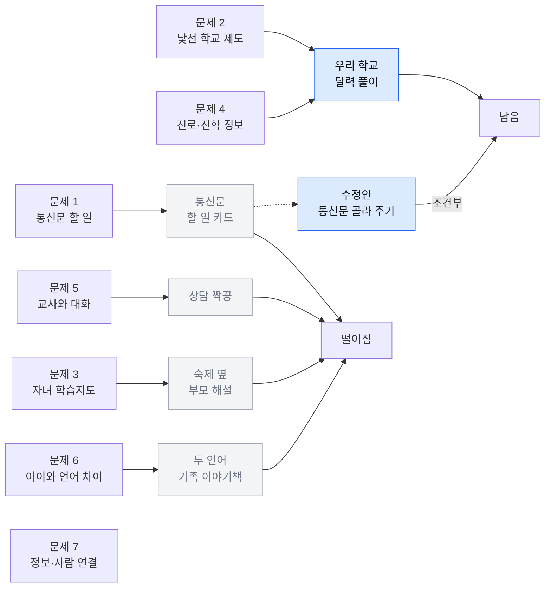

# 6. 다문화가정 부모

[사회 문제 대상별 아이디어](README.md)의 대상별 문서다. 조사와 평가 방법은 README에 있다.

## 1. 대상

한국에서 아이를 키우는 결혼이민자·귀화자 부모다. 영유아부터 고등학생까지 자녀를 둔 부모를 보았고, 학교와 육아 쪽에 집중했다. 2025년 이주배경 학생은 202,208명이며 [1], 그중 67.5%가 국내에서 태어난 국제결혼가정 자녀다 [2].

- 제주의 이주배경 학생은 3,332명으로 1년 전보다 6.5% 늘었다(2024.04.01 기준) [3].
- 서귀포시가족센터는 대정초등학교에 가정통신문 베트남어 통·번역을 지원해 왔다 [4].

### 가. 처음 짐작과 조사 뒤 달라진 점

- 처음에는 "학교 가정통신문을 이해하기 어렵다"가 가장 큰 문제라고 짐작했다.
- 조사해 보니 맞지만 일부였다. 자녀 양육 어려움 1·2위는 학습지도(41.4%)와 진로·진학 정보 부족(41.1%)이었고 [1], 교사와 직접 이야기하기, 아이와의 언어 차이, 학교 제도 자체가 낯선 문제도 따로 확인되었다.
- 통신문 번역은 학교 알림 앱(클래스팅)과 제주 학교 누리집 번역 단추에 이미 있었다 [5][6]. 비어 있는 곳은 첨부 파일로 된 통신문과 "무엇을 언제까지 해야 하는지"의 정리였다.

## 2. 이 대상이 가진 문제

| 번호 | 문제 | 근거 |
|---|---|---|
| 1 | 가정통신문·알림장에서 꼭 할 일과 마감을 정확히 뽑기 어렵다 | 초등 가정통신문 1,000건에 요청 뜻의 동사, 학교 용어, 한자어가 많다 [7]. 통신문 유형(알림 / 골라서 하는 요청 / 꼭 해야 하는 요청)에 따라 결혼이민 여성의 읽기 이해도가 달랐다 [8] |
| 2 | 수행평가, 체험학습 신청, 학사일정 같은 한국 학교 제도와 1년 일정이 낯설다 | 교감 기고: 학사일정·수행평가·체험학습 신청이 보호자에게 "전혀 다른 세계의 말"과 같다 [9]. 나이스(NEIS, 교육행정정보시스템) 학부모용 앱은 한국어·영어만 지원 [10] |
| 3 | 자녀 학습지도와 숙제 봐주기가 어렵다 | 자녀 양육 어려움 1위 "학습지도·학업 관리" 41.4%(1·2순위 합산, 기사에 조사 연도 표기 없음) [1]. 2021년 조사에서도 1위(50.4%) [11] |
| 4 | 중·고등학생 자녀의 진로·진학 정보를 얻기 어렵다 | 양육 어려움 2위 "진로·진학 정보 부족" 41.1% [1]. 지원이 초등과 한국어 교육에 치우치고 중·고교는 진로·직업교육 수준에 머문다 [2] |
| 5 | 교사와 직접 이야기하기 어렵다(상담과 통역) | 한국교육개발원 조사에서 교사 342명 중 42.1%가 이주배경 학부모와 소통이 어렵다고 답함 [12]. 학생이 가족의 통역자가 되어 자기 어려움을 말할 기회를 잃는다 [13] |
| 6 | 아이와의 언어 차이(영유아 한국어 지도, 부모 모국어 물려주기) | 만 5세 이하 자녀 양육 어려움 1위 "한국어 지도" 26.8%. 부모 모국어를 한국어만큼 잘하고 싶다는 비율이 42.4%(2018년)에서 27.3%(2021년)로 줄었다 [11] |
| 7 | 육아·교육 정보와 사람 연결에서 빠지기 쉽다 | 한국생활 어려움에 외로움 19.6%, 만 5세 이하 양육 어려움 2위 긴급돌봄 20.5% [11]. 의사소통과 홍보 부족 때문에 있는 지원 정책을 충분히 쓰지 못한다 [14] |

## 3. 해결 방법과 결과

- 문제 7은 직접 겨냥한 아이디어가 없고, 우리 학교 달력 풀이가 방과후·돌봄·지원 신청 시기 알림으로 일부만 다룬다.
- 점선은 평가 단계에서 원안을 고친 수정안이다. 수정안은 4장에 적는다.

| 아이디어 | 겨냥한 문제 | 어떻게 푸는지 | 이미 있는 것 (다시 확인한 결과) |
|---|---|---|---|
| 통신문 할 일 카드 | 1 (2 일부) | 저녁에 아이 가방에서 현장체험학습 안내문을 꺼낸 부모가 사진을 찍으면, 번역 전문 대신 "꼭 할 일, 마감, 준비물, 비용, 회신 여부"를 부모 언어 카드로 보여 준다. "참가함"을 누르면 한국어 회신 문장이 채워진다 | 비슷한 것 있음. 학교 안내문 사진에서 날짜·준비물을 뽑아 가족 달력에 넣는 School Flyer Scanner & Planner(영어·일본어) [15], 제주 학교 누리집의 7개 언어 번역 단추 [6] |
| 우리 학교 달력 풀이 | 2, 4 (7 일부) | 학교 이름·학년·언어를 한 번 등록하면, 나이스 학사일정을 읽어 행사 일주일 전에 "무엇인지, 부모가 할 일, 언제까지"를 부모 언어로 먼저 보낸다. 중학교 3학년이 되면 고등학교 원서 시기 카드도 온다 | 비슷한 것 있음. 한국어 학사일정 알림은 아이엠스쿨 [16], 다국어 챗봇은 대구시교육청 다-잇다봇(7개 언어, 지원 사업 안내만) [17]. 우리 학교 일정에 맞춰 부모 언어로 먼저 보내는 것은 못 찾음 |
| 상담 짝꿍 | 5 | 상담 전날 부모가 모국어로 말한 걱정을 한국어 질문으로 정리하고, 상담 중에는 태블릿 하나에 두 언어 자막을 띄우고, 끝나면 "누가 무엇을 하기로 했는지"를 두 언어 한 장으로 남긴다 | 있음에 가까움. 클라이온 LXHUB가 대면 상담 AI 통역과 상담 요약 보고서 자동 생성을 하고, 학교장 연수에서 외국인 학부모 상담을 시연함 [18][19] |
| 숙제 옆 부모 해설 | 3 | 수학 익힘책 쪽을 찍으면 부모 언어로 단원 설명, 한국 교과서 용어와 부모 나라 용어 대응, 아이에게 물어볼 질문 3개가 나오고 정답은 바로 보여 주지 않는다. 받아쓰기 낱말은 소리로 불러 준다 | 비슷한 것 있음. 부모용 한·영 숙제 도우미 Chekki AI [20], 답 대신 단계를 안내하는 Homework Helper App for Parents [21] |
| 두 언어 가족 이야기책 | 6 | 부모가 "할머니 집 앞 강에서 물고기 잡던 날"을 모국어로 말하면, 쪽마다 부모 언어와 쉬운 한국어를 나란히 실은 6~8쪽 그림책이 되고 부모 목소리 녹음이 붙는다 | 있음에 가까움. Gemini 스토리북(대화로 10쪽 그림책, 45개 넘는 언어) [22], 이중언어 가족용 Our Stories [23] |

## 4. 평가

### 가. 점수표

| 아이디어 | 주제·독창성 | 기술 도구 | 도전과 해결 | 완성도 | 발표 | 합계(25) | AI 채팅으로 해결 | 사회 도움 | 법·윤리 | 2명·4주 |
|---|---|---|---|---|---|---|---|---|---|---|
| 우리 학교 달력 풀이 | 4 | 4 | 4 | 3 | 4 | 19 | 통과 | 통과 | 통과 | 주의 |
| 통신문 할 일 카드 | 2 | 3 | 4 | 4 | 4 | 17 | **탈락** | 통과 | 주의 | 주의 |
| 숙제 옆 부모 해설 | 2 | 3 | 4 | 3 | 3 | 15 | **탈락** | 통과 | 주의 | 주의 |
| 두 언어 가족 이야기책 | 2 | 3 | 3 | 3 | 4 | 15 | **탈락** | 통과 | 주의 | 주의 |
| 상담 짝꿍 | 2 | 3 | 3 | 2 | 3 | 13 | **탈락** | 통과 | 주의 | **탈락** |
| (참고) 통신문 골라 주기(수정안) | 3 | 3 | 4 | 3 | 4 | 17 | 주의 | 통과 | 주의 | 주의 |

"AI 채팅으로 해결" 칸이 탈락이면 점수와 관계없이 남기지 않았다.

- 원안 5개 중 이 기준을 통과한 것은 우리 학교 달력 풀이 하나다. 그래서 평가자가 통신문 할 일 카드의 입력을 바꾼 수정안을 참고 줄로 넣었다.
- 다섯 개 모두 4주 안에 결혼이민자 부모가 직접 써 보게 하거나 원어민 검수를 받을 길이 아직 없어, "2명·4주"는 모두 주의 이하로 두었다.

### 나. 남은 2개

#### 1) 우리 학교 달력 풀이 (19점)

- "본 적 없는" 정의 초안: 번역 도구는 부모가 문서를 손에 쥔 뒤에야 움직이지만, 이 서비스는 학교가 이미 공개한 학사일정을 읽어 부모가 묻기 전에 "이번 주 우리 아이 학교에서 부모가 할 일"을 부모 언어로 먼저 알려 준다.
- 시연 장면
  - 입력: 학교 "대정중학교", 학년 "2", 언어 "타갈로그어", 시연용 오늘 날짜 2026-08-24.
  - 출력: 나이스 학사일정 응용 프로그램 인터페이스(API)에서 실제로 받은 "학부모 상담주간(2026-08-31~09-04)" 카드가 타갈로그어로 나온다 [24]. 카드에는 무엇인지(담임과 아이의 학교생활을 이야기하는 주간), 부모가 할 일("상담 신청은 어떻게 하나요? 통역이 필요합니다" 한국어 문장 복사 단추), 통역이 필요할 때 다누리콜센터(1577-1366) 3자 통화 안내 [25], 근거 칸(나이스 행사 이름 원문과 받은 날짜)이 있다. 이어서 "학교공개의 날(9/4)" 카드가 나온다.
  - 학년을 3으로 바꾸면 "3학년 1차 내신성적 산출(8/21)" 카드가 고등학교 입시와 어떻게 이어지는지 설명한다.
  - 학교를 대정초로 바꾸면 9~12월 카드가 거의 없다는 것을 그대로 보여 주고, 왜 그런지와 어떻게 메웠는지를 "도전과 해결"로 이어 간다.
- Skill·MCP(모델 컨텍스트 프로토콜, Model Context Protocol)가 들어갈 자리
  - Skill(자연스러움): "행사 카드 쓰기" Skill. 카드 틀(무엇인지 / 부모 할 일 / 언제까지 / 근거 / 학교마다 다른 점), 금지 규칙(근거 없는 날짜·금액 쓰지 않기, 학교별 신청 방법 단정하지 않기), 쉬운 문장 기준을 묶는다. 팀이 카드 30~50개 초안을 쓸 때와 앱이 처음 보는 행사 이름에 "검토 전" 초안을 만들 때 같은 규칙을 쓴다. 사람이 쓴 카드와 AI 초안의 꼴이 어긋나면 시험 정답 표와 비교할 수 없어서 필요하다.
  - MCP(질문 답변에서만 필요): 나이스 학사일정을 부르는 MCP 서버(학교 찾기, 기간별 일정, 학년 표시 읽기). 부모가 "다음 시험 언제예요?"처럼 자유롭게 물을 때 모델이 실제 일정을 불러 답한다. 정해진 날에 카드를 보내는 부분은 일반 예약 작업으로 충분해서, 거기에 MCP를 넣는 것은 억지라고 평가됐다. 발표에서 이 구분을 그대로 말해야 한다.
- AI가 틀릴 수 있는 곳과 시험 방법
  - 행사 이름 짝짓기: "꿈·끼 탐색주간", "여름방학선언"처럼 학교마다 이름이 달라 엉뚱한 카드에 붙이거나, 부모 할 일이 없는 행사에 할 일을 지어낸다. 제주 중학교 전체의 2026학년도 행사 이름을 모아 두 사람이 따로 정답을 붙이고, 짝짓기 정확도(%), "모름"으로 넘긴 비율, 할 일을 지어낸 건수, 두 사람 정답이 같은 비율을 표로 낸다.
  - 학년 거르기: 학년 표시 칸과 이름 속 학년("1,3학년 현장체험학습")이 어긋나면 다른 학년 부모에게 보낸다. 어긋난 줄 수와 학년별 알림 대상이 맞은 비율을 낸다.
  - 번역: 내신, 재량휴업일, 수행평가 같은 학교 용어를 잘못 옮긴다. 카드 30개 × 2개 언어를 한국어로 되돌려(역번역) 뜻이 달라진 건수를 센다. 원어민 1명을 구하면 같은 카드의 오류 건수를 따로 센다.
  - 질문 답변: 자료에 없는 것을 지어낸다. 답이 자료에 있는 질문 20개와 없는 질문 10개로 정답률과, "자료에 없음"으로 학교에 물을 문장을 내준 비율을 낸다.
  - 범용 AI 채팅 대조: 범용 AI 채팅은 우리 아이 학교의 일정을 모르고 먼저 연락하지 않는다. 이것이 AI 채팅 기준을 통과한 이유이므로, 같은 학교·날짜로 웹 검색을 켠 AI 채팅에 "이번 주 우리 학교에서 부모가 할 일"을 물어 실제 일정과 맞은 행사 수와 지어낸 행사 수를 나란히 보여 준다.
- 가장 큰 위험: 서비스 가치가 학교가 나이스에 일정을 얼마나 적어 넣느냐에 달려 있다. 평가 단계에서 세 학교의 2026.03~12 학사일정을 모두 불러 보니 초등학교 두 곳은 행사 이름이 5종뿐이고 2학기에는 토요휴업일만 있었으며, 조사 단계 예시의 "수행평가 기간"은 세 학교 어디에도 없었다 [24].
  - 대정초(서귀포): 받은 줄 101, 행사 이름 5종(입학식, 시업식, 재량휴업일, 여름방학식, 개학식)
  - 노형초(제주시): 받은 줄 87, 행사 이름 5종(입학식, 개학식, 개교기념일, 재량휴업일, 여름방학선언)
  - 대정중(서귀포): 받은 줄 158, 행사 이름 27종(학부모 상담주간, 학교교육과정 설명회, 중간·기말고사, 현장체험학습, 내신성적 산출, 학교공개의 날 등)
- 아동 개인정보: 학교 이름·학년·언어만 받고 아이 이름은 받지 않는다. 학교마다 다른 신청 방법은 단정하지 않고 학교에 물을 한국어 문장으로 돌려 오답 피해를 줄인다. 그래서 법·윤리는 통과로 보았다.
- 고치면 나아질 점: 대상을 중학생 자녀를 둔 부모로 좁히면 데이터가 풍부하고(대정중 27종), 진로·진학 정보 부족(41.1%) [1]과 중·고교 단계 지원이 비어 있다는 지적 [2]에도 맞는다. 초등은 아래 2)의 게시판 통신문으로 메운다.

#### 2) 통신문 골라 주기 (17점, 조건부)

원안 "통신문 할 일 카드"는 사진 한 장과 "할 일, 마감, 준비물, 돈, 회신 여부를 베트남어로 정리해 줘" 한 줄이면 범용 AI 채팅에서도 같은 꼴의 결과가 나와 AI 채팅 기준에서 떨어졌다. 평가자는 입력을 부모가 찍은 사진에서 학교 누리집 가정통신문 게시판의 새 글로 바꿔, 날마다 새 글을 읽고 "꼭 해야 함 / 골라서 신청 / 알림만"으로 나눈 뒤 우리 아이 학년에 꼭 해야 하는 것만 부모 언어로 먼저 보내는 안으로 고쳤다. 원안이 아니라 평가자가 고친 안이므로 팀이 받아들일지 정한다.

- "본 적 없는" 정의 초안: 기존 서비스는 통신문을 통째로 번역해 주지만, 이 서비스는 학교 게시판에 닷새 동안 열 건씩 쌓이는 통신문을 대신 읽고 그중 우리 아이에게 꼭 해야 하는 일이 있는 것만 골라 마감과 함께 부모 언어로 먼저 알려 준다. 제주 학교 누리집에는 이미 7개 언어 번역 단추가 있으므로 [6], 발표에서는 "번역은 이미 있고, 이 서비스는 언제 무엇을 해야 하는지를 먼저 알려 준다"로 선을 긋는다.
- 시연 장면
  - 입력: 학교 "대정초등학교", 학년 "3", 언어 "베트남어". 사진은 넣지 않는다.
  - 출력: 2026.11.16~11.20 게시판 새 글 10건이 "꼭 알아야 함 / 골라서 신청 / 알림만" 세 칸으로 나뉜다 [6]. 맨 위 "꼭 알아야 함" 1건은 "11/27(금) 파업으로 급식 대신 빵·과일·음료·우유. 알레르기가 있으면 담임에게 미리 연락하고 도시락 준비"와 담임에게 보낼 한국어 문장, 근거가 된 원문 문장 표시다. "골라서 신청" 칸에는 학부모 아카데미, 토요영어 독서교실 등이 들어가고 "알림만" 칸은 접혀 있다. 평가자가 손으로 나눠 보니 10건 대부분이 골라서 하는 신청이나 알림이었다.
  - 내용이 첨부에만 있는 글은 "첨부 파일을 사진으로 올려 주세요"로 넘어가는 것을 그대로 보여 준다.
- Skill·MCP가 들어갈 자리
  - Skill(자연스러움): "통신문 나누기" Skill. 통신문 유형 연구의 세 갈래(알림 / 골라서 하는 요청 / 꼭 해야 하는 요청) [8], 뽑을 칸(날짜·금액·준비물·회신), "원문에 없는 값은 쓰지 않고 원문 문장을 함께 낸다"는 규칙을 묶는다. 분류 기준이 서비스의 핵심이고 시험 정답 표도 같은 기준으로 붙여야 정확도를 비교할 수 있어서 필요하다.
  - MCP(질문 답변에서만 필요): 게시판 글 목록·본문 읽기와 나이스 일정 조회를 묶은 MCP 서버. 게시판은 robots.txt(검색 로봇에게 수집 허용 범위를 알리는 파일)가 허용한 글 화면만 읽는다 [26]. 부모가 "이번 주에 낼 것 있어요?"라고 물을 때 쓴다. 날마다 모아 나누고 보내는 부분은 일반 예약 작업으로 충분해서, 거기에 MCP를 넣는 것은 억지라고 평가됐다.
- AI가 틀릴 수 있는 곳과 시험 방법
  - 분류(가장 위험): "꼭 해야 함"을 "골라서"나 "알림"으로 잘못 나누면 부모가 놓친다. 제주 학교 몇 곳 게시판의 공개 글 100건에 두 사람이 따로 정답을 붙이고, "꼭 해야 함"을 놓치지 않은 비율(재현율)과 전체 정확도를 낸다. 목표 예는 재현율 0.95 이상.
  - 값 지어내기: 원문에 없는 날짜·금액·준비물이 나온다. 뽑은 값이 원문에 글자 그대로 있는지 프로그램으로 대조해 어긋난 건수(목표 0)와 정답 표 대비 날짜 일치율을 낸다.
  - 본문만 읽어서 놓침: 내용이 첨부에만 있는 글이다. 본문만으로 나눈 결과와 첨부까지 사람이 읽고 붙인 정답을 비교해 본문만으로 틀린 비율을 낸다(대정초 10건 중 4건이 이 경우).
  - 범용 AI 채팅 대조: 이 안의 AI 채팅 기준은 "주의"다. 글 하나를 처리하는 일은 AI 채팅으로도 되고, 차이는 부모가 게시판을 날마다 열어 골라 넣는 일을 없앤다는 데서만 난다. 그래서 같은 글 20건을 AI 채팅에 하나씩 넣어 나눈 결과와 걸린 시간(게시판을 열고 복사해 넣는 시간 포함)을 나란히 보여 주는 장면이 시연에 꼭 있어야 한다.
- 가장 큰 위험: 첨부 파일이다. 대정초 최근 10건 중 7건에 첨부(한글 문서, PDF, 그림)가 있고 4건은 본문이 200자 미만이라 내용이 첨부에만 있는데, robots.txt가 첨부 내려받기 경로를 막는다 [6][26]. 첨부를 부모 사진 입력으로 돌리면 그 부분은 다시 "AI 채팅에 사진 올리기"와 같아지고, 원안에서 지적된 아동 개인정보 위험(알림장 사진에 아이 이름·반이 찍힘)도 함께 돌아온다.
- 고치면 나아질 점: 1)과 한 제품으로 합쳐 "이번 주 부모 할 일" 한 화면(나이스 일정 + 게시판 통신문)으로 만들면 초등의 빈 일정을 통신문이 메우고 정의도 "묻기 전에 먼저"로 하나가 된다. 둘을 따로 만들면 4주를 넘을 수 있어, 1)을 중심에 두고 이 안은 "이번 주 통신문" 화면 하나로 줄이는 편이 안전하다. 첨부 문제를 근본적으로 풀려면 교사가 올리기 전에 "꼭 해야 함 상자"를 붙이게 하는 변형이 맞지만, 4주 안에 교사 사용자를 구하기 어렵고 해외 TalkingPoints의 Message Mentor와 방향이 같다 [27].

### 다. 떨어진 3개와 이유

#### 1) 상담 짝꿍 (13점, AI 채팅으로 해결·2명·4주)

상담 중 통역과 상담 뒤 요약은 클라이온 LXHUB가 이미 하고 있고 2025.12.03 서울 초등학교장 연수에서 외국인 학부모 상담을 모의 시연했으며 [18][19], 서울시교육청도 2026 계획에 학부모 상담용 AI 동시 통·번역 확대를 넣었다 [28]. 남는 차별점인 "상담 전날 모국어 걱정을 한국어 질문으로 바꾸기"는 범용 AI 채팅 한 번으로 된다. 제출 마감(12/20) 전까지 학부모 상담 주간이 없어(대정중 나이스 기준 3월과 8~9월 [24]) 실제 상담에서 시험할 수 없고, 상담 내용은 아동의 학업·행동·가정 정보라 동의 절차 없이는 역할극 말고 쓸 자료가 없다.

#### 2) 숙제 옆 부모 해설 (15점, AI 채팅으로 해결)

숙제 사진을 AI 채팅에 올리고 "베트남어로 이 단원이 무엇을 배우는지, 아이에게 물을 질문 3개, 답은 말하지 말 것"이라고 하면 같은 꼴이 나오고, 부모용 두 언어 숙제 도우미(Chekki AI, 한·영)와 답 대신 단계를 주는 부모용 도우미도 이미 있다 [20][21]. 유일한 차별점인 검수된 교과 용어 대응표는 초등 1~4학년 수학·국어를 두 언어로 만들고 원어민 검수까지 해야 하는데, 4주 안에 검수할 사람이 없다. 틀린 풀이는 부모를 아이 앞에서 곤란하게 만들고, 숙제 사진에는 아이 이름이 찍힌다.

#### 3) 두 언어 가족 이야기책 (15점, AI 채팅으로 해결)

Gemini 스토리북은 2025년 8월부터 대화만으로 그림과 읽어 주기가 붙은 10쪽 그림책을 45개 넘는 언어로 만들어 [22][29], 이야기를 말하고 "쪽마다 크메르어와 쉬운 한국어를 나란히"라고 하면 대부분 된다. 이중언어 가족용으로도 Our Stories, BookCloud, 가족 사진으로 등장인물을 넣는 Kukulala가 있어 [23][30][31], 남는 차별점(한 쪽에 두 언어, 부모 실제 녹음)은 기능 한두 개 차이다. 부모 목소리와 가족 이야기를 저장하고 아이를 닮은 그림을 만들 위험이 있으며, 크메르어 음성 인식·번역 결과는 팀이 검증할 수단이 없다.

## 5. 출처

열람·호출은 모두 2026.11.20~21에 했다.

1. [20만 이주배경 학생 암담한 진로·진학…취학 격차 '비상등'](https://news.tf.co.kr/read/life/2312044.htm) (더팩트, 2026.04.11)
2. [이주배경학생 늘지만 지원은 초등 편중](https://hangyo.com/mobile/article.html?no=108699) (한국교육신문, 2026.07.31)
3. [제주 가족의 표준이 사라진다… 저출생·고령화·이주가 바꾼 생활공동체](https://www.fnnews.com/news/202605181419427234) (파이낸셜뉴스, 2026.05.18)
4. [다문화·위기학생, 학교 밖과 잇는다… 대정초·서귀포시가족센터 업무협약](https://www.fnnews.com/news/202607120917593224) (파이낸셜뉴스, 2026.07.12)
5. [Classting Class Translation User Guide \[English\]](https://support.classting.com/hc/ko/article_attachments/43868218131481) (클래스팅, 경상북도 학교용 안내서, 2025.02)
6. [대정초등학교 누리집 가정통신문 게시판](https://school.jje.go.kr/daejung-e/na/ntt/selectNttList.do?mi=101631&bbsId=110467) (대정초등학교, 2026.11 열람. 새 글 10건의 본문 길이·첨부 수와 언어 단추는 프로그램으로 셈)
7. [한국 초등학교 가정통신문의 어휘 특성 연구: 부산·울산·경남 지역을 중심으로](https://koreascience.kr/article/JAKO201836435692705.page?lang=ko) (국제한국어교육학회, 한국어교육 29권 2호, 2018.06)
8. [가정통신문의 텍스트 유형과 여성결혼이민자의 읽기 이해 연구](https://dspace.ewha.ac.kr/handle/2015.oak/185204) (이화여자대학교 교육대학원 석사학위논문, 연도 확인 못함) (검색 요약으로 확인)
9. [\[다문화 교육의 현주소②\] 부모가 변해야 아이가 변한다](https://www.hangyo.com/mobile/article.html?no=108047) (한국교육신문, 서울신강초 교감 기고, 2026.06.18)
10. [나이스학부모서비스](https://apps.apple.com/us/app/%EB%82%98%EC%9D%B4%EC%8A%A4%ED%95%99%EB%B6%80%EB%AA%A8%EC%84%9C%EB%B9%84%EC%8A%A4/id6446389541?l=ko) (한국교육학술정보원, 앱스토어 소개 페이지)
11. [「2021년 전국 다문화가족 실태조사」 결과 보도자료](https://www.korea.kr/briefing/pressReleaseView.do?newsId=156513530) (여성가족부, 2022.06.27)
12. [Teachers struggle with communication at schools with many immigrant students: report](https://koreatimes.co.kr/www/special/2024/09/177_382849.html) (The Korea Times, 2024.09.22)
13. [\[다문화 교육의 현주소⑤\] 마음은 통역되지 않는다](https://hangyo.com/mobile/article.html?no=109329) (한국교육신문, 서울 오산중 상담교사 기고, 2026.09.18)
14. [다문화 가정 아동의 교육 지원에 대한 학부모의 인식 및 요구 분석](https://scholar.kyobobook.co.kr/article/detail/4010068908398) (학습자중심교과교육연구 24권 5호, 2024.03)
15. [School Flyer Scanner & Planner](https://apps.apple.com/app/id6761006516) (First Penguin LLC, 앱스토어 소개 페이지, 버전 3.0.0)
16. [아이엠스쿨 - 알림장/교육정보/커뮤니티](https://apps.apple.com/kr/app/%EC%95%84%EC%9D%B4%EC%97%A0%EC%8A%A4%EC%BF%A8-%ED%95%99%EA%B5%90-%EC%95%A0%ED%94%8C%EB%A6%AC%EC%BC%80%EC%9D%B4%EC%85%98/id540665717) (NHN에듀, 앱스토어 소개 페이지) (검색 요약으로 확인)
17. [대구시교육청 다국어 챗봇 '다-잇다봇' 공개 보도](https://dgmbc.com/NewsArticle/860495) (대구MBC, 2026.09.05)
18. ['AI Interpreter Assists Consultations with Foreign Parents'... Klayon's 'LXHUB' Receives Positive Feedback On-Site](https://www.asiae.co.kr/en/article/2025121110373789715) (아시아경제 영문판, 2025.12.11)
19. [클라이온, RAG 기반 AI 통역 솔루션 'LXHUB' 선봬](https://www.tech42.co.kr/?p=99482) (테크42, 2025.04.03)
20. [Chekki AI](https://www.producthunt.com/products/chekki-ai) (Product Hunt) (검색 요약으로 확인)
21. [Homework Helper App for Parents](https://www.producthunt.com/p/homework-helper-app-for-parents/homework-helper-app-for-parents) (Product Hunt, Learning Period Tutoring) (검색 요약으로 확인)
22. [Gemini 스토리북 안내](https://gemini.google/kr/overview/storybook/) (Google)
23. [Our Stories](https://www.producthunt.com/products/our-stories) (Product Hunt, 2026 출시)
24. [나이스 교육정보 개방 포털 학사일정·학교기본정보](https://open.neis.go.kr/) (공개 API 직접 호출, 대정초·노형초·대정중 2026.03~12 전체)
25. [다누리콜센터 안내](https://www.mogef.go.kr/cc/dcc/cc_dcc_f001.do) (여성가족부(현 성평등가족부) 누리집)
26. [제주 학교 누리집 robots.txt](https://school.jje.go.kr/robots.txt) (제주 학교 누리집 공통 틀, 2026.11 열람)
27. [Our translation difference](https://talkingpts.org/translations/), [Innovation](https://talkingpts.org/innovation) (TalkingPoints 누리집, Message Mentor 소개) (검색 요약으로 확인)
28. [서울시교육청 이주배경 학생·보호자 지원 계획 보도](https://biz.newdaily.co.kr/site/data/html/2026/03/11/2026031100480.amp.html) (뉴데일리, 2026.03.12)
29. [Gemini 스토리북 발표](https://blog.google/products/gemini/storybooks/) (Google 블로그, 2025.08.05) (검색 요약으로 확인)
30. [BookCloud: Bilingual Books](https://apps.apple.com/app/id6763815768) (Kurba Pty Ltd, 앱스토어 소개 페이지)
31. [Kukulala](https://apps.apple.com/app/id6751211585) (Coralworks Innovations, 앱스토어 소개 페이지)
