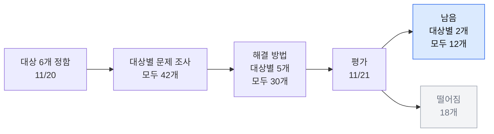

# 사회 문제 대상별 아이디어

[주제 도출 과정](../README.md)의 일부다. 11/20, 이미 있던 두 아이디어(용어 정리집, 세금 도우미)에 더해 사회 문제를 푸는 쪽으로 후보를 넓혔다. 도울 대상을 먼저 정하고, 대상이 가진 문제를 찾고, 문제를 풀 방법을 낸 뒤, 공지 채점 기준으로 걸렀다.

## 1. 진행 과정

대상을 먼저 정하고, 1차로 문제와 해결 방법을 넓게 생각한 뒤, 2차로 채점 기준을 반영해 평가하는 순서는 팀이 정했다.

1. 대상 정하기
   - 가. 어려움이 글, 말, 절차 쪽이라 AI를 쓰는 소프트웨어로 풀 수 있는 대상을 골랐다.
   - 나. 4주 안에 실제로 물어볼 수 있는지도 봤다. 만나기 어려운 대상(경계선 지능인·발달장애인, 자립준비청년)도 사회 문제가 뚜렷해 넣었다.
   - 다. 후보 6개를 놓고 팀은 6개를 모두 쓰기로 했다.
2. 문제 조사와 해결 방법
   - 가. 대상마다 Claude Code 에이전트를 하나씩 붙였다. 정부 실태조사, 연구, 기사, 지원기관 자료로 문제 5~7개를 찾고, 문제를 풀 방법 5개를 냈다.
   - 나. 이 단계에서는 채점 기준으로 거르지 않았다. 문제에서 출발한 방법이 먼저 나오게 하려는 것이다.
3. 평가
   - 가. 방법을 낸 에이전트가 아닌 다른 에이전트가 평가했다. 자기가 낸 방법을 자기가 채점하면 점수가 후해지기 때문이다.
   - 나. 평가 에이전트는 이미 있는 서비스를 다시 검색해, 판정을 고쳤다. 앞 단계에서 "못 찾음"이나 "비슷한 것 있음"이었던 것 가운데 여럿이 다시 찾아보니 이미 있었다.
   - 다. 공지 채점 기준 5개(주제 해석과 독창성, 기술 도구 사용의 타당성, 도전과 해결, 완성도, 발표)로 각 1~5점, 합계 25점을 매겼다.
   - 라. 팀 기준 4개(AI 채팅에 물어보면 되지 않나, 사회에 도움이 되나, 법·윤리 위험, 2명이 4주에 되나)는 통과/주의/탈락으로 표시했다. 첫째 기준은 앞선 후보를 거를 때 생긴 것이다([기준이 생긴 순서](../earlier_rounds/01_criteria.md)).
   - 마. "AI 채팅에 물어보면 되지 않나"에서 탈락하면 점수가 높아도 남기지 않았다.
4. 한계
   - 가. 웹 검색 도구가 미국 기준이라 국내 앱 장터가 잘 잡히지 않았다. "국내에서 못 찾음"은 검색 실패일 수 있다.
   - 나. 출처 일부는 원문을 열지 못하고 검색 요약으로 확인했다. 대상별 문서의 출처 목록에 표시했다.
   - 다. 당사자에게 직접 묻지 않았다. 문제는 공개 자료로만 찾았다.
   - 라. 같은 입력을 일반 AI 채팅에 넣어 비교하는 시험은 아직 하지 않았다.

## 2. 대상과 가진 문제

| 대상 | 조사에서 찾은 문제 | 자세히 |
|---|---|---|
| 1. 외국인 유학생·이주노동자 | 일한 시간과 임금 증명, 병원에서 증상 말하기, 어선 위 안전 지시, 체류 기한, 정착 초기의 금융과 사기, 외로움, 숙소 | [문서](1_foreign_residents.md) |
| 2. 자취하는 대학생 | 월세 밖의 실제 부담, 계약 전 위험 가려내기, 무거운 주거비, 학기와 맞지 않는 계약, 하자 수리 다툼, 보증금 돌려받기, 아플 때 기댈 사람 | [문서](2_students_living_alone.md) |
| 3. 경계선 지능인·발달장애인 | 생활 문서에서 할 일 알기, 금융 사기와 경제적 착취, 일자리, 관계와 고립, 스스로 결정하기, 가족이 없을 때의 돌봄, 제도 밖의 지원 | [문서](3_borderline_developmental.md) |
| 4. 자립준비청년 | 생활비와 돈 관리, 집 구하기, 흩어지고 바뀌는 제도, 물어볼 어른, 마음 건강과 고립, 금전 착취, 지원 체계와 계속 이어지기 | [문서](4_youth_leaving_care.md) |
| 5. 가족돌봄청년 | 지원 대상인지 모름, 주변에 말하기 어려움, 흩어진 지원 정보, 쉴 시간 없음, 학업과 진로, 또래 만나기 어려움, 생계와 의료비 | [문서](5_young_carers.md) |
| 6. 다문화가정 부모 | 통신문에서 할 일 뽑기, 학교 제도와 1년 일정, 자녀 학습지도, 진로·진학 정보, 교사와 상담, 아이와의 언어 차이, 육아 정보와 사람 연결 | [문서](6_multicultural_parents.md) |

## 3. 남은 해결 방법 (대상별 상위 2개)

| 대상 | 해결 방법 | 점수 | AI 채팅 기준 | 어떻게 푸는지 |
|---|---|---|---|---|
| 외국인 | 선상 안전 말판 | 19 | 통과 | 어선 안전 지시를 선원 모국어 음성으로 미리 만들어 두고, 바다 위에서 인터넷 없이 재생 |
| | 일한 시간 증거 지갑 | 17 | 통과 | 모국어로 남긴 출퇴근 기록을 수정 이력과 함께 쌓아, 상담 창구에 낼 한국어 요약서로 |
| 자취 대학생 | 방 상태 타임라인 | 19 | 통과 | 보증금 공제 항목마다 입주 날 영상의 같은 자리를 찾아 원래 있던 흠인지 새 흠인지 나눔 |
| | 계약 전날 점검 도구 (MCP) | 17 | 주의 | 주소와 등기부를 주면 건축물대장과 실거래를 불러와 "집주인에게 물을 질문"으로 바꿈 |
| 경계선 지능·발달장애 | 잠깐 멈춤 버튼 | 19 | 주의 | 아는 사람이 돈이나 신분증을 요구할 때 누르면, 미리 정한 믿는 사람의 "멈춰/괜찮아"를 받아 옴 |
| | 나를 소개하는 한 장 | 18 | 주의 | 부모가 아는 돌봄 방법을 AI 인터뷰로 꺼내 한 장 인수인계 문서로. 부모와 당사자 말이 다르면 둘 다 남김 |
| 자립준비청년 | 만약에 계산기 | 18 | 주의 | 휴학, 아르바이트, 이사 전에 받는 지원이 어떻게 바뀌는지 근거 조항과 함께 보여 줌 |
| | 조용한 안부 | 17 | 통과 | 청년이 정한 방식으로 안부를 주고받고, 담당자에게는 "이번 주 누구에게 먼저, 왜"만 전함 |
| 가족돌봄청년 | 이것도 돌봄이에요 | 19 | 주의 | 평소 말로 쓴 하루에서 돌봄을 찾아 이름을 붙이고, 사는 지역의 지원 제도를 출처와 함께 나란히 |
| | 돌봄 나눔 주간표 | 17 | 주의 | 수업 시간을 먼저 고정하고, 남는 돌봄 가운데 공적 서비스나 다른 가족에게 넘길 칸을 찾음 |
| 다문화가정 부모 | 우리 학교 달력 풀이 | 19 | 통과 | 학교 학사일정을 읽어, 그 주에 부모가 할 일을 부모 언어로 먼저 알려 줌 |
| | 통신문 골라 주기 (조건부) | 17 | 주의 | 학교 게시판에 새로 올라온 통신문 가운데 꼭 할 일만 골라 마감과 함께 먼저 알려 줌 |

다문화가정 부모의 둘째는 원안 "통신문 할 일 카드(사진을 찍으면 할 일 카드로)"가 AI 채팅 기준에서 떨어져, 평가 에이전트가 입력을 학교 게시판으로 바꾼 수정안이다. 받아들일지는 팀이 정한다.

## 4. 떨어진 해결 방법과 이유

| 대상 | 해결 방법 | 점수 | 떨어진 기준 | 이유 |
|---|---|---|---|---|
| 외국인 | 체류·정착 기한 달력 | 16 | AI 채팅 | AI 채팅과 휴대폰 달력으로 대부분 된다. 여러 언어로 만료를 알려 주는 앱도 있다 |
| | 진료실 한 장 카드 | 15 | AI 채팅 | 같은 구조의 앱과 연구가 이미 있고, AI 채팅 음성 모드로도 된다 |
| | 제주 말벗 교환일기 | 12 | 점수 | 언어 교환 앱과 대상만 다르다. 외로움이 줄었는지 4주 안에 숫자로 보일 수 없다 |
| 자취 대학생 | 학기 달력 계약 계산기 | 14 | AI 채팅 | 조건을 AI 채팅에 쓰면 계산된다. 중도 퇴거 때 돌려받을 돈은 특약에 달려 정답을 낼 수 없다 |
| | 한 달 방값 계산표 | 13 | AI 채팅 | 매물 캡처를 AI 채팅에 올리면 같은 결과가 나온다 |
| | 자취 SOS 버디 | 13 | 법·윤리 | 증상으로 급한 정도를 가르는 것이 의료 판단으로 보이고, 건강 정보는 민감정보다 |
| 경계선 지능·발달장애 | 우편함 할 일 카드 | 16 | AI 채팅 | 고지서 사진에서 할 일을 뽑는 앱이 있고, AI 채팅에 사진을 올려도 된다 |
| | 일 순서 카드 | 13 | AI 채팅 | 할 일 쪼개기 도구가 이미 있고, 4주 안에 협조할 일터를 구할 수 없다 |
| | 관계 연습 상대 | 13 | AI 채팅 | 거절 역할극 앱과 국내 연구가 있고, 연습 효과를 4주 안에 보일 수 없다 |
| 자립준비청년 | 거절 연습장 | 17 | AI 채팅 | AI 사기범 역할 체험 서비스가 이미 있다. 가족 역할 연습은 채팅에 지시 한 문단이면 된다 |
| | 첫 집 계약 전 한 번 더 | 12 | AI 채팅 | 서울시가 청년에게 AI 전세사기 위험 보고서를 무료로 준다 |
| | 선배 답장 | 12 | 2명·4주 | 4주 안에 실제로 답해 줄 선배를 모을 수 없어 빈 게시판이 된다 |
| 가족돌봄청년 | 새벽 편지함 | 16 | 점수 | 국내 익명 편지 앱이 이미 있고, 실제 사용자가 없으면 AI가 위기 표현을 놓칠 위험을 확인할 수 없다 |
| | 말 꺼내기 연습장 | 14 | AI 채팅 | 범용 AI 채팅이 메일 초안과 교수 역할 연습을 그대로 해 준다 |
| | 돌봄 병행 일자리 렌즈 | 14 | AI 채팅 | 공고 비교는 AI 채팅이, 출퇴근 시간은 지도 앱이 해 준다 |
| 다문화가정 부모 | 상담 짝꿍 | 13 | AI 채팅, 2명·4주 | 상담 통역과 요약 서비스가 이미 있고, 12/20 전에 학부모 상담 주간이 없어 시험할 수 없다 |
| | 숙제 옆 부모 해설 | 15 | AI 채팅 | 숙제 사진을 AI 채팅에 올리면 거의 같고, 부모용 숙제 도우미도 있다 |
| | 두 언어 가족 이야기책 | 15 | AI 채팅 | 범용 AI가 대화만으로 여러 언어 그림책을 만들어 준다 |

떨어진 18개를 이유로 나누면 아래와 같다.

| 떨어진 기준 | 개수 |
|---|---|
| AI 채팅에 물어보면 된다 | 14 |
| 점수가 낮다 | 2 |
| 법·윤리 위험 | 1 |
| 2명이 4주에 못 한다 | 1 |

사진이나 글을 넣고 답을 받는 꼴, AI와 역할극으로 연습하는 꼴은 거의 다 첫째 기준에서 떨어졌다.

## 5. 남은 방법에서 보이는 점

1. 남은 방법은 아래 넷 가운데 하나를 갖고 있다.
   - 가. 시간에 걸친 기록: 방 상태 타임라인, 일한 시간 증거 지갑
   - 나. 묻기 전에 먼저 알려 주거나 사람을 이어 줌: 우리 학교 달력 풀이, 조용한 안부, 잠깐 멈춤 버튼
   - 다. 인터넷이 없는 현장: 선상 안전 말판
   - 라. 판정은 팀이 만든 규칙표가 하고 AI는 말을 풀기만 함: 만약에 계산기, 이것도 돌봄이에요
2. AI 채팅 기준을 깔끔하게 통과한 것은 5개다: 선상 안전 말판, 일한 시간 증거 지갑, 방 상태 타임라인, 조용한 안부, 우리 학교 달력 풀이.
3. 나머지 7개는 "주의"다. 같은 입력을 일반 AI 채팅에 넣은 결과와 비교한 숫자가 있어야 판단할 수 있다.

## 6. 다음 할 일

1. 팀이 12개 가운데 후보를 골라, 기존 두 아이디어와 함께 [이슈 #5](https://github.com/lumos0107/AI_Final_Project/issues/5)에서 주제를 정한다.
2. 고른 후보가 "주의"라면 일반 AI 채팅과 비교하는 사전 시험을 먼저 한다.
